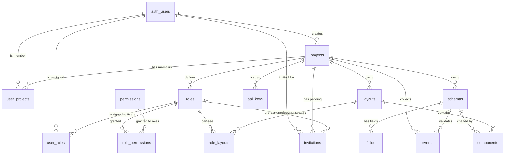

# Tables & Relations

> Overview map of the Hotlog database — Part 0 of the database documentation.
> Related: [Data Contracts & Event Ingestion](./01-data-contracts-and-events.md) ·
> [Access Control & Identity](./02-access-control-and-identity.md) ·
> [Dashboards & Visualization](./03-dashboards-and-visualization.md) ·
> [Supabase Infrastructure & Operations](./04-supabase-infrastructure-and-operations.md)

## Purpose of this document

This is the **single-page map of every table in Hotlog and how they connect**.
It exists so that anyone — a new engineer, a reviewer, or the diploma committee
— can understand the entire data model without reading 19 migrations. Each of
the 14 tables gets a short "what it is for" description and a full column
breakdown; the relationships between them are shown both as a diagram and as an
explicit foreign-key table.

> **Schema-source note.** The base table DDL was applied directly on the hosted
> Supabase project (`supabase/migrations/20260314173820_remote_schema.sql` is an
> empty placeholder). Column lists below come from the generated
> `database.types.ts`; constraints/defaults are attributed to the migration that
> introduced them. See the [Ops doc](./04-supabase-infrastructure-and-operations.md)
> for the full explanation.

---

## The model in one paragraph

Everything in Hotlog hangs off a **project** — the multi-tenant root. A project
has **members** (`user_projects`), a set of **roles** (`roles`) that bundle
**permissions** (`permissions` via `role_permissions`), and pending
**invitations**. A project defines **schemas** and their **fields** (the
immutable data contracts), against which applications send **events**
authenticated by **api_keys**. The same project owns **layouts**
(dashboards) made of **components** (charts), and a layout's visibility can be
narrowed to specific roles via **role_layouts**. Identity itself
(`creator_id`, `user_id`, `invited_by`) lives in Supabase's `auth.users`,
referenced from the public schema.

---

## Entity-relationship diagram



Legend: `||--o{` = one-to-many (mandatory parent); `|o--o{` = one-to-many with
an **optional / nullable** foreign key (the child row can exist without the
parent). `auth_users` is Supabase's `auth.users` table, shown for context.

---

## Foreign-key reference

Every relationship in the database, with the on-delete behaviour. "Logical"
means there is **no physical FK constraint** to `auth.users`; the link is
enforced in code/RLS via `auth.uid()` rather than a database constraint.

| Child table | Column | → Parent | On delete | Kind |
|---|---|---|---|---|
| `user_projects` | `project_id` | `projects.id` | (default) | physical FK |
| `user_projects` | `user_id` | `auth.users.id` | — | logical |
| `roles` | `project_id` | `projects.id` | (default) | physical FK |
| `user_roles` | `role_id` | `roles.id` | (default) | physical FK |
| `user_roles` | `user_id` | `auth.users.id` | — | logical |
| `role_permissions` | `role_id` | `roles.id` | (default) | physical FK |
| `role_permissions` | `permission_id` | `permissions.id` | (default) | physical FK |
| `schemas` | `project_id` | `projects.id` | (default) | physical FK |
| `fields` | `schema_id` | `schemas.id` | (default) | physical FK *(nullable col)* |
| `events` | `project_id` | `projects.id` | (default) | physical FK |
| `events` | `schema_id` | `schemas.id` | (default) | physical FK |
| `layouts` | `project_id` | `projects.id` | (default) | physical FK |
| `components` | `layout_id` | `layouts.id` | **CASCADE** | physical FK |
| `components` | `schema_id` | `schemas.id` | **SET NULL** | physical FK *(nullable col)* |
| `api_keys` | `project_id` | `projects.id` | (default) | physical FK |
| `role_layouts` | `role_id` | `roles.id` | **CASCADE** | physical FK |
| `role_layouts` | `layout_id` | `layouts.id` | **CASCADE** | physical FK |
| `invitations` | `project_id` | `projects.id` | **CASCADE** | physical FK |
| `invitations` | `role_id` | `roles.id` | **SET NULL** | physical FK *(nullable col)* |
| `invitations` | `invited_by` | `auth.users.id` | **CASCADE** | physical FK |
| `projects` | `creator_id` | `auth.users.id` | — | logical |

**Cascade behaviour worth remembering:** deleting a `layout` deletes its
`components` and its `role_layouts`; deleting a `role` deletes its
`role_layouts`; deleting a `project` deletes its `invitations`. Deleting a
`schema` does **not** destroy components bound to it — `components.schema_id`
is set to `NULL` so the chart is orphaned, not lost. There is **no** cascade
from `projects` to `schemas`/`events`/`layouts`/`roles`/`api_keys` — project
deletion deliberately requires the application to tear those down explicitly.

---

## Tables (14)

Conventions: PK = primary key. `id uuid` PKs default `gen_random_uuid()`;
`id` integer PKs are `bigint` identity. `created_at` is
`timestamptz DEFAULT now()` unless noted. "?" marks a nullable column.

### Identity & access (RBAC)

#### `projects` — the multi-tenant root

Every other row in the system ultimately belongs to a project. A project is one
team's isolated workspace; `creator_id` is its owner and gets implicit full
access in RLS. Created when a user makes a new workspace.

| Column | Type | Notes |
|---|---|---|
| `id` | `uuid` | **PK** |
| `name` | `text` | workspace name (insert-optional ⇒ defaulted) |
| `creator_id` | `uuid` | **NOT NULL**; owning user = `auth.users.id` (logical; used as `creator_id = auth.uid()`) |
| `created_at` | `timestamptz` | `DEFAULT now()` |

#### `user_projects` — project membership

The many-to-many between users and projects: "user X is a member of project Y".
Membership (not just a role) is the baseline that almost every `SELECT` RLS
policy checks via `is_project_member()`.

| Column | Type | Notes |
|---|---|---|
| `id` | `uuid` | **PK** (surrogate; *not* a composite key) |
| `user_id` | `uuid` | **NOT NULL** = `auth.users.id` |
| `project_id` | `uuid` | **NOT NULL**, FK → `projects.id` |

#### `roles` — named permission bundles, per project

A project defines its own roles (e.g. "Admin", "Viewer"). A role is just a name
scoped to a project; what it can *do* comes from `role_permissions`, and which
users hold it comes from `user_roles`.

| Column | Type | Notes |
|---|---|---|
| `id` | `uuid` | **PK** |
| `project_id` | `uuid` | **NOT NULL**, FK → `projects.id` |
| `name` | `text` | **NOT NULL** |
| `created_at` | `timestamptz` | `DEFAULT now()` |

#### `user_roles` — role assignment

Which roles a user holds. A user can hold several roles within a project; their
effective permissions are the union.

| Column | Type | Notes |
|---|---|---|
| `id` | `uuid` | **PK** (surrogate) |
| `user_id` | `uuid` | **NOT NULL** = `auth.users.id` |
| `role_id` | `uuid` | **NOT NULL**, FK → `roles.id` |

#### `permissions` — the static `action:subject` catalogue

A global, read-only list of every grantable capability, e.g.
`create:schemas`, `read:events`, `delete:api_keys`. The special
`subject = 'all'` row is a wildcard that matches any subject for that action.
Not project-scoped — shared by all tenants.

| Column | Type | Notes |
|---|---|---|
| `id` | `uuid` | **PK** |
| `action` | `text` | **NOT NULL** — `create` / `read` / `update` / `delete` |
| `subject` | `text` | **NOT NULL** — `schemas`, `fields`, `events`, `layouts`, `components`, `roles`, `users`, `api_keys`, `projects`, or `all` (wildcard) |

#### `role_permissions` — which permissions a role grants

The many-to-many between roles and permissions. This table *is* the RBAC
authorization data that `has_permission()` walks (`user_roles → roles →
role_permissions → permissions`).

| Column | Type | Notes |
|---|---|---|
| `id` | `uuid` | **PK** (surrogate) |
| `role_id` | `uuid` | **NOT NULL**, FK → `roles.id` |
| `permission_id` | `uuid` | **NOT NULL**, FK → `permissions.id` |

#### `invitations` — pending team invites

A pending invitation to join a project, optionally pre-assigning a role.
Carries a unique `token` (the link the invitee clicks) and a 7-day expiry;
`accept_invitation()` consumes it and creates the `user_projects` (and
`user_roles`) row. Full DDL in `20260417`.

| Column | Type | Notes |
|---|---|---|
| `id` | `uuid` | **PK**, `DEFAULT gen_random_uuid()` |
| `project_id` | `uuid` | **NOT NULL**, FK → `projects.id` **ON DELETE CASCADE** |
| `email` | `text` | **NOT NULL** — invitee email (matched case-insensitively) |
| `role_id` | `uuid?` | FK → `roles.id` **ON DELETE SET NULL** — role granted on accept |
| `invited_by` | `uuid` | **NOT NULL**, FK → `auth.users.id` **ON DELETE CASCADE** |
| `token` | `uuid` | **NOT NULL** `DEFAULT gen_random_uuid()`, **UNIQUE** |
| `status` | `text` | **NOT NULL** `DEFAULT 'pending'`, CHECK ∈ (`pending`,`accepted`,`revoked`) |
| `created_at` | `timestamptz` | **NOT NULL** `DEFAULT now()` |
| `expires_at` | `timestamptz` | **NOT NULL** `DEFAULT now() + 7 days` |

### Data contracts & ingestion

#### `schemas` — event type definitions (immutable contracts)

A named, versioned definition of a kind of event a project collects (e.g.
`user_signup`). `key` is the **immutable contract** used by the SDK and
events; `display_name` is the editable label; `status` does soft delete
(`active` / `archived`). See [doc 01](./01-data-contracts-and-events.md).

| Column | Type | Notes |
|---|---|---|
| `id` | `uuid` | **PK** |
| `project_id` | `uuid` | **NOT NULL**, FK → `projects.id` |
| `key` | `text` | **NOT NULL**, **immutable**, slug `^[a-z][a-z0-9_]*$` |
| `name` | `text` | **NOT NULL** — legacy raw name (base) |
| `display_name` | `text` | **NOT NULL** — editable label |
| `status` | `schema_status` | **NOT NULL** `DEFAULT 'active'` — soft delete |
| `created_at` | `timestamptz` | `DEFAULT now()` |

Unique: `(project_id, key)`.

#### `fields` — typed columns of a schema (immutable contracts)

The individual typed attributes of a schema (`type` ∈ `FieldTypes`). Like
schemas, `key` is immutable and `status` soft-deletes. `metadata` (a **`json`**,
not `jsonb`, column) holds type-specific extras: `enumValues`, `numberRange`,
`itemType`, `description`.

| Column | Type | Notes |
|---|---|---|
| `id` | `uuid` | **PK** |
| `schema_id` | `uuid?` | FK → `schemas.id` |
| `key` | `text` | **NOT NULL**, **immutable** |
| `name` | `text` | **NOT NULL** — legacy raw name (base) |
| `display_name` | `text` | **NOT NULL** |
| `type` | `FieldTypes` | **NOT NULL** — `STRING`/`NUMBER`/`BOOLEAN`/`DATETIME`/`ARRAY`/`JSON`/`ENUM` |
| `required` | `boolean` | **NOT NULL** `DEFAULT false` (forced false when archived) |
| `status` | `field_status` | **NOT NULL** `DEFAULT 'active'` |
| `metadata` | `json` | **`json`, not `jsonb`** — type-specific extras |
| `created_at` | `timestamptz` | `DEFAULT now()` |

Unique: `(schema_id, key)`.

#### `events` — append-only telemetry

The actual ingested data points. One row per event sent through the SDK/HTTP
API; `value` is a JSONB payload keyed by field `key`. The largest, hottest
table; only ever inserted or read, never updated in normal use.

| Column | Type | Notes |
|---|---|---|
| `id` | `bigint` | **PK** (identity) |
| `project_id` | `uuid` | **NOT NULL**, FK → `projects.id` |
| `schema_id` | `uuid` | **NOT NULL**, FK → `schemas.id` |
| `value` | `jsonb` | **NOT NULL** — payload keyed by field `key` |
| `created_at` | `timestamptz` | `DEFAULT now()` |

#### `api_keys` — public ingestion credentials

The credential an external application uses to send events. Stored as a
`sha256` hash (`key_hash`, the lookup column); `revoked_at` soft-revokes;
`last_used_at` is touched on every successful ingest/SDK call. **Has no
`created_at` column.** Never expose `key` / `key_hash` outside the DB.

| Column | Type | Notes |
|---|---|---|
| `id` | `bigint` | **PK** (identity) |
| `project_id` | `uuid` | **NOT NULL**, FK → `projects.id` |
| `key` | `text` | **NOT NULL** — raw key (creation-time / legacy) |
| `key_hash` | `text?` | `sha256(key)` hex; **UNIQUE** lookup column |
| `key_prefix` | `text?` | first 8 chars (shown in UI) |
| `last_used_at` | `timestamptz?` | touched by every successful ingest/SDK RPC |
| `revoked_at` | `timestamptz?` | non-null ⇒ key rejected (soft revoke) |

### Dashboards & visualization

#### `layouts` — a dashboard

A named dashboard within a project. Holds presentation-only metadata (`name`,
`description`, `color`). Visibility is **public to all members** unless
`role_layouts` rows narrow it. See [doc 03](./03-dashboards-and-visualization.md).

| Column | Type | Notes |
|---|---|---|
| `id` | `bigint` | **PK** (identity) |
| `project_id` | `uuid` | **NOT NULL**, FK → `projects.id` |
| `name` | `text` | **NOT NULL** |
| `description` | `text` | insert-optional ⇒ defaulted |
| `color` | `text` | **NOT NULL** `DEFAULT '#3b82f6'` — the colored dot in the UI |
| `created_at` | `timestamptz` | `DEFAULT now()` |

#### `components` — a chart inside a layout

One visualization within a layout. Optionally bound to a `schema` (the data it
charts). `visualization` (`line`, `bar`, …) is the real chart type;
`type` (`ComponentTypes`) is legacy and only ever `TIME_SERIES`. `span`
controls full-width vs. half-width; `index` is the display order.

| Column | Type | Notes |
|---|---|---|
| `id` | `uuid` | **PK** |
| `layout_id` | `bigint` | **NOT NULL**, FK → `layouts.id` **ON DELETE CASCADE** |
| `schema_id` | `uuid?` | FK → `schemas.id` **ON DELETE SET NULL** |
| `type` | `ComponentTypes` | **NOT NULL** `DEFAULT 'TIME_SERIES'` — legacy, superseded by `visualization` |
| `visualization` | `text` | **NOT NULL** `DEFAULT 'line'` — actual chart type |
| `span` | `text` | **NOT NULL** `DEFAULT 'full'` — `full` stacked / `half` side-by-side |
| `name` | `text` | **NOT NULL** |
| `description` | `text` | **NOT NULL** |
| `index` | `integer` | **NOT NULL** — display order within the layout |
| `inputs_ids` | `json` | **NOT NULL** — component-input → schema-field-key bindings |
| `created_at` | `timestamptz` | `DEFAULT now()` |

#### `role_layouts` — per-role dashboard visibility

Restricts a layout to specific roles. **No rows for a layout ⇒ it is public to
all project members; ≥1 row ⇒ visible only to holders of a listed role** (plus
the project creator and anyone with `read:layouts`). Managing it is gated by
`update:layouts`, not a dedicated subject. Full DDL in `20260414`.

| Column | Type | Notes |
|---|---|---|
| `id` | `uuid` | **PK**, `DEFAULT gen_random_uuid()` |
| `role_id` | `uuid` | **NOT NULL**, FK → `roles.id` **ON DELETE CASCADE** |
| `layout_id` | `bigint` | **NOT NULL**, FK → `layouts.id` **ON DELETE CASCADE** |

Unique: `(role_id, layout_id)`.

---

## How the tables group together

| Group | Tables | Owner doc |
|---|---|---|
| **Identity & access (RBAC)** | `projects`, `user_projects`, `roles`, `user_roles`, `permissions`, `role_permissions`, `invitations` | [02](./02-access-control-and-identity.md) |
| **Data contracts & ingestion** | `schemas`, `fields`, `events`, `api_keys` | [01](./01-data-contracts-and-events.md) (keys: [04](./04-supabase-infrastructure-and-operations.md)) |
| **Dashboards & visualization** | `layouts`, `components`, `role_layouts` | [03](./03-dashboards-and-visualization.md) |

The three groups touch at exactly two seams: **`components.schema_id`** ties a
dashboard chart to a data contract, and **`role_layouts.role_id`** ties
dashboard visibility to the RBAC model. Everything else is contained within its
group, with `projects` as the universal parent.

## Quick relationship checks

Run in the Supabase SQL editor / `psql` (the `postgres` role bypasses RLS).

**1. Full object count for one project**

```sql
select
  (select count(*) from user_projects   where project_id = p.id) as members,
  (select count(*) from roles           where project_id = p.id) as roles,
  (select count(*) from schemas         where project_id = p.id) as schemas,
  (select count(*) from events          where project_id = p.id) as events,
  (select count(*) from layouts         where project_id = p.id) as layouts,
  (select count(*) from api_keys        where project_id = p.id) as api_keys
from projects p
where p.id = '<project_id>';
```

**2. Every declared foreign key, with on-delete behaviour**

```sql
select tc.table_name      as child_table,
       kcu.column_name    as fk_column,
       ccu.table_name     as parent_table,
       rc.delete_rule     as on_delete
from   information_schema.table_constraints   tc
join   information_schema.key_column_usage    kcu
       on kcu.constraint_name = tc.constraint_name
join   information_schema.constraint_column_usage ccu
       on ccu.constraint_name = tc.constraint_name
join   information_schema.referential_constraints rc
       on rc.constraint_name = tc.constraint_name
where  tc.constraint_type = 'FOREIGN KEY'
  and  tc.table_schema = 'public'
order  by child_table, fk_column;
```

**3. Orphaned components (schema was archived/deleted → `schema_id` is NULL)**

```sql
select c.id, c.name, l.name as layout
from   components c
join   layouts l on l.id = c.layout_id
where  l.project_id = '<project_id>'
  and  c.schema_id is null;
```

**4. Roles and how many members / permissions / layouts each touches**

```sql
select r.name as role,
       count(distinct ur.user_id)        as members,
       count(distinct rp.permission_id)  as permissions,
       count(distinct rl.layout_id)      as restricted_layouts
from   roles r
left   join user_roles       ur on ur.role_id = r.id
left   join role_permissions rp on rp.role_id = r.id
left   join role_layouts     rl on rl.role_id = r.id
where  r.project_id = '<project_id>'
group  by r.id, r.name
order  by r.name;
```

---

## Source references

- Generated types: `database.types.ts` (authoritative column list, 4 enums)
- Migrations: `supabase/migrations/` (`20260404` base RLS/indexes →
  `20260425`); `role_layouts` `20260414`, `invitations` `20260417`
- Consolidated reference: [`genesis.md`](../genesis.md)
- Per-domain detail: docs [01](./01-data-contracts-and-events.md) /
  [02](./02-access-control-and-identity.md) /
  [03](./03-dashboards-and-visualization.md) /
  [04](./04-supabase-infrastructure-and-operations.md)
