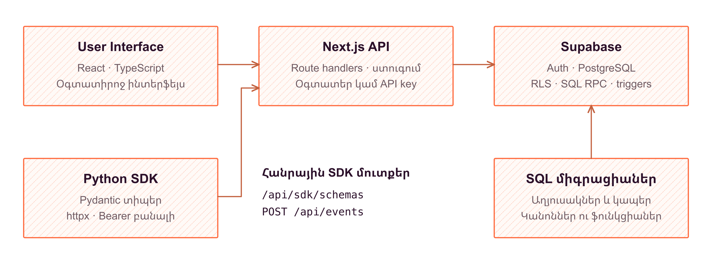
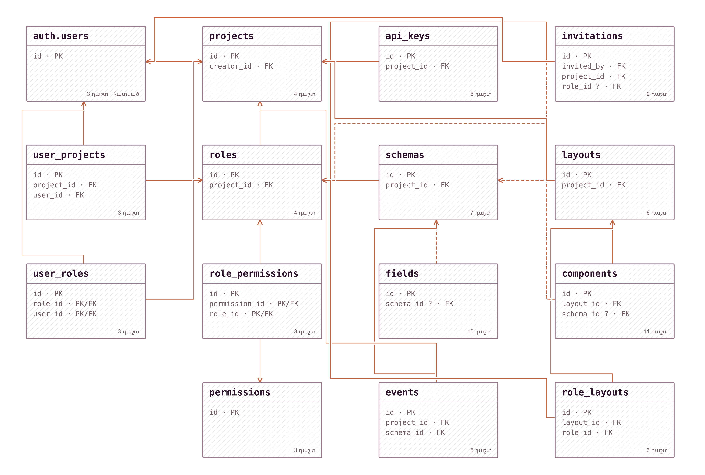

# Hotlog - նախագծի հայերեն նկարագրություն

Փաթեթը պարունակում է բոլոր ութ թեմաների պատրաստի Markdown բովանդակությունը, «Համակարգի ֆունկցիոնալություն» բաժնի չորս ինքնուրույն տարբերակ և համապատասխան դիագրամները։ Word փաստաթղթեր չեն ստեղծվում։

## Ամբողջական տարբերակներ

Ստորև յուրաքանչյուր ֆայլ արդեն ներառում է բոլոր ութ բաժինները՝ ճիշտ հերթականությամբ։ Առաջին վեց բաժիններն ու եզրակացությունն ընդհանուր են, իսկ յոթերորդ բաժինը ներկայացնում է տվյալ ուղղությունը։ Տարբերակների ծավալները միտումնավոր չեն հավասարեցված։

| Ուղղություն | Պատրաստի ամբողջական Markdown |
| --- | --- |
| Վեբ դիզայն և FrontEnd | [Բացել](versions/01-web-design-frontend.md) |
| BackEnd և Python SDK | [Բացել](versions/02-backend-sdk.md) |
| BackEnd անվտանգություն, դերեր և հրավերներ | [Բացել](versions/03-backend-security.md) |
| BackEnd՝ իրադարձություններ, սխեմաներ և դասավորություններ | [Բացել](versions/04-backend-events-schemas-layouts.md) |

## Բաժիններն առանձին

1. [Ներածություն](chapters/01-introduction.md)
2. [Խնդրի դրվածք](chapters/02-problem-statement.md)
3. [FrontEnd](chapters/03-frontend.md)
4. [BackEnd](chapters/04-backend.md)
5. [Տվյալների բազայի նկարագրություն և կապեր](chapters/05-database.md)
6. [FrontEnd և BackEnd փոխհամագործակցություն](chapters/06-frontend-backend.md)
7. Համակարգի ֆունկցիոնալություն՝ ստորև նշված չորս տարբերակներից մեկը։
8. [Եզրակացություն](chapters/08-conclusion.md)

### «Համակարգի ֆունկցիոնալություն» բաժնի ուղղությունները

- [Վեբ դիզայն և FrontEnd](functionality/07-web-design-frontend.md)
- [BackEnd և Python SDK](functionality/07-backend-sdk.md)
- [BackEnd անվտանգություն, դերեր և հրավերներ](functionality/07-backend-security.md)
- [BackEnd՝ իրադարձություններ, սխեմաներ և դասավորություններ](functionality/07-backend-events-schemas-layouts.md)

## Ճարտարապետական պատկերներ

Դիագրամները տեղադրված են համապատասխան բաժիններում՝ հայերեն բացատրությունների և վերնագրերի կողքին։ Ձևավորումը `tldraw`-ին մոտ է՝ բաց ֆոնով, պարզ եզրագծերով, թեթև շտրիխավորմամբ և կայքի նարնջագույն `#FF6C40` ու մուգ մանուշակագույն `#2C112B` գույներով։ Նկարները պարունակում են միայն բուն դիագրամը՝ առանց արտաքին վերնագրերի կամ բացատրական ստորագրությունների։



*Նկար 1.1 - համակարգի ճարտարապետություն*

### Տվյալների բազայի ընդհանուր քարտեզ



*Նկար 5.1 - տվյալների մոդել*

### Յուրաքանչյուր աղյուսակի պատկերը

| Աղյուսակ | Պատկեր |
| --- | --- |
| `auth.users` | [PNG](images/table-auth-users.png) · [SVG](images/table-auth-users.svg) |
| `projects` | [PNG](images/table-projects.png) · [SVG](images/table-projects.svg) |
| `user_projects` | [PNG](images/table-user_projects.png) · [SVG](images/table-user_projects.svg) |
| `roles` | [PNG](images/table-roles.png) · [SVG](images/table-roles.svg) |
| `user_roles` | [PNG](images/table-user_roles.png) · [SVG](images/table-user_roles.svg) |
| `permissions` | [PNG](images/table-permissions.png) · [SVG](images/table-permissions.svg) |
| `role_permissions` | [PNG](images/table-role_permissions.png) · [SVG](images/table-role_permissions.svg) |
| `schemas` | [PNG](images/table-schemas.png) · [SVG](images/table-schemas.svg) |
| `fields` | [PNG](images/table-fields.png) · [SVG](images/table-fields.svg) |
| `events` | [PNG](images/table-events.png) · [SVG](images/table-events.svg) |
| `layouts` | [PNG](images/table-layouts.png) · [SVG](images/table-layouts.svg) |
| `components` | [PNG](images/table-components.png) · [SVG](images/table-components.svg) |
| `role_layouts` | [PNG](images/table-role_layouts.png) · [SVG](images/table-role_layouts.svg) |
| `api_keys` | [PNG](images/table-api_keys.png) · [SVG](images/table-api_keys.svg) |
| `invitations` | [PNG](images/table-invitations.png) · [SVG](images/table-invitations.svg) |

Պատկերներում `PK`-ն հիմնական բանալին է, `FK`-ն՝ արտաքին բանալին, իսկ `?`-ը ցույց է տալիս թույլատրելի `NULL` արժեքը։ Սլաքը գնում է արտաքին բանալի պարունակող աղյուսակից դեպի ծնող աղյուսակը՝ `N → 1`։ Բաղադրյալ հիմնական բանալու բոլոր մասերը նշված են `PK`-ով։

### Մյուս դիագրամները

- [FrontEnd շերտերի բաժանումը](images/frontend-architecture.png) · [SVG](images/frontend-architecture.svg)
- [Վեբ հարցման և պատասխանի ճանապարհը](images/data-request-flow.png) · [SVG](images/data-request-flow.svg)
- [Հավելվածի և Supabase-ի պայմանագրի զարգացումը](images/migrations-contract.png) · [SVG](images/migrations-contract.svg)
- [Python SDK-ի տիպավորված ինտեգրումը](images/sdk-flow.png) · [SVG](images/sdk-flow.svg)
- [Հասանելիության ստուգման շերտերը](images/security-access.png) · [SVG](images/security-access.svg)
- [Հրավերով նախագծին միանալու ընթացքը](images/invitations-flow.png) · [SVG](images/invitations-flow.svg)
- [Իրադարձության ընդունման և ընթերցման ընթացքը](images/event-lifecycle.png) · [SVG](images/event-lifecycle.svg)
- [Կայուն պայմանագիր և խմբագրվող ներկայացում](images/schema-contract.png) · [SVG](images/schema-contract.svg)
- [Դասավորության և բաղադրիչների կառուցվածքը](images/layout-composition.png) · [SVG](images/layout-composition.svg)
- [Օգտատիրոջ հիմնական աշխատանքային սցենարը](images/frontend-user-flow.png) · [SVG](images/frontend-user-flow.svg)

## Օգտագործում և խմբագրում

- Կարելի է անմիջապես աշխատել `versions/` պանակի ամբողջական տարբերակներից մեկի հետ կամ խմբագրել առանձին բաժինները։
- Word տեղափոխելիս օգտագործեք `images/` պանակի PNG ֆայլերը․ հայերեն գրությունները արդեն պատկերի մաս են։ SVG տարբերակները պահված են չափափոխման և հետագա խմբագրման համար։
- Բազայի ընդհանուր քարտեզի համար օգտակար է առանձին լայնադիր էջը։ Մնացած նկարները կարելի է տեղադրել սովորական էջի լայնքով։
- Էջերի վերջնական քանակը կախված է ընտրված տառաչափից, միջտողային հեռավորությունից և նկարների չափից։ Բաժինները գրված են բովանդակային ծավալով՝ մոտավոր 20–30 էջանոց աշխատանքների համար, առանց արհեստական հավասարեցման կամ պարտադիր էջաբաժանումների։
- Կոդի հատվածները բացատրական օրինակներ կամ նշված կրճատված քաղվածքներ են։ Դրանք պարունակում են միայն անվտանգ օրինակային արժեքներ։

Բաժինները խմբագրելուց հետո ամբողջական Markdown տարբերակները վերակազմելու համար՝ նախագծի արմատից.

```bash
node docs/project-documentation/tools/assemble.mjs
```

Դիագրամները վերագեներացնելու համար՝ նույն տեղից։ Գործիքն օգտագործում է նախագծում հասանելի `typescript` և `sharp` փաթեթները, կարդում է միայն կառուցվածքի աղբյուրները և չի միանում տվյալների բազային.

```bash
node docs/project-documentation/tools/generate-assets.mjs
```

Markdown հղումները, պատկերների ամբողջականությունը և բազայի ցանկերը ստուգելու համար՝

```bash
node docs/project-documentation/tools/validate.mjs
```
