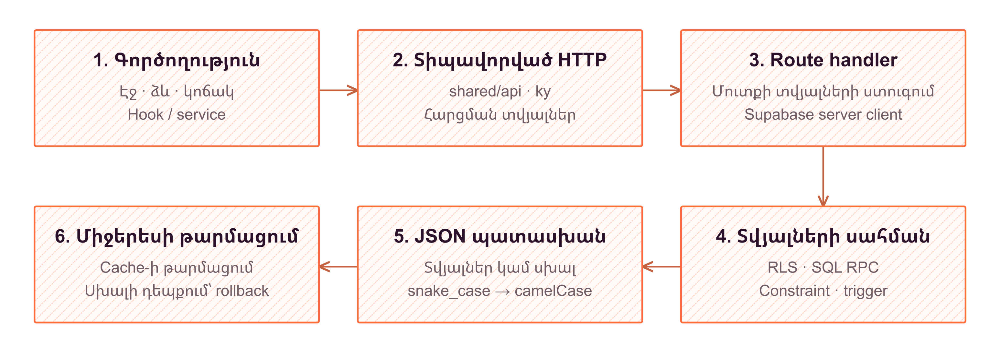

# 4. BackEnd

## Սերվերային շերտի կազմակերպումը

Hotlog-ի սերվերային շերտն իրականացված է Next.js 16 App Router-ի route handler-ներով և գրված է TypeScript-ով։ Առանձին HTTP ծառայության փոխարեն կիրառությունը սահմանում է հարցումների մշակիչներ `src/app/(api)/api` ծառում։ `(api)` հատվածը կազմակերպչական խումբ է և չի ընդգրկվում URL-ում։ Յուրաքանչյուր `route.ts` արտահանում է համապատասխան HTTP մեթոդների գործառույթները՝ օգտագործելով `NextRequest` և `NextResponse`։

Այս շերտը կապում է օգտագործողի գործողությունները տվյալների բազայի գործառնությունների հետ։ Այն ընթերցում է հարցման պարամետրերը, ստուգում նույնականացումը, վավերացնում մուտքային կառուցվածքը և ձևավորում JSON պատասխան։ Պարզ ընթերցումներն ու փոփոխությունները կատարվում են Supabase հաճախորդի աղյուսակային հարցումներով, իսկ փոխկապակցված գործողությունները փոխանցվում են SQL RPC գործառույթներին։

Տվյալների բազայի ներկայացումն անհրաժեշտության դեպքում վերածվում է կիրառական DTO-ի։ Օրինակ՝ `display_name` և `created_at` սյունակները պատասխանում ներկայացվում են որպես `displayName` և `createdAt`։ Այս փոխակերպմամբ միջերեսը ստանում է իր համար հստակ պայմանագիր՝ առանց պահեստավորման բոլոր մանրամասները կրկնելու։



*Նկար 4.1 - հարցման ընթացք*

## Վերջնակետերը և նույնականացման համատեքստը

Backend-ը սպասարկում է երկու տարբեր մուտքային ուղի։ Կառավարման միջերեսը դիմում է նույն ծագման Next.js վերջնակետերին՝ փոխանցելով օգտատիրոջ սեսիայի cookie-ները։ Այս հարցումներում նույնականացման հիմքը Supabase Auth-ի օգտատերն է։ SDK-ի համար նախատեսված հարցումները, հակառակը, օգտագործում են նախագծի API բանալի՝ `Authorization: Bearer ...` վերնագրով և չեն պահանջում բրաուզերային մուտք։

Հիմնական վերջնակետերը խմբավորվում են հետևյալ կերպ։

| Վերջնակետ կամ խումբ | HTTP մեթոդներ | Նշանակություն |
|---|---|---|
| `/api/user/projects` | GET, POST, DELETE | Նախագծերի ցուցակ, ստեղծում և հեռացում |
| `/api/project/schemas`, `/api/project/schemas/[id]/fields` | GET, POST, PATCH | Սխեմաների և դաշտերի կառավարում |
| `/api/project/schemas/[id]/fields/batch` | POST | Դաշտերի խմբային փոփոխություններ |
| `/api/project/events` | GET, DELETE | Իրադարձությունների դիտում և հեռացում |
| `/api/project/events/stats` | GET | Օրական քանակների ստացում |
| `/api/project/layouts` | GET, POST, PATCH, DELETE | Դասավորությունների կառավարում |
| `/api/project/layouts/components` | POST | Բաղադրիչների խմբային պահպանում |
| `/api/project/api-keys` | GET, POST, PATCH, DELETE | Բանալիների դիտում, ստեղծում, փոխարինում և անվավերացում |
| `/api/sdk/schemas` | GET | API բանալիով գործող պայմանագրերի ընթերցում |
| `/api/events` | POST | API բանալիով իրադարձության գրանցում |

Այսպիսով՝ `POST /api/events`-ը SDK-ի գրանցման մուտքն է, իսկ `GET /api/project/events`-ը՝ կառավարման միջերեսի ընթերցման մուտքը։ Դրանք տարբեր վերջնակետեր են՝ նույնականացման տարբեր հիմքերով։ Անդամների, դերերի, թույլտվությունների և հրավերների մշակիչները լրացնում են կառավարման նույն կառուցվածքը։ Առանձին գործողություններ կան նաև հրավերն ընդունելու, նախագծից դուրս գալու և հաշիվը հեռացնելու համար։

`src/lib/supabase/server.ts`-ի `createClient()`-ը սերվերային հաճախորդը ստեղծում է ընթացիկ հարցման cookie-ներով։ Մշակիչները `supabase.auth.getUser()` կանչով ստուգում են օգտատիրոջը, իսկ բազային հարցումները պահպանում են նրա նույնականացման համատեքստը։ Այդ պատճառով PostgreSQL-ի `auth.uid()`-ը և Row Level Security կանոնները գործարկվում են տվյալ օգտատիրոջ համար։ Սեսիայի թարմացման շերտը համապատասխան cookie-ները փոխանցում է նաև պատասխանին։

API բանալիով գործառույթներում նախագիծը որոշվում է ստուգված բանալուց։ Բազայում պահպանվում են բանալու SHA-256 hash-ը, ցուցադրման նախածանցը և օգտագործման տվյալները, ոչ թե բաց գաղտնիքը։ Ամբողջական բանալին վերադարձվում է ստեղծման կամ փոխարինման ժամանակ, իսկ ցուցակագրման հարցումը վերադարձնում է միայն մետատվյալները։

## Մուտքային վավերացումը և պատասխանների ձևաչափը

Հաջող պատասխանները տվյալները սովորաբար տեղադրում են `data` դաշտում, իսկ վերահսկվող սխալները ներկայացվում են `{ error: { message } }` կառուցվածքով։ Ցուցակային պատասխանները կարող են ունենալ լրացուցիչ տեղեկություն. օրինակ՝ իրադարձությունների էջավորման համար վերադարձվում է `nextCursor`։

Վավերացումը կատարվում է մի քանի մակարդակով։ HTTP մշակիչը ստուգում է պարտադիր պարամետրերը, նույնացուցիչների ձևաչափը և գործողությանը համապատասխան մարմնի կառուցվածքը։ Օրինակ՝ բաղադրիչների պահպանման հարցման `layout_id`-ը պետք է լինի դրական անվտանգ ամբողջ թիվ, իսկ `creates`, `updates` և `deletes` դաշտերը՝ զանգվածներ։

Իրադարձության գրանցման մշակիչը պահանջում է `application/json` բովանդակություն և սահմանափակում է մարմինը 64 KiB-ով։ `readBoundedBody()`-ն ընթերցման ընթացքում հաշվում է բայթերը՝ չհենվելով միայն `Content-Length` վերնագրի վրա։ Սահմանը գերազանցելու դեպքում վերադարձվում է `413`, իսկ անհամապատասխան բովանդակության տեսակի դեպքում՝ `415`։

`schema-validator.ts`-ը ստուգում է իրադարձության արժեքը գործող դաշտերի նկարագրությամբ։ Այն տարբերակում է տող, թիվ, տրամաբանական արժեք, ամսաթիվ, զանգված, JSON օբյեկտ և enum, հաշվի է առնում պարտադիրությունը, թվային սահմանները և զանգվածի տարրերի տեսակը։ Դաշտային խախտումները վերադարձվում են `field_errors` զանգվածով՝ `field_key` և `reason` հատկություններով։

HTTP կարգավիճակը լրացնում է հաղորդագրության իմաստը։ Անվավեր մուտքը ներկայացվում է `400`, բացակայող կամ անվավեր նույնականացումը՝ `401`, մերժված թույլտվությունը՝ համապատասխան մշակիչներում `403`, իսկ չգտնված ռեսուրսը՝ `404`։ Բանալիների բախումների համար օգտագործվում է `409`, ստեղծման հաջողության համար՝ `201`։ RPC օգտագործող մշակիչները PostgreSQL-ի սխալի կոդերը փոխակերպում են համապատասխան HTTP կարգավիճակների։ Իրադարձության գրանցման անսպասելի բազային սխալի դեպքում վերադարձվում է ընդհանուր `500` հաղորդագրություն՝ առանց SQL մանրամասների բացահայտման։

## Սխեմաների և դաշտերի կենսաշրջանը

Backend-ը սխեմաները դիտարկում է որպես իրադարձությունների կայուն պայմանագրեր։ Սխեմայի `key`-ը նախագծի ներսում եզակի նույնացուցիչ է, մինչդեռ `display_name`-ը փոփոխելի ցուցադրական անվանում է։ HTTP պայմանագիրը թույլ չի տալիս փոխել սխեմայի բանալին, իսկ դաշտի համար անփոփոխ է պահում նաև `type`-ը։

Հեռացման փոխարեն կիրառվում է `active` և `archived` վիճակների անցումը։ Սովորական ընթերցումները վերադարձնում են գործող գրառումները, իսկ `include_archived=true` պարամետրը ներառում է նաև արխիվացվածները։ Դաշտն արխիվացնելիս նրա `required` հատկությունը դառնում է `false`։ Այս մոտեցումը պահպանում է պատմական իրադարձությունների հղումները՝ առանց արխիվացված դաշտը նոր իրադարձությունների համար պարտադիր դարձնելու։

Արխիվացված սխեմայի բանալին շարունակում է զբաղեցված մնալ։ Նույն բանալիով ստեղծման փորձի ժամանակ մշակիչը տարբերակում է գործող և արխիվացված սխեմայի բախումները՝ վերադարձնելով համապատասխան կառուցվածքային տեղեկություն։ Զուգահեռ ստեղծումների դեպքում եզակիության վերջնական երաշխիքը տվյալների բազայի սահմանափակումն է։

## SQL RPC-ների պատասխանատվությունը և ատոմականությունը

Փոխկապակցված փոփոխությունների ամբողջականությունը վստահվում է PostgreSQL գործառույթներին։ `create_project` RPC-ն մեկ գործարքով ստեղծում է նախագիծը, հիմնադրի անդամակցությունը, `Owner` դերը, դրա նշանակումը և թույլտվությունների կապերը։ Որևէ քայլի ձախողումը հետ է շրջում ամբողջ գործողությունը՝ բացառելով թերի սկզբնական կառուցվածքը։

Նույն սկզբունքն օգտագործվում է բաղադրիչների խմբային պահպանման համար։ Մշակիչից վերցված հետևյալ հատվածը ամբողջ փաթեթը փոխանցում է մեկ RPC-ի։

```typescript
const { data, error } = await supabase.rpc('batch_layout_components', {
  p_layout_id: layout_id,
  p_creates: creates,
  p_updates: updates,
  p_deletes: deletes,
})
```

`batch_layout_components`-ը փոփոխություններից առաջ ստուգում է փաթեթի կառուցվածքը, կրկնվող նույնացուցիչները, բաղադրիչների պատկանելությունը դասավորությանը և սխեմաների պատկանելությունը նույն նախագծին։ Համապատասխան տողերի կողպումը կարգավորում է զուգահեռ փոփոխությունների փոխազդեցությունը։ Ստեղծումը, խմբագրումը և հեռացումը կա՛մ հաստատվում են միասին, կա՛մ ամբողջությամբ հետ են շրջվում։ Այս գործառույթը և նախագծի ստեղծումը գործում են `SECURITY INVOKER` սկզբունքով՝ պահպանելով կանչողի RLS սահմանափակումները։

Իրադարձությունների դեպքում TypeScript վավերացումը չի փոխարինում բազայի ստուգմանը։ Գրման trigger-ը ստուգում է գործող սխեման, նախագծային պատկանելությունը և արժեքի համապատասխանությունը դաշտերին։ Խախտումը չեղարկում է գրանցումը, իսկ `ingest_event` RPC-ի շրջանակում՝ նաև բանալու օգտագործման ժամանակի փոփոխությունը։ Այսպիսով, ատոմականության հստակ սահմանը տվյալ բազային գործարքն է. մեկ HTTP մշակիչում մի քանի առանձին հարցումների առկայությունն ինքնին ընդհանուր գործարք չի ստեղծում։