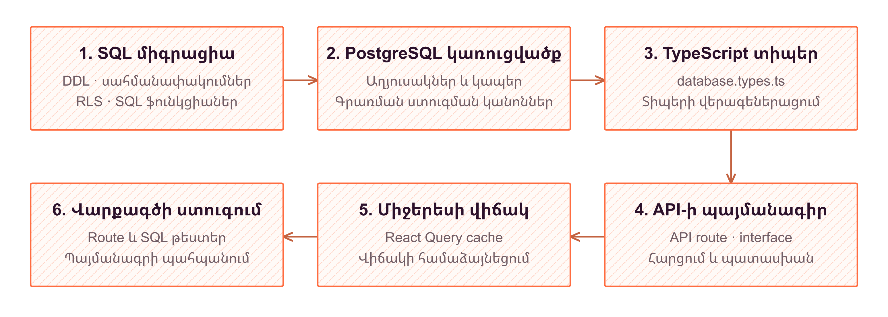

# 6. FrontEnd և BackEnd փոխհամագործակցություն

Hotlog-ում միջերեսի և սերվերային մասի համագործակցությունը չի սահմանափակվում HTTP հարցումներով։ Այն հիմնվում է միասնական պայմանագրի վրա, որը սահմանում է տվյալների կառուցվածքը, թույլատրելի փոփոխությունները, հասանելիության կանոնները և պատասխանի ձևը։ Next.js 16 App Router-ով կառուցված հավելվածը, React 19 բաղադրիչները և Supabase/PostgreSQL շերտը համադրվում են SQL միգրացիաների, TypeScript տիպերի, API ձևափոխումների և cache-ի կառավարման միջոցով։

## Միգրացիաները՝ հավելվածի և բազայի պայմանագիր

`supabase/migrations` պանակի համարակալված SQL ֆայլերը նկարագրում են տվյալների բազայի կառուցվածքի հաջորդական զարգացումը։ Սկզբնական՝ baseline միգրացիան սահմանում է հիմնական աղյուսակները, կապերն ու տիպերը։ Հաջորդ միգրացիաները լրացնում կամ փոխարինում են այդ սահմանումները, ավելացնում կիրառական SQL ֆունկցիաներն ու հասանելիության քաղաքականությունները։ Ուստի վերջնական կառուցվածքը հասկանալու համար բավարար չէ միայն առաջին `CREATE TABLE` հրամանը․ պետք է հաշվի առնել նաև հետագա `ALTER TABLE`, `CREATE OR REPLACE FUNCTION` և քաղաքականությունների վերասահմանումները։

Հերթականությունը պայմանավորված է օբյեկտների կախվածություններով։ Նախ պետք է գոյություն ունենան աղյուսակներն ու դրանց սյունակները, ապա՝ այդ սյունակներն օգտագործող գործառույթներն ու սահմանափակումները։ Նույն սկզբունքը վերաբերում է իրավունքներին․ աղյուսակային արտոնությունները, RLS քաղաքականությունները և RPC-ի կատարման թույլտվությունները միասին են որոշում հասանելիությունը։ Այսպիսով, միգրացիան ոչ միայն նոր դաշտի նկարագրություն է, այլև հավելվածի վարքագծի փոփոխության տվյալահենք մասը։



*Նկար 6.1 - միգրացիաների շղթա*

## Պայմանագրի զարգացումը և համատեղելիությունը

Կառուցվածքային իրադարձությունների սխեմաների զարգացումը ցույց է տալիս այս մոտեցման նշանակությունը։ Սկզբնական `name` դաշտին հաջորդող փոփոխությունները `schemas` և `fields` աղյուսակներում ավելացնում են `key`, `display_name` և `status`, իսկ դաշտերի համար՝ նաև `required`։ Միգրացիան նախ լրացնում է առկա գրառումների նոր արժեքները, կարգավորում կրկնվող բանալիները, ապա սահմանում պարտադիր արժեքներն ու եզակիության սահմանափակումները։ Սխեմայի բանալին եզակի է նախագծի, դաշտի բանալին՝ սխեմայի շրջանակում։

Հավելվածում `key`-ը ծառայում է որպես կայուն տեխնիկական նույնացուցիչ, իսկ `display_name`-ը՝ խմբագրվող անվանում։ Սխեմայի թարմացման API-ն բացահայտ մերժում է `key`-ի փոփոխությունը։ `active` և `archived` վիճակները թույլ են տալիս կառավարել տեսանելիությունը՝ առանց գրառումն ու պատմական կապերը վերացնելու։ Միաժամանակ API-ն շարունակում է լրացնել նաև նախկին `name` սյունակը։ Սա համատեղելիության կոնկրետ օրինակ է․ միջերեսի նոր ներկայացումը չի անտեսում բազայի պահպանված պարտադիր դաշտը։

Նմանապես զարգանում է դասավորությունների կարգավորումը։ `layouts.color`, բաղադրիչների `visualization`, `schema_id` և `span` սյունակները պահպանում են միջերեսում ընտրված գույնը, գծապատկերի տեսակը, սխեմայի կապն ու լայնությունը։ `span`-ի նախնական արժեքը `full` է, իսկ միջերեսը տարբերակում է ամբողջական և կիսալայն ներկայացումները։ Նախկին `type` սյունակի համար սահմանված լռելյայն արժեքը թույլ է տալիս նոր հարցումներում այն չուղարկել։ Համատեղելիությունն այստեղ ապահովվում է SQL լռելյայն արժեքների և հավելվածի համապատասխան ձևափոխումների համադրությամբ։

API բանալիների պայմանագիրը ևս փոխվում է համաձայնեցված ձևով։ Վերջնական կառուցվածքում բաց բանալու սյունակը հեռացված է․ պահպանվում են SHA-256 ամփոփագիրը՝ `key_hash`, ճանաչելի նախածանցը և օգտագործման ու անվավերացման տվյալները։ Ստեղծման RPC-ն ամբողջական բանալին վերադարձնում է ստեղծման պահին, իսկ ցուցակագրման API-ն ընտրում է միայն մետատվյալները։ Հետևաբար բազայի փոփոխությանը համապատասխանում են և՛ սերվերային հարցումները, և՛ միջերեսում գաղտնիքի ժամանակավոր պահպանումը։

## Գեներացված տիպերի դերը և սահմանները

`database.types.ts`-ը տվյալների բազայի նկարագրությունից ստացվող TypeScript ներկայացումն է։ Այն պարունակում է աղյուսակների `Row`, `Insert`, `Update` կառուցվածքները, կապերը, enum-ները և SQL գործառույթների մուտքային ու ելքային տիպերը։ Նախագծում Supabase-ի տիպերի գեներացման համար նախատեսված է առանձին `supabase-types` գործողություն․ ֆայլը սովորական build-ի ընթացքում ինքնաբերաբար չի վերագեներացվում։ Կառուցվածքի աղբյուրը միգրացիաներն են, իսկ գեներացված ֆայլը՝ դրանցով ձևավորված բազայի արտապատկերումը, ոչ թե սահմանափակումների փոխարինողը։

Օրինակ՝ գոյություն ունեցող տիպից կարելի է առանձնացնել բաղադրիչի տողն ու խմբային պահպանման մուտքը․

```typescript
import type { Database } from './database.types'

type ComponentRow = Database['public']['Tables']['components']['Row']
type ComponentBatchArgs =
  Database['public']['Functions']['batch_layout_components']['Args']
```

Սա տիպերի կիրառման օրինակ է, ոչ հավելվածից բառացի արտածում։ Տիպավորումը օգնում է մշակման ժամանակ, սակայն չի ստուգում ստացված JSON-ի արժեքները կամ օգտատիրոջ իրավունքները։ Python SDK-ի գեներացումն առանձին մեխանիզմ է․ այն նախագծի API բանալիով ստանում է `/api/sdk/schemas` պատասխանը և ակտիվ իրադարձությունների սխեմաներից ստեղծում Pydantic դասեր։ Դրանք նկարագրում են ուղարկվող իրադարձությունները, ոչ PostgreSQL աղյուսակները։ SDK-ն այդ դասերի օբյեկտները կամ `send_raw`-ի արժեքներն ուղարկում է `POST /api/events` հասցեով։

## Հարցման անցումը շերտերով

Դասավորության խմբագրումը ներկայացնում է ամբողջ շղթան։ `ModulesComponent`-ը օգտվում է `useModulesService`-ից, ծառայությունը՝ React Query hook-երից, իսկ դրանք՝ տիպավորված API գործառույթներից։ `ky`-ով կազմաձևված ընդհանուր հաճախորդը JSON հարցումն ուղարկում է հավելվածի նույն ծագման Next.js route handler-ին՝ ներառելով cookie-ները։ Այս բաժանումը բաղադրիչը ազատում է URL-ների, HTTP սխալների և տվյալների բազայի սյունակների անմիջական կառավարումից։

Handler-ը ստուգում է հարցման մարմինը և `supabase.auth.getUser()`-ով նույնականացնում օգտատիրոջը։ `supabase/server.ts`-ի հաճախորդը ստեղծվում է `createServerClient<Database>`-ով և հարցման cookie-ներով, հետևաբար բազային դիմումը պահպանում է օգտատիրոջ սեսիան։ SQL գործողության հասանելիությունը որոշում են համապատասխան արտոնությունները և RLS-ը։ Ավելի ուշ միգրացիաներով `has_permission`-ը հաշվի է առնում ոչ միայն դերը, այլև նախագծին անդամակցությունը, իսկ իրադարձության գրառման trigger-ը ստուգում է սխեմայի պատկանելությունը, ակտիվությունն ու արժեքների համապատասխանությունը։

Բաղադրիչների ստեղծումը, փոփոխումն ու հեռացումը միավորվում են `batch_layout_components` RPC-ում։ Այն ստուգում է ամբողջ խմբաքանակը, արգելափակում համապատասխան դասավորության տողը և փոփոխություններն իրականացնում մեկ գործարքով․ սխալը հետ է շրջում այդ խմբաքանակը։ Նույն սկզբունքով `create_project` RPC-ն միասին ստեղծում է նախագիծը, անդամակցությունը և սկզբնական դերը։ Դասավորության ընդհանուր մետատվյալների առանձին հարցումը, սակայն, բաղադրիչների գործարքի մաս չէ։

Պատասխանի ճանապարհին handler-ը բազայի տողերը վերածում է միջերեսի DTO-ների․ օրինակ՝ `schema_id`-ը դառնում է `schemaId`, `created_at`-ը՝ `createdAt`, `name`-ը՝ `title`, իսկ `inputs_ids`-ը՝ `bindings`։ Այս ձևափոխումը համատարած անվանափոխություն չէ, այլ տվյալ endpoint-ի հստակ պայմանագիր։ Կանոնավորված JSON պատասխանը վերադարձվում է API գործառույթին և React Query-ին։

## Cache-ի համաձայնեցումը և սխալի հետշրջումը

Հաստատված փոփոխությունը պետք է արտացոլվի նաև էկրանի վիճակում։ Query key-երում նախագծի կամ սխեմայի նույնացուցիչը պահպանում է cache-ի տարանջատումը։ Բաղադրիչների հաջող պահպանման hook-ը չեղարկում է տվյալ հարցման ընթացիկ ընթերցումները, պատասխանից cache է տեղադրում հաստատված բաղադրիչները՝ ներառյալ բազայի ստեղծած նույնացուցիչները, ապա համապատասխան հարցումը նշում է հնացած։ Այս հերթականությունը թույլ չի տալիս ավելի վաղ սկսված ընթերցման պատասխանին փոխարինել նոր հաստատված արդյունքը։ Սխեմայի դաշտերը պահպանելուց հետո թարմացման ենթակա են նշվում և՛ դաշտերի, և՛ սխեմաների հարցումները։

Որոշ գործողություններ ունեն լավատեսական փոփոխություն։ API բանալու հեռացման hook-ը նախ չեղարկում է համապատասխան ընթերցումը, պահում նախկին տվյալները և բանալին անմիջապես հեռացնում ցուցակից։ Եթե հարցումը ձախողվում է, `onError`-ը վերականգնում է միայն այդ գործողությամբ հեռացված տարրը՝ չվերադարձնելով ամբողջ հին ցուցակը և չչեղարկելով այլ փոփոխություններ։ `onSettled`-ը վերջում անվավերացնում է համապատասխան cache-ը։ `ky`-ի սխալների մշակումը պահպանում է HTTP սխալը և առանձնացնում սերվերի հաղորդագրությունը, որպեսզի ձախողումը հասնի hook-ին, իսկ միջերեսը չներկայացնի չհաստատված փոփոխությունը որպես պահպանված արդյունք։
