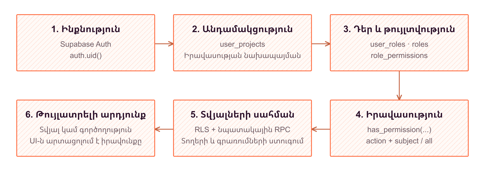
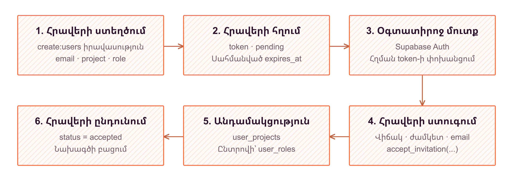

# 7. Համակարգի ֆունկցիոնալություն

Hotlog-ի գործառույթները ներառում են ոչ միայն կառուցվածքային իրադարձությունների պահպանումն ու դիտարկումը, այլև դրանց շուրջ կազմակերպվող համատեղ աշխատանքը։ Նույն նախագծում տարբեր օգտատերեր կարող են դիտել իրադարձությունները, սահմանել տվյալների պայմանագրերը, կազմել վահանակներ կամ կառավարել անդամներին։ Այս գործողությունները նույն իրավասությունը չեն ենթադրում։ Համակարգը տարանջատում է օգտատիրոջ ինքնությունը, նախագծին անդամակցությունը և կոնկրետ գործողություն կատարելու թույլտվությունը։ Այդ տարբերակումը արտահայտվում է ինչպես կառավարման միջերեսում, այնպես էլ Next.js-ի սերվերային մշակիչներում և PostgreSQL-ի կանոններում։

## Նույնականացում, անդամակցություն և սեփականատեր

Supabase Auth-ի աշխատաշրջանը պատասխանում է «ո՞վ է դիմողը» հարցին, բայց ինքնին չի տալիս ցանկացած նախագծի տվյալների հասանելիություն։ Կառավարման վահանակը դիմում է նույն ծագման Next.js route handler-ներին, որոնք `supabase.auth.getUser()`-ով ստուգում են օգտատիրոջը։ Սերվերային Supabase client-ը պահպանում է cookies-ով փոխանցված աշխատաշրջանը, ուստի տվյալների հարցումները կատարվում են օգտատիրոջ ինքնությամբ։ PostgreSQL-ում այդ ինքնությունը հասանելի է `auth.uid()`-ով։ Օրինակ՝ հարցման մեջ ուրիշի `user_id` փոխանցելը չի փոխարինում հաստատված աշխատաշրջանին։

Նախագծին մասնակցությունը ներկայացվում է `user_projects` կապով, իսկ սեփականատերը որոշվում է `projects.creator_id`-ով։ Դրանք առանձին հարաբերություններ են։ Նախագիծ ստեղծելիս `create_project` RPC-ն մեկ գործարքում ստեղծում է նախագիծը, ստեղծողի անդամակցությունը, `Owner` դերը և դրա կապերը իրավասությունների առկա կատալոգի հետ։ Հետևաբար մեկնարկային կառավարումը ձևավորվում է փոխկապակցված գրառումներով, ոչ թե միայն դերի անվան հատուկ մեկնաբանությամբ։

Սեփականատիրոջ կարգավիճակը ևս համընդհանուր շրջանցում չէ։ Այն առանձին ճանաչվում է, օրինակ, նախագծի փոփոխման ու ջնջման, որոշ դերային գործողությունների և layout-ների տեսանելիության կանոններում։ Սակայն API key ստեղծող RPC-ն պահանջում է համապատասխան իրավասություն նաև սեփականատիրոջից։ `Owner` անվանումը և `creator_id`-ով հաստատվող սեփականությունը նույն հասկացությունը չեն։

## Նախագծային դերեր և իրավասությունների իմաստ

Յուրաքանչյուր դեր պատկանում է մեկ նախագծի։ `user_roles` կապը օգտատիրոջը միացնում է դերերին, իսկ `role_permissions`-ը՝ դերը `permissions` կատալոգի գրառումներին։ Իրավասությունը կազմված է գործողությունից և առարկայից՝ `action` ու `subject`։ Հավելվածի ճանաչած գործողություններն են `create`, `read`, `update`, `delete`, իսկ առարկաները նկարագրում են ռեսուրսները՝ օրինակ `events`, `schemas`, `users`, `layouts`, `api_keys`։

Մի քանի դեր ունեցող օգտատիրոջ հնարավորությունները համախմբվում են։ `/api/user/permissions` մշակիչը նախ ստուգում է անդամակցությունը, ապա հավաքում տվյալ նախագծի դերերի իրավասությունները, հեռացնում կրկնությունները և վերադարձնում ճանաչված արժեքները։ Առանց դերի անդամը ստանում է դատարկ իրավասությունների ցանկ։ Իսկ ոչ անդամի դիմումը մերժվում է `403` կարգավիճակով, նույնիսկ եթե նրա համար դերային կապ պահպանված լինի։ Նույն անդամակցության պայմանը առկա է նաև տվյալների բազայի `has_permission` ֆունկցիայում։

Հետևյալ պայմանական ցանկը ցույց է տալիս վերադարձվող իրավասությունների տողային ձևաչափը․

```json
["read:events", "create:all"]
```

Այստեղ `create:all`-ը թույլ է տալիս ստեղծման գործողությունը տարբեր առարկաների համար, բայց չի նշանակում կարդալու, փոխելու կամ ջնջելու թույլտվություն։ `all`-ը միայն առարկայի ընդհանրացումն է։ `has_permission`-ի գործող պայմաններից ճշգրիտ հատվածը դա ներկայացնում է այսպես․

```sql
AND p.action = p_action
AND (p.subject = p_subject OR p.subject = 'all')
```

Այսպիսով, գործողության համար wildcard կամ բոլոր գործողությունները ներառող `manage` իմաստ չի կիրառվում։ Միաժամանակ յուրաքանչյուր ընթերցման կանոնը պարտադիր չէ, որ պահանջի առանձին `read` իրավասություն․ օրինակ՝ իրադարձությունների ու սխեմաների ընթերցումը RLS-ում կապված է անդամակցության հետ, իսկ API key-երի ցանկի համար պահանջվում է `read:api_keys`։ Իրավասության իմաստը ամբողջական է միայն տվյալ գործողության կանոնի հետ միասին։

## RLS սահմանը և դերերի վերահսկվող փոփոխությունը

Միջերեսում CASL-ը իրավասությունների ցանկից կառուցում է թույլատրելի գործողությունների պատկերը։ Այն օգնում է չցուցադրել անհասանելի կառավարման տարրերը, բայց տվյալների պաշտպանության վերջնական սահմանը չէ։ Այդ սահմանը PostgreSQL-ի Row Level Security-ն է՝ աղյուսակային իրավասությունների և RPC-ների ստուգումների հետ միասին։ Նախագիծը փոխելիս միջերեսը նաև չի օգտագործում նախորդ նախագծի ժամանակավոր պահպանված իրավասությունները՝ մինչև նոր հարցման պատասխանը։



*Նկար 7.1 - հասանելիության ստուգում*

`SECURITY DEFINER` ֆունկցիան աշխատում է իր սեփականատիրոջ տվյալների բազայի իրավասություններով և կարող է անցնել սովորական RLS սահմաններից։ Ուստի այդ հատկանիշն ինքնին անվտանգության երաշխիք չէ․ որոշիչ են ֆունկցիայի թույլատրած գործողությունները, դիմողի ստուգումը և կատարման իրավունքը։ Դերերի ու բանալիների կառավարման RPC-ները ստուգում են `auth.uid()`-ի առկայությունը։ Դրանց նոր սահմանումներում կիրառվում է `SET search_path = ''`, իսկ աղյուսակները նշվում են ամբողջական անուններով։ Ավելի վաղ որոշ օժանդակ ֆունկցիաներում ուղին ամրագրված է `public`-ի վրա։ Ֆիքսված `search_path`-ը կանխատեսելի է դարձնում անունների լուծումը, բայց չի փոխարինում լիազորման ստուգումներին։

Անդամի դերը փոխող `PATCH /api/project/members` մշակիչը ստուգում է երեք UUID-ները և կանչում `update_user_role`։ Գործողությունը թույլատրված է նախագծի ստեղծողին կամ `create:users` կամ `update:roles` ունեցող անդամին։ RPC-ն հաստատում է, որ թիրախային օգտատերը տվյալ նախագծի անդամ է, իսկ ընտրված դերը պատկանում է հենց այդ նախագծին։ Այն նախ կողպում է անդամակցության համապատասխան տողերը `FOR UPDATE`-ով, ապա դերի տողը՝ `FOR SHARE`-ով։ Միայն դրանից հետո տվյալ նախագծի նախկին նշանակումները փոխարինվում են նորով՝ առանց այլ նախագծերի դերերին դիպչելու։

Դերային կապերի `AFTER` trigger-ը լրացուցիչ պահանջում է անդամակցություն դերի նախագծին։ Այն գործում է նաև ուղղակի գրառումների դեպքում, իսկ բացառությունը հետ է շրջում փոփոխությունը։ Սովորական օգտատիրոջ չթույլատրված գրառումը նախ մերժվում է RLS-ով՝ մինչև այս արտոնյալ ստուգումը։

Օրինակ՝ Ա նախագծում դերը փոխելու իրավունք ունեցող կառավարիչը չի կարող այդ գործողության մեջ փոխանցել Բ նախագծի դերի նույնացուցիչը։ RPC-ն մերժում է այն, նույնիսկ եթե թիրախային օգտատերը երկու նախագծերի անդամ է։ Մերժումը տեղի է ունենում մինչև նախկին նշանակումների ջնջումը։ Իսկ համապատասխան լիազորություն չունեցող անդամը ստանում է `403` պատասխան։

Այս սահմանափակումները չեն սահմանում դերերի աստիճանակարգ կամ պահանջ, որ նշանակվող դերի իրավասությունները լինեն կառավարչի սեփական իրավասությունների ենթաբազմությունը։ Նշված կառավարիչը կարող է ընտրել նախագծի ցանկացած դեր։ Հետևաբար դերերի նշանակման իրավունքը ինքնին պատասխանատու վարչական լիազորություն է։ Դեր ստեղծելու համար պահանջվում է սեփականություն կամ `create:roles`, ջնջելու համար՝ `delete:roles`։ Դերին իրավասություն ավելացնելիս ընդունվում է սեփականությունը կամ `update:roles`, իսկ կապը հեռացնելիս պահանջվում է `update:roles`։

## Դերերով պայմանավորված layout-ների տեսանելիություն

Դերերը կարգավորում են նաև վահանակների ընտրությունը։ `role_layouts` կապ չունեցող layout-ը հասանելի է նախագծի անդամներին։ Այստեղ «բաց» լինելը չի նշանակում հասանելիություն չնույնականացված այցելուներին։ Եթե layout-ին դերեր են կցված, անդամը պետք է ունենա դրանցից առնվազն մեկը։ Նախագծի ստեղծողը և `read:layouts` ունեցող անդամը կարող են տեսնել նաև այդ սահմանափակումներով layout-ները։ RLS-ի ընդհանուր անդամակցության պայմանը պահպանվում է։

Դեր–layout կապ ավելացնելն ու հեռացնելը պահանջում են layout-ի նախագծի `update:layouts` իրավասությունը։ Այս մեխանիզմով նույն նախագծում կարելի է տարբեր աշխատախմբերի համար առանձնացնել համապատասխան դիտումները։ Սակայն layout-ի հասանելիությունը ինքնին նոր թույլտվություն չի ստեղծում իրադարձություններ փոխելու կամ անդամներ կառավարելու համար։ Ներկայացման տեսանելիությունն ու տվյալների նկատմամբ գործողությունները տարբեր կանոններ ունեն։

## Հրավերներով անդամակցության ձևավորում

Հրավերը կապում է նախագիծը, ստացողի email-ը, հրավիրողին, UUID token-ը և վավերականության ժամկետը։ Դերը կամընտիր է․ `role_id` չտրամադրելու դեպքում ընդունումը կարող է ստեղծել անդամակցություն՝ առանց դերի նշանակման։ Լռելյայն հրավերը գործում է յոթ օր և ունի `pending`, `accepted` կամ `revoked` վիճակ։

`POST /api/project/invitations` մշակիչը հաստատված օգտատիրոջ նույնացուցիչն է պահում որպես `invited_by`, իսկ email-ը վերածում է փոքրատառերի։ RLS-ը պահանջում է `create:users` և հրավիրողի համապատասխանություն ընթացիկ օգտատիրոջը։ Ստուգվում է արդեն անդամ լինելու հանգամանքը, իսկ նույն նախագծի ու email-ի համար երկրորդ սպասող հրավերը սահմանափակվում է եզակի ինդեքսով։ Սպասող հրավերների ցանկը կարող են կարդալ նախագծի անդամները․ այս քաղաքականությունը առանձին `read:users` չի պահանջում։

Մշակիչը կազմում է token պարունակող ընդունման հղումը և Resend ինտեգրման առկայության դեպքում փորձում է ուղարկել նամակը։ Հրավերի ստեղծումն ու նամակի առաքումը առանձին արդյունքներ են․ ուղարկման սխալը չի վերացնում ստեղծված հրավերը։ Պատասխանը վերադարձնում է նաև token-ը։ Հետևաբար ստեղծման հաջող պատասխանը չի մեկնաբանվում որպես նամակի ստացման հաստատում։



*Նկար 7.2 - հրավերի ընդունում*

Ընդունման էջը չնույնականացված այցելուին ուղղորդում է մուտքի էջ՝ պահպանելով վերադարձի հասցեն։ Այնուհետև `POST /api/invite/accept`-ը փոխանցում է token-ը `accept_invitation` RPC-ին։ Ֆունկցիան email-ը վերցնում է `auth.users`-ից՝ `auth.uid()`-ով, ոչ թե հարցման մարմնից։ Այն պահանջում է սպասող, չժամկետանց հրավեր և ստացողի email-ի համընկնում՝ առանց տառաչափը հաշվի առնելու։ Միայն token ունենալը բավարար չէ ուրիշին հասցեագրված հրավերն ընդունելու համար։

Նոր անդամի դեպքում նույն RPC գործարքում նախ ավելացվում է անդամակցությունը, հետո՝ դերը, եթե նշված է, և վերջում հրավերը դառնում է `accepted`։ Այդ հերթականությունը համատեղելի է դերային կապի անդամակցության ստուգման հետ։ Արդեն անդամ եղող ստացողի դեպքում հրավերը նշվում է ընդունված՝ առանց նրա դերը փոխելու։ Հետկանչի համար API-ի `DELETE` մեթոդն իրականում թարմացնում է սպասող հրավերի վիճակը՝ դարձնելով `revoked`։ Ուստի կիրառվող իրավասությունը `create:users` է՝ թարմացման քաղաքականությունից, ոչ թե ֆիզիկական ջնջման համար նախատեսված `delete:users`-ը։

## Նախագծային API key-երի կառավարում

Արտաքին ծրագրերի մուտքը տարբերվում է օգտատիրոջ աշխատաշրջանից։ Python SDK-ն նախագծային API key-ն փոխանցում է որպես Bearer credential՝ `/api/sdk/schemas`-ից պայմանագրերը ստանալու և `POST /api/events`-ով իրադարձություն ուղարկելու համար։ Սխեմաներից գեներացվող Pydantic դասերը տվյալների կառուցվածքն են նկարագրում, ոչ թե օգտատերերի դերերը։ Բանալին նախագիծ է նույնացնում և չի փոխարինում անդամների կառավարման լիազորություններին։

Նոր բանալին ստեղծվում է տվյալների բազայում՝ UUID ձևաչափով։ Պահվում են դրա SHA-256 hash-ը և առաջին ութ նիշը, ոչ թե ամբողջական գաղտնիքը։ Ամբողջական արժեքը վերադարձվում է ստեղծման կամ փոխարինման պատասխանում։ Հետագա `GET` հարցումը ընտրում է միայն `id`, `project_id`, `key_prefix`, `last_used_at`, `revoked_at` դաշտերը։ Նույն սահմանափակումը հաստատված է նաև սյունակային `GRANT`-ով․ ցանկից հնարավոր չէ վերականգնել գաղտնիքը կամ ստանալ hash-ը։ Այս մշակիչների պատասխաններն ունեն `Cache-Control: no-store`։

Ստեղծումը պահանջում է `create:api_keys`, ցանկի ընթերցումը՝ `read:api_keys`, հետկանչը՝ `delete:api_keys`։ `PATCH`-ով փոխարինումը պահանջում է և՛ ստեղծման, և՛ ջնջման իրավասությունները։ Այն վերաբերում է ընտրված մեկ ակտիվ բանալու․ RPC-ն կողպում է նախագծի տողը, ստուգում բանալու պատկանելությունը, հետ է կանչում հինը և ստեղծում նորը նույն գործարքում։ Ձախողման դեպքում հին բանալու հետկանչը նույնպես հետ է շրջվում։

Հետկանչը ֆիզիկական ջնջում չէ․ լրացվում է `revoked_at`-ը՝ պահպանելով նույնացուցիչն ու օգտագործման տվյալները։ SDK-ի հարցումները մշակող SQL ֆունկցիաները ստացված գաղտնիքի hash-ը համեմատում են միայն չհետկանչված բանալիների հետ և սխեմաները փնտրում են այդ բանալու նախագծում։ Այսպիսով, հաճախորդի փոխանցած սխեմայի անունը չի ընտրում կամայական այլ նախագիծ։

## Անդամակցությունից դուրս գալու և հաշվի ջնջման սահմանափակումներ

Ուրիշ անդամի հեռացումը պահանջում է `delete:users`, իսկ նախագծի ստեղծողի հեռացումը արգելված է։ Սեփական մասնակցությունը դադարեցնելու համար նախատեսված է առանձին `leave_project` RPC։ Դիմողը չի փոխանցում հեռացվող օգտատիրոջ նույնացուցիչը․ թիրախը միշտ `auth.uid()`-ն է։ Ֆունկցիան ստուգում է անդամակցությունը, արգելում սեփականատիրոջ դուրս գալը և կողպումներից հետո մեկ գործարքում մաքրում տվյալ նախագծի դերային կապերն ու անդամակցությունները։

Հաշիվը ջնջելու համար պահանջվում են email-ի ճշգրիտ հաստատում և վերջին տասնհինգ րոպեում կատարված մուտք՝ ստուգված Auth claims-ի հիման վրա։ Աշխատաշրջանի սովորական թարմացումը նոր մուտք չի համարվում։ Սերվերային արտոնյալ Auth client-ը ջնջման թիրախը ստանում է միայն հաստատված աշխատաշրջանից։

Սեփական նախագծեր ունեցող օգտատերը չի կարող այդ գործողությամբ անուղղակիորեն ջնջել դրանք։ Նախնական ստուգումից բացի գործում է `projects.creator_id` արտաքին բանալու `ON DELETE RESTRICT` սահմանափակումը, որը պահպանում է արգելքը նաև ստուգումից հետո առաջացող մրցակցող փոփոխությունների դեպքում։ Այս մոտեցմամբ հաշվի, անդամակցության և նախագծի կենսաշրջանները մնում են հստակ տարանջատված, իսկ վարչական գործողությունների հետևանքները չեն սահմանափակվում միայն միջերեսի նախազգուշացումներով։
