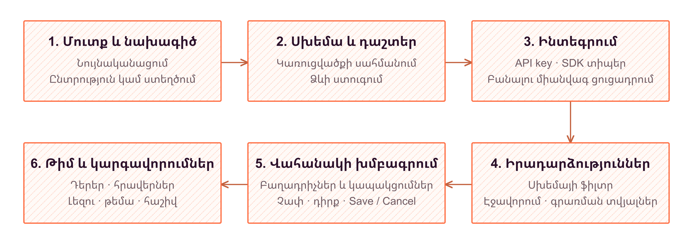

# 7. Համակարգի ֆունկցիոնալություն

Hotlog-ի վեբ միջերեսը կառուցված է կառուցվածքային իրադարձությունների հետ աշխատանքը հասկանալի հաջորդականության վերածելու սկզբունքով։ Օգտատերը նախ ընտրում է նախագիծը, սահմանում տվյալների պայմանագիրը, ուսումնասիրում իրադարձությունները և ձևավորում իրեն անհրաժեշտ վահանակները։ FrontEnd լուծման նշանակությունը միայն տվյալներ ցուցադրելը չէ․ այն նաև բացատրում է գործողությունների իմաստը, տարբերակում ժամանակավոր փոփոխությունը պահպանված արդյունքից և տեսանելի արձագանքում է հարցումների ընթացքին։

## Տեսողական ինքնություն և տեղեկատվական հիերարխիա

Տեսողական ինքնության ջերմ հիմքը արտահայտված է `home` մոդուլի ոճերում ընտրված նարնջագույն `#FF6C40` և մուգ մանուշակագույն `#2C112B` համադրությամբ։ Նարնջագույնը կապվում է Hotlog անվան ջերմության գաղափարի հետ, իսկ մուգ երանգը հավասարակշռում է այն՝ ստեղծելով խորություն։ Ճառագայթային և գծային գրադիենտները, կլորացված կոճակները և ընդգծված վերնագրերը ծառայում են ճանաչելիության ձևավորմանը։ Ներկայացուցչական էջերի շարժուն ֆոները շարունակվում են նույն ջերմ տրամադրությամբ, սակայն աշխատանքային միջավայրում առաջնային են դառնում տվյալների ընթեռնելիությունն ու կառավարելիությունը։

Վահանակում կիրառվում են համեմատաբար չեզոք մակերեսներ, սահմանագծերով առանձնացված քարտեր և զուսպ ստվերներ։ Սա կարևոր տարբերակում է․ մուտքի էջը ուշադրություն է հրավիրում համակարգի վրա, իսկ աշխատանքային էջերը չեն մրցակցում բովանդակության հետ։ Մեծ վերնագիրը ցույց է տալիս ընթացիկ բաժինը, երկրորդային տեքստը բացատրում է նշանակությունը, իսկ փոքր նշապիտակները ներկայացնում են դաշտի տեսակը, կարգավիճակը կամ տեխնիկական բանալին։

Միևնույն բաղադրիչային լեզուն պահպանվում է ձևերում, աղյուսակներում և երկխոսության պատուհաններում։ Գործողությունների նշանակությունը փոխանցվում է ոչ միայն գույնով, այլև անվանումով, պատկերակով և դիրքով։ Օրինակ՝ վտանգավոր գործողությունների համար կիրառվում է առանձին գունային շեշտադրում, մինչդեռ պահպանման և չեղարկման կոճակները կազմում են կանխատեսելի զույգ։

## Ներկայացուցչական էջից մինչև նույնականացում

Մեկնարկային էջը տեղեկատվությունը բացահայտում է աստիճանաբար՝ գլխավոր հաղորդագրություն, հնարավորությունների քարտեր, աշխատանքի քայլեր և հաջորդ գործողության առաջարկ։ Շարժապատկերներն ունեն ներկայացուցչական դեր․ դրանք համակարգի աշխատանքային տվյալների փոփոխություն չեն արտահայտում։ Գործողության հիմնական առաջարկը կախված է մուտքի վիճակից․ նույնականացված օգտատիրոջ համար այն տանում է դեպի վահանակ, իսկ մյուսների համար առաջարկվում են գրանցում և մուտք։

Մուտքի ու գրանցման էջերում կենտրոնացված քարտը առանձնացնում է հիմնական խնդիրը և նվազեցնում տեսողական շեղումները։ Էլեկտրոնային հասցեի և գաղտնաբառի դաշտերն ունեն պիտակներ ու ստուգման հաղորդագրություններ։ React Hook Form-ի և Zod-ի համադրությամբ սխալ ձևաչափը ներկայացվում է համապատասխան դաշտի մոտ, իսկ նույնականացման անհաջողությունը՝ ձևի ընդհանուր հաղորդագրությամբ։ Հարցման ընթացքում ուղարկման կոճակն անգործուն է և փոխում է գրությունը։

Մուտքի էջը նաև տրամադրում է Google, GitHub և Discord նույնականացման մեկնարկի կոճակներ ու գաղտնաբառի վերականգնման հղում։ Հաջող մուտքից հետո կատարվում է անցում թույլատրելի ներքին հասցեով։ Այսպիսով, ձևի լրացումը, ընթացքի ցուցադրումը և հաջորդ էկրանին անցումը կազմում են մեկ ամբողջական փոխազդեցություն։

*Նկար 7.1 - օգտատիրոջ աշխատանքային ընթացք*

## Հարմարվող աշխատանքային միջավայր և նախագծի ամփոփում

Աշխատանքային միջավայրը պահպանում է ընդհանուր կառուցվածք՝ կողային նավարկում, վերևի ուղեգիծ և էջի բովանդակություն։ Կողային վահանակի վերևում նախագծի ընտրիչն է, կենտրոնում՝ բաժիններն ու մոդուլները, ներքևում՝ օգտատիրոջ հաշիվը։ Այս դասավորությունը տեսանելի է պահում աշխատանքի համատեքստը․ նույնանուն սխեման կամ մոդուլը միշտ վերաբերում է ընտրված նախագծին։

Լայն էկրանին կողային վահանակը կարող է սեղմվել մինչև պատկերակների սյունակ՝ հուշումներով։ Փոքր էկրանին այն բացվում է ծածկող շարժական վահանակով։ Վերևի ուղեգիծն օգնում է հասկանալ էջի դիրքը, իսկ որոնումն ու բաժնին հատուկ գործողությունները հայտնվում են նույն հատվածում։ Նախագծի ստեղծումն իրականացվում է փոքր երկխոսության պատուհանում․ դատարկ անունը չի ուղարկվում, իսկ սխալի դեպքում պատուհանն ու մուտքագրված անունը պահպանվում են։

Overview էջում տեղեկատվությունը բաժանված է գործառնական խմբերի։ Վերևում իրադարձությունների օրական քանակների գրաֆիկն է, որը ստանում է վերջին երեսուն օրվա ամփոփումը։ Այնուհետև ներկայացվում են API բանալիները, անդամների և դերերի ներդիրները։ Որոնումը հնարավորություն է տալիս առանձնացնել անդամին էլեկտրոնային հասցեով կամ դերանունով, իսկ դերերը՝ անունով կամ թույլտվությամբ։ Հասանելի գործողությունների թվում են հրավերը, դերի ստեղծումը, անդամի դերի փոփոխությունը և հրավերի հետկանչը։

API բանալու քարտում տարբերակվում են բանալիների ցուցակը և ստեղծումից կամ փոխարինումից հետո մեկ անգամ ստացվող ամբողջական արժեքը։ Վերջինս կարելի է բացել, թաքցնել, պատճենել և հեռացնել ցուցադրումից։ Պատճենման հաջողությունը ստանում է կարճ հաղորդագրություն։ Նախագծի ջնջումը առանձնացված է վտանգավոր գործողությունների հատվածում և պահանջում է անվան հաստատում։

## Սխեմայի խմբագրիչը՝ որպես տվյալների պայմանագրի ձև

Սխեմաների աղյուսակը համադրում է մարդուն հասկանալի անվանումը, տեխնիկական `key`-ը, դաշտերի և իրադարձությունների քանակները։ Որոնումը աշխատում է անվան ու բանալու նկատմամբ։ Ստեղծման պատուհանում անվանումից ձևավորվող բանալին նախապես ցուցադրվում է, որպեսզի օգտատերը տարբերակի ներկայացման տեքստը ծրագրային նույնացուցիչից։

Խմբագրիչը լայն էկրանին բացվում է աջից, իսկ շարժական սարքում՝ ներքևից։ Առանձին քարտերով ներկայացվում են `string`, `number`, `boolean`, `datetime`, `enum`, `array` և `json` տեսակները։ Նոր դաշտի համար ընտրվում են անվանումը, բանալին, տեսակը և պարտադիր լինելը։ Պահպանված դաշտի բանալին ու տեսակը չեն վերախմբագրվում․ դրանց անփոփոխությունը միջերեսում արտահայտվում է բանալու նշապիտակով և կողպված տեսակի ընտրիչով։

Ձևը հարմարվում է դաշտի իմաստին։ Թվային դաշտի համար հայտնվում են նվազագույն և առավելագույն սահմանները, թվարկման համար՝ թույլատրելի արժեքները, զանգվածի համար՝ տարրի տեսակը։ Այս մետատվյալները ներկայացվում են իրենց նշանակությանը համապատասխան մուտքագրման տարրերով, ոչ թե մեկ ընդհանուր JSON խմբագրիչով։ Ընտրված դաշտի եզրագծի ընդգծումը և նոր դաշտի նշապիտակը օգնում են պահպանել ուշադրությունը երկար պայմանագրի ներսում։

Փոփոխությունները նախ կուտակվում են տեղային սևագրում։ Save-ը հասանելի է փոփոխության առկայության դեպքում, իսկ Cancel-ը վերադարձնում է սկզբնական դաշտերն ու անվանումը։ Պահպանման սխալը ցուցադրվում է խմբագրիչում՝ առանց սևագիրը վերացնելու։ Արխիվացված դաշտերը կարելի է ցուցադրել առանձին փոխարկիչով և վերականգնել։ Սխեմայի վերականգնումն ունի այլ մուտք․ եթե ստեղծվող բանալին արդեն պատկանում է արխիվացված սխեմայի, պատուհանը բացատրում է հակասությունը և համապատասխան իրավունքի դեպքում առաջարկում վերականգնել նախկին սխեման՝ առանց այն նորով փոխարինելու։

## Իրադարձությունների որոնում և մանրամասների դիտում

Իրադարձությունների բաժնում աղյուսակը ծառայում է արագ կողմնորոշմանը, իսկ մանրամասների վահանակը՝ բովանդակության ուսումնասիրությանը։ Տողում տեսանելի են իրադարձության նույնացուցիչով վերնագիրը, սխեման և ժամանակը։ Տողի կամ բացման գործողության ընտրությունը ցուցադրում է դաշտերը դրանց տեսակին համապատասխան՝ թվային, տրամաբանական, ամսաթվային, զանգվածային կամ JSON ներկայացմամբ։ Օգտատերը չի կորցնում ցուցակի համատեքստը՝ մանրամասները դիտելու համար առանձին էջ անցնելով։

Զտիչի ձևավորումը կազմակերպված է երեք քայլով՝ սխեմա, դաշտ, պայման։ Դաշտի տեսակը որոշում է թույլատրելի համեմատությունները․ տեքստի համար առաջարկվում են հավասարություն և պարունակության պայմաններ, թվերի ու ժամանակի համար՝ նաև մեծության համեմատություններ։ Զանգվածի տարրերի և JSON-ի ներքին բանալու նկատմամբ պայմաններն ունեն համապատասխան նշանակումներ։ Կիրառված պայմանները ցուցադրվում են փոքր պիտակներով, որոնցից կարելի է բացել խմբագրումը կամ հեռացնել առանձին պայմանը։

Որոնման և զտման արժեքները ներառվում են սերվերին ուղարկվող հարցման մեջ։ Ցուցակը համալրվում է ոլորման ընթացքում՝ cursor-ով հաջորդ հատվածը ստանալով։ Բեռնման ցուցիչն ու ցուցակի ավարտի հաղորդագրությունը տարբերակում են շարունակվող հարցումը ավարտված արդյունքից։ Ջնջման իրավունքի դեպքում հասանելի են տողերի ընտրությունը, խմբային գործողությունը և հաստատման պատուհանը․ ջնջումը չի կատարվում միայն ընտրություն կատարելու հետևանքով։

## Մոդուլների դասավորություն և գրաֆիկների կազմավորում

Մոդուլը օգտատիրոջ կազմավորած աշխատանքային էջ է։ Ստեղծման պատուհանը թույլ է տալիս նշել անունը, գույնը և դերային տեսանելիությունը։ Դերային սահմանափակման բացակայությունը վերաբերում է նախագծի անդամների հասանելիությանը, ոչ թե համացանցում հրապարակմանը։ Էջի վերնագիրն ու նկարագրությունը խմբագրվում են տեղում, իսկ գունային նշիչը կապում է էջը կողային նավարկման համապատասխան տարրի հետ։

Բաղադրիչի խմբագրիչում ընտրվում են վերնագիրը, նկարագրությունը, գրաֆիկի տեսակը, սխեման և մուտքային դաշտերի կապերը։ Հասանելի են գծային, մակերեսային, սյունակային, կուտակային սյունակային, շրջանային, օղակաձև, կետային գրաֆիկներ, ջերմային քարտեզ, հիստոգրամ և ժամանակային միջակայքների պատկերում։ Ընտրությունը փոխում է պահանջվող մուտքերը․ օրինակ՝ գծային գրաֆիկը պահանջում է ժամանակ և թվային արժեք, իսկ կետայինը՝ երկու թվային առանցք։

Դաշտերի ընտրիչները սահմանափակվում են համատեղելի տեսակներով․ անվանական մուտքին կարող է կապվել տեքստ կամ թվարկում, թվայինին՝ թիվ կամ տրամաբանական դաշտ, ժամանակայինին՝ `datetime`։ Պարտադիր կապերի բացակայության դեպքում բաղադրիչի հաստատումն անգործուն է։ Սխեմայի կամ պատկերման տեսակի փոփոխության ժամանակ կապերը վերակազմավորվում են, որպեսզի նախորդ ընտրությունը չընկալվի որպես ինքնաբերաբար վավեր նոր պայմաններում։

*Նկար 7.2 - դասավորության կառուցվածք*

Վերադասավորման ռեժիմում քարտերը ստանում են քաշելու տեսողական հուշումներ։ Օգտատերը կարող է փոխել հերթականությունը, խմբագրել կամ հեռացնել բաղադրիչը և ընտրել `half` կամ `full` լայնություն։ Փոքր էկրանին քարտերը դասավորվում են մեկ սյունակով, իսկ ավելի լայն տարածքում կիսալայն քարտերը զբաղեցնում են երկսյուն ցանցի մեկ բջիջը։

Բաղադրիչի պատուհանի հաստատումը նախ թարմացնում է մոդուլի սևագիրը։ Ընդհանուր Save/Cancel հատվածը հայտնվում է չպահպանված փոփոխությունների դեպքում։ Պահպանման ընթացքում խմբագրումը կողպվում է, հաջող պատասխանից հետո գործողությունների հատվածը փակվում է, իսկ սխալի դեպքում սևագիրը մնում է տեսանելի։ Բաղադրիչների փոփոխություններն ուղարկվում են խմբով, սակայն մոդուլի վերնագրային տվյալներն ու դերային տեսանելիությունը մշակվում են առանձին գործողություններով։ Հետևաբար սևագրի Cancel-ը նույնը չէ, ինչ արդեն պահպանված տեսանելիության փոփոխության հետարկումը։

## Իրավունքներին համապատասխան միջերես և անհատականացում

CASL-ի միջոցով թույլտվությունները վերածվում են ներկայացման կանոնների։ Դրանք որոշում են, օրինակ, հրավիրելու, դեր ստեղծելու, բաղադրիչ ավելացնելու կամ ջնջելու կառավարման տարրերի հասանելիությունը։ Նախագիծը փոխելիս նախորդ նախագծի թույլտվությունները չեն կիրառվում որպես նորի ժամանակավոր իրավունքներ։ Այնուամենայնիվ, կոճակի թաքցնելը անվտանգության սահման չէ․ նույնականացումն ու իրական թույլտվությունները ստուգվում են սերվերում և PostgreSQL-ի RLS կանոններով։

Հաշվի հատվածից բացվող կարգավորումները միավորում են հաշվի, լեզվի և նախագծերի ներդիրները։ Հնարավոր է փոխել ցուցադրվող անունը, դուրս գալ հաշվից, անցնել այլ նախագիծ կամ դադարեցնել անդամակցությունը։ Նախագծի սեփականատիրոջ հեռանալը սահմանափակված է, իսկ հաշվի ջնջման գործողությունը հասանելի չէ սեփական նախագծերի առկայության դեպքում։ Վտանգավոր գործողությունների հաստատման համար մուտքագրվում է նախագծի անունը կամ հաշվի էլեկտրոնային հասցեն։

Լոկալացումը հիմնված է next-intl-ի վրա և նախատեսում է հայերեն, անգլերեն ու ռուսերեն միջերեսային բառարաններ։ Կարգավորումներում լեզվի փոփոխությունը պահպանում է ընթացիկ ուղին և հարցման պարամետրերը։ Բաց ու մուգ տեսքը սահմանվում է ընդհանուր CSS փոփոխականներով և համակարգային նախընտրությանը հետևող ThemeProvider-ով։ Կարգավորումների ներդիրներն ունեն ստեղնաշարային նավարկում, իսկ պատուհանը փակվելուց հետո կենտրոնացումը վերադարձվում է այն բացող տարրին։

## Հետադարձ կապը միասնական աշխատանքային սցենարում

Տվյալների ստացումը կազմակերպվում է TanStack Query-ի հարցումներով և փոփոխման գործողություններով՝ նույն ծագման Next.js route handler-ների միջոցով։ Հարցումների բանալիներում նախագիծն ու զտիչները տարբերակում են արդյունքները։ Բեռնման կմախքները, դատարկ վիճակի բացատրությունները և սխալի հաղորդագրությունները տարբեր իմաստներ ունեն․ տվյալների բացակայությունը չի ներկայացվում որպես չավարտված հարցում։ Իրադարձությունների ջնջման դեպքում կիրառվում է լավատեսական թարմացում․ տողերը ժամանակավորապես հեռացվում են տեղային պահոցից, իսկ անհաջողության դեպքում վերադարձվում են և արդյունքը համադրվում է սերվերի հետ։

Դիտարկենք վճարումների ուսումնասիրության պայմանական սցենար։ Օգտատերը ստեղծում է «Payment Received» սխեման և նախադիտման մեջ տեսնում `payment_received` բանալին։ Ավելացնում է պարտադիր `amount` թվային և `occurred_at` ժամանակային դաշտերը։ Նոր դաշտերի նշապիտակներն ու ակտիվացած Save-ը ցույց են տալիս, որ պայմանագիրը դեռ սևագիր է։ Պահպանման պահին կոճակը փոխում է վիճակը, իսկ սխալի դեպքում հաղորդագրությունը մնում է դաշտերի կողքին՝ թույլ տալով շարունակել աշխատանքը։

Երբ արտաքին հավելվածը իրադարձություններ է ուղարկում, օգտատերը բացում է դրանց ցուցակը և `amount` դաշտի համար սահմանում `> 10000` պայմանը։ Պայմանը տեսանելի պիտակ է դառնում, իսկ ընտրված տողի մանրամասները բացվում են նույն ցուցակի կողքին։ Այնուհետև օգտատերը մոդուլում ընտրում է գծային գրաֆիկ, ժամանակի մուտքին կապում `occurred_at`-ը, արժեքին՝ `amount`-ը։ Քարտի լայնության կամ դիրքի փորձնական փոփոխությունը կարելի է չեղարկել՝ առանց սկզբնական դասավորությունը կորցնելու։ Այս ամբողջ ուղու ընթացքում միջերեսը բացատրում է ոչ միայն հասանելի գործողությունը, այլև դրա ընթացիկ վիճակն ու պահպանման սահմանը։
