# Hotlog

Նախագծի նկարագրություն

**Ուղղություն՝ BackEnd և Python SDK**

## Բովանդակություն

1. Ներածություն
2. Խնդրի դրվածք
3. FrontEnd
4. BackEnd
5. Տվյալների բազայի նկարագրություն և կապեր
6. FrontEnd և BackEnd փոխհամագործակցություն
7. Համակարգի ֆունկցիոնալություն
8. Եզրակացություն

---

# 1. Ներածություն

## Թեմայի արդիականությունը

Ծրագրային համակարգերի աշխատանքն ուղեկցվում է իրադարձություններով, որոնցում արտացոլվում են օգտատերերի գործողությունները, կատարված գործառնությունները և դրանց առնչվող տվյալները։ Այդ տեղեկությունների հավաքագրումն ինքնին դեռ բավարար չէ դրանցից օգտվելու համար։ Երբ գրառումների կառուցվածքը հստակ սահմանված չէ, նույն իմաստն ունեցող տվյալները կարող են ներկայացվել տարբեր անուններով կամ տիպերով։ Դա դժվարացնում է որոնումը, համադրումը և թիմի ներսում արդյունքների միասնական մեկնաբանությունը։ Հետևաբար կարևոր է ոչ միայն իրադարձությունները պահպանելը, այլև դրանց կառուցվածքի և հասանելիության կանոնների նախնական համաձայնեցումը։

Hotlog-ը լուծում է այս խնդիրը՝ մեկ համակարգում կապելով կառուցվածքային իրադարձությունների ընդունումը, նախագծերի շրջանակում պահպանումը և տեսողական ներկայացումը։ Այն նախատեսված է այն աշխատանքի համար, որտեղ թիմը պետք է որոշի՝ ինչ տվյալներ հավաքագրել, ինչպես ներկայացնել դրանք և ում տրամադրել դիտելու կամ փոփոխելու իրավունք։ Ուշադրության կենտրոնում իրադարձության բովանդակությունն է և դրա օգտագործման համատեքստը։

## Համակարգի հիմնական գաղափարը

Hotlog-ի հիմքում schema-first մոտեցումն է․ իրադարձություններ ուղարկելուց առաջ նախագծում սահմանվում են դրանց սխեմաները և դաշտերը։ Սխեման նկարագրում է իրադարձության կառուցվածքը, իսկ դաշտի տիպը, պարտադիր լինելը և լրացուցիչ սահմանափակումները ձևավորում են տվյալների պայմանագիրը։ Տեխնիկական բանալիներն առանձնացված են ցուցադրվող անվանումներից, ուստի մարդուն հասկանալի վերնագիրը և ծրագրային նույնացուցիչը տարբեր նշանակություններ ունեն։ Արխիվացման կարգավիճակն էլ հնարավորություն է տալիս սահմանումները դուրս բերել ակտիվ օգտագործումից՝ առանց համապատասխան գրառումները պարզապես հեռացնելու։

Տվյալներ ուղարկող հավելվածը նույնականացվում է նախագծի API բանալիով և իրադարձությունը փոխանցում է `POST /api/events` հասցեին։ Ընդունվող արժեքները ստուգվում են ակտիվ սխեմայի դաշտերի պայմանների համաձայն։ Python SDK-ն `/api/sdk/schemas` միջերեսից ստացված սահմանումներով ստեղծում է Pydantic դասեր և ուղարկում դրանցով կազմված իրադարձությունները։ Այս դասերը թույլ են տալիս մի շարք կառուցվածքային ու տիպային սխալներ հայտնաբերել դեռ մինչև HTTP հարցումը՝ չփոխարինելով սերվերային ստուգումները։


*Նկար 1.1 - համակարգի ճարտարապետություն*

Վեբ միջերեսում թիմը դիտում և զտում է իրադարձությունները, ինչպես նաև կազմում է գծապատկերներով կարգավորվող վահանակներ։ Համակարգը կառուցված է Next.js 16 App Router-ի, React 19-ի և TypeScript-ի հիմքով։ Supabase Auth-ը և PostgreSQL-ը ապահովում են նույնականացման ու պահպանման շերտերը, իսկ Row Level Security-ը (RLS) կիրառում է տվյալների հասանելիության կանոնները։

## Աշխատանքի նպատակը և խնդիրները

Աշխատանքի նպատակն է նախագծել և իրականացնել կառուցվածքային իրադարձությունների կառավարման համակարգ, որտեղ տվյալների սահմանումը, ընդունումը, դիտարկումը և թիմային հասանելիությունը միավորված են փոխկապակցված աշխատանքային ընթացքի մեջ։ Կարևոր է, որ ուղարկող հավելվածը և տվյալները դիտող օգտատերը գործեն նույն նախագծային ու իմաստային սահմանների շրջանակում։

Նպատակին հասնելու հիմնական խնդիրներն են իրադարձությունների պայմանագրային մոդելի ձևավորումը, API բանալիով ընդունման և վավերացման մեխանիզմի իրականացումը, նախագծերի տվյալների տարանջատումը և դերերով լիազորությունների սահմանումը։ Դրանց լրացնում են հրավերներով անդամակցության կազմակերպումը, իրադարձությունների դիտարկման միջերեսը, սխեմաների դաշտերին կապվող գծապատկերների կազմավորումը և Python SDK-ի միջոցով արտաքին հավելվածների ինտեգրումը։ Այս խնդիրները դիտարկվում են որպես մեկ ամբողջություն, քանի որ տվյալների կառուցվածքը, ներկայացումը և հասանելիությունը փոխադարձաբար պայմանավորում են միմյանց։

## Հետազոտության օբյեկտը, առարկան և գործնական նշանակությունը

Հետազոտության օբյեկտը ծրագրային հավելվածներից ստացվող իրադարձությունների հավաքագրման, պահպանման և թիմային օգտագործման գործընթացն է։ Հետազոտության առարկան այդ գործընթացն ապահովող տվյալների պայմանագրերն են, նախագծային մեկուսացման և լիազորման մեխանիզմները, իրադարձությունների ընդունման միջերեսներն ու կարգավորվող տեսապատկերման միջոցները։

Աշխատանքի գործնական նշանակությունը հավաքագրվող տեղեկության շուրջ միասնական աշխատանքային միջավայրի ձևավորումն է։ Մշակողը կարող է օգտվել սխեմայից ստեղծված դասերից, իսկ թիմի մյուս անդամները՝ իրենց հասանելի տվյալների աղյուսակներից և գծապատկերներից։ Հրավերներն ու դերերը հնարավորություն են տալիս աշխատանքը կազմակերպել ընդհանուր նախագծում՝ տարբերակելով անդամների գործողությունների շրջանակը։ Այսպիսով, Hotlog-ը կառուցվածքային տվյալների հետ աշխատանքը կապում է ոչ միայն ծրագրային ինտեգրման, այլև թիմային պատասխանատվության և տեղեկության հասկանալի ներկայացման հետ։

## Հաշվետվության կառուցվածքը

Հաշվետվության հաջորդ գլուխներում ներկայացվում են խնդրային ոլորտը և համակարգին առաջադրվող պահանջները, ընտրված ճարտարապետությունը և տվյալների մոդելը։ Այնուհետև դիտարկվում են վեբ միջերեսի կազմակերպումը, իրադարձությունների մշակման ընթացքը, անվտանգության ու թիմային հասանելիության լուծումները և SDK-ի դերը։ Ներկայացումը շարժվում է ընդհանուր գաղափարից դեպի առանձին բաղադրիչների աշխատանքը՝ ցույց տալով, թե ինչպես են տվյալների պայմանագրերը կապում համակարգի տարբեր շերտերը։ Եզրափակիչ ամփոփումը համադրում է աշխատանքի արդյունքները սկզբնական նպատակի հետ։

---

# 2. Խնդրի դրվածք

## Լուծվող խնդիրը և օգտվողները

Լուծվող խնդիրը ծրագրից ստացվող կառուցվածքային իրադարձությունների ընդունումը, սահմանված պայմանագրին համապատասխանության ստուգումը և նախագծային միջավայրում ուսումնասիրումն է։ Միայն ազատ տեքստային գրառումների պահպանումը բավարար չէ, երբ անհրաժեշտ է համեմատել գործողությունների թվային արժեքները, տարբերակել կարգավիճակները կամ որոնել որոշակի դաշտով։ Hotlog-ը կապում է տվյալ ուղարկող ծրագրի և դրանք ուսումնասիրող օգտվողի աշխատանքը՝ իրադարձության կառուցվածքը դարձնելով բացահայտ և կառավարվող։ Այս մոտեցմամբ ուղարկող ծրագիրն ու դիտարկման միջերեսը հենվում են միևնույն նախագծում սահմանված դաշտերի նշանակության վրա։

Համակարգի հիմնական օգտվողներն են ինտեգրում իրականացնող ծրագրավորողները, նախագծի կառուցվածքն ու հասանելիությունը կառավարող պատասխանատուները և իրադարձություններն ուսումնասիրող թիմակիցները։ Այդ պատասխանատվությունները կարող է համատեղել նույն անձը։ Դրանք չեն ենթադրում անփոփոխ պաշտոնների հավաքածու, այլ նախագծի ներսում արտահայտվում են դերերով և կոնկրետ գործողությունների թույլտվություններով։

## Հիմնական օգտագործման սցենարը

Սցենարը սկսվում է նույնականացված օգտվողի կողմից նախագծի ստեղծմամբ։ Նախագիծը ձևավորում է տվյալների և համատեղ աշխատանքի առանձին սահման։ Օգտվողը սահմանում է իրադարձության schema-ն՝ մեքենայական բանալիով, ցուցադրվող անունով և դաշտերով։ Յուրաքանչյուր դաշտի համար ընտրվում են տվյալների տիպը, պարտադիր լինելը և անհրաժեշտ սահմանափակումները, օրինակ՝ թվային միջակայքը կամ թույլատրելի արժեքների ցանկը։

Այնուհետև ստեղծվում է նախագծի API բանալի։ Python SDK-ի `hotlog generate` հրամանը `/api/sdk/schemas` հասցեից ստանում է ակտիվ schema-ներն ու դաշտերը և դրանց հիման վրա կազմում ներմուծվող Pydantic դասեր։ Դրանք կիրառական կոդում ներկայացնում են տիպավորված իրադարձություններ և օբյեկտի կառուցման պահին կատարում տեղային ստուգումներ։ Պայմանագրի փոփոխությունից հետո այդ դասերը կրկին գեներացվում են։

Ծրագիրը ձևավորում է իրադարձության օբյեկտը և `Client.send()` մեթոդով ուղարկում այն `POST /api/events` հասցեին։ Սերվերը ստուգում է բանալին, համապատասխան schema-ն և արժեքները։ Հաջող ընդունման դեպքում վերադարձվում են գրառման նույնականացուցիչն ու ստեղծման ժամանակը։ Իրավասու թիմակիցը վեբ միջերեսում գտնում է իրադարձությունը, ուսումնասիրում դրա դաշտերը և կարգավորում է գծապատկերների կապերը համապատասխան սխեմայի դաշտերի հետ։

## Ֆունկցիոնալ պահանջները

Հիմնական գործառույթները կազմում են փոխկապակցված աշխատանքային շղթա, ոչ թե միմյանցից անկախ էջերի հավաքածու։

| Ուղղություն | Պահանջվող վարքագիծ |
|---|---|
| Նախագծեր | Ստեղծել նախագիծ և աշխատել ընտրված նախագծի տվյալների սահմաններում։ |
| Տվյալների պայմանագրեր | Սահմանել schema-ներ, դաշտեր, տիպեր ու սահմանափակումներ, կառավարել ակտիվ և արխիվացված վիճակները։ |
| Ծրագրային ինտեգրում | Ստեղծել, փոխարինել ու չեղարկել API բանալիներ, գեներացնել Python տիպեր և ուղարկել իրադարձություններ։ |
| Իրադարձությունների ուսումնասիրում | Դիտել էջաբաժանված ցանկը, որոնել, կիրառել schema-ի ու դաշտերի զտիչներ և թույլտվության դեպքում ջնջել գրառումներ։ |
| Համատեղ աշխատանք | Կառավարել անդամներին, դերերը, թույլտվություններն ու նախագծին միանալու հրավերները։ |
| Պատկերային ներկայացում | Կազմել դասավորություններ, կարգավորել բաղադրիչները և գծապատկերները կապել schema-ների դաշտերին։ |

## Ամբողջականության, լիազորման և որակի պահանջները

Տվյալների ամբողջականությունը պետք է պահպանվի նաև սխալ կամ միջերեսը շրջանցող հարցումների դեպքում։ Schema-ի բանալին եզակի է նախագծի, իսկ դաշտի բանալին՝ schema-ի սահմաններում։ Կառավարման API-ն թույլ չի տալիս փոխել schema-ի բանալին, ինչպես նաև արդեն ստեղծված դաշտի բանալին ու տիպը։ Արխիվացումը պահպանում է սահմանումները, սակայն նոր իրադարձության ընդունման համար schema-ն պետք է ակտիվ լինի։ Պարտադիր դաշտերը, տիպերը և սահմանված արժեքային սահմանափակումները ստուգվում են ինչպես սերվերում, այնպես էլ տվյալների բազայում՝ գրառման պահին։ Նախագծի սկզբնական կապերի ստեղծումը և դասավորության բաղադրիչների խմբային պահպանումը կատարվում են ամբողջությամբ՝ առանց մասնակի արդյունքի։

Վեբ օգտվողը գործում է Supabase Auth-ի սեսիայով, իսկ SDK-ն՝ նախագծին պատկանող API բանալիով։ RLS-ը և SQL RPC-ների ստուգումները սահմանափակում են գործողությունները՝ ըստ անդամակցության և թույլտվությունների։ Դերի նշանակումը պահանջում է համապատասխան նախագծին անդամակցություն։ API բանալու գաղտնիքը բազայում բաց տեսքով չի պահպանվում, իսկ չեղարկված բանալին չի թույլատրում հետագա ընդունում։

Ոչ ֆունկցիոնալ պահանջներն ընդգրկում են նաև կանխատեսելի պատասխանները, հասկանալի սխալները և հարցումների ծավալի սահմանափակումը։ Իրադարձության HTTP մարմինը սահմանափակված է 64 KiB-ով, իսկ ցանկերը տրամադրվում են էջաբաժանմամբ։ Վավերացման սխալը ներկայացվում է դաշտի բանալիով և պատճառաբանությամբ՝ հնարավորություն տալով ուղղել հենց խախտված պայմանը։

## Ընդունման չափանիշները և սահմանները

Լուծման ընդունումը սահմանվում է դիտարկելի վարքագծով։ Վավեր բանալիով և պայմանագրին համապատասխան ուղարկված իրադարձությունը ստանում է `201` պատասխան և հասանելի է համապատասխան իրավունք ունեցող օգտվողին։ Բացակայող պարտադիր դաշտը կամ սխալ տիպը հանգեցնում է `400` պատասխանի՝ առանց իրադարձության պահպանման։ Չեղարկված բանալիով հարցումը մերժվում է, իսկ այլ նախագծի նույնանուն schema-ն չի ընտրվում տվյալ բանալու համար։ Նախագծի նույնականացուցիչն իմանալն ինքնին հասանելիություն չի տալիս դրա տվյալներին։

Խնդրի սահմանը կիրառական իրադարձություններն են, դրանց պայմանագրերը, նախագծային հասանելիությունը և կարգավորվող ներկայացումը։ Համակարգը չի փոխարինում ենթակառուցվածքի կատարողականի չափագրման կամ ավտոմատ ահազանգման գործիքներին։ Պայմանագրի կառավարումը նույնպես չի ենթադրում schema-ների պաշտոնական տարբերակների համակարգ կամ պատմական իրադարձությունների ավտոմատ վերաձևում։

---

# 3. FrontEnd

## Տեխնոլոգիական հիմքը և պատասխանատվությունների բաժանումը

Hotlog-ի FrontEnd-ը կառուցված է Next.js 16 App Router-ի, React 19-ի և TypeScript-ի հիման վրա։ Այն միավորում է նախագծերի կառավարումը, կառուցվածքային իրադարձությունների դիտարկումը, սխեմաների սահմանումը և վերլուծական էջերի կազմավորումը։ Next.js-ի ընտրությունը թույլ է տալիս էջերի երթուղավորումը, սերվերային ստուգումները և ինտերակտիվ բաղադրիչները կազմակերպել միասնական հավելվածում՝ պահպանելով դրանց պատասխանատվությունների սահմանները։

Հավելվածում առանձնացված են վեբ էջերի և API հարցումների երթուղավորման ուղղությունները։ Վեբ ուղղությունը որոշում է, թե օգտատերը որ էջն է տեսնում և ինչպես է տեղաշարժվում բաժինների միջև։ API ուղղությունը սպասարկում է տվյալների ստացման ու փոփոխման հարցումները։ Այս բաժանումը թույլ է տալիս միջերեսի ներկայացումն ու տվյալների մշակումը զարգացնել առանձին՝ դրանք կապելով հստակ հարցումներով և պատասխաններով։ Լեզվային համատեքստը նույնպես ներառված է նավարկման մեջ, որպեսզի էջերի միջև անցնելիս պահպանվի ընտրված լեզուն։

Պատասխանատվությունները բաժանված են նաև սերվերի և բրաուզերի միջև։ Սերվերային կողմը ստուգում է օգտատիրոջ ինքնությունը և անհրաժեշտության դեպքում ուղղորդում մուտքի էջ՝ պահպանելով աշխատաշրջանի համատեքստը։ Բրաուզերային կողմը կառավարում է խմբագրիչները, որոնման տարրերը, երկխոսության պատուհանները և գործողությունների անմիջական արձագանքը։ Այսպիսով, էջը բացելու նախապայմաններն առանձնացված են դրա ներսում ընթացող փոխազդեցությունից։

## Գործառութային մոդուլների կազմակերպումը

Միջերեսը կազմակերպված է գործառութային մոդուլներով՝ իրադարձությունների ուսումնասիրում, սխեմաների կառավարում, նախագծի ամփոփում, վահանակների կազմավորում և նույնականացում։ Յուրաքանչյուր մոդուլ միավորում է իր ուղղությանը վերաբերող ներկայացումն ու վարքագիծը։ Երթուղավորման շերտը ընտրում է համապատասխան մոդուլը, բայց չի ստանձնում դրա բոլոր ներքին գործողությունները։ Այդ պատճառով նավարկման փոփոխությունը չի պահանջում վերակազմակերպել տվյալ գործառույթի ամբողջ տրամաբանությունը։

Մոդուլի ներսում տեսողական բաղադրիչը տարանջատված է վարքագիծը կառավարող ծառայության շերտից։ Բաղադրիչը նկարագրում է տարրերի դասավորությունն ու դրանց ցուցադրումը, իսկ ծառայության շերտը կազմակերպում է հարցումները, տեղային վիճակները, հաշվարկվող արժեքներն ու օգտատիրոջ գործողությունները։ Այստեղ ծառայությունը FrontEnd-ի կազմակերպման միջոց է, ոչ թե առանձին սերվերային համակարգ։ Այս բաժանումը ներկայացումն ավելի ընթեռնելի է դարձնում և օգնում է վարքագիծը ստուգել՝ առանց այն տեսողական կառուցվածքի հետ խառնելու։

Խոշոր մոդուլները կազմվում են ավելի փոքր աղյուսակներից, խմբագրիչներից, զտիչներից և կառավարման տարրերից։ Մի քանի բաժինների համար ընդհանուր նավարկումը միավորվում է աշխատանքային վահանակի շրջանակում, իսկ կրկնվող կոճակները, ձևերն ու պատուհանները տրամադրվում են ընդհանուր UI շերտից։ Այսպիսով, գործառութային մոդուլը կենտրոնանում է իր խնդրի վրա, մինչդեռ միջերեսի ընդհանուր վարքագիծը չի կրկնօրինակվում յուրաքանչյուր էջում։

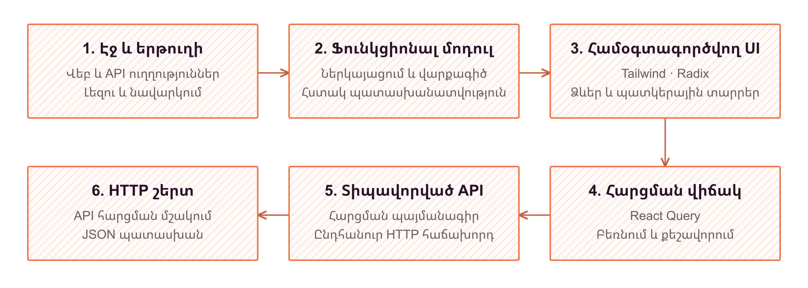

*Նկար 3.1 - FrontEnd-ի շերտեր*

## API շերտը և վիճակների կառավարումը

Վահանակի տվյալների հարցումները ուղղվում են հավելվածի նույն ծագման API-ին։ HTTP հաղորդակցությունը կազմակերպված է միասնական հաճախորդով՝ `ky` գրադարանի հիման վրա։ Այդ շերտը կենտրոնացնում է հարցումների հասցեի կազմավորումը, աշխատաշրջանի cookie-ների փոխանցումը և սխալների մշակումը։ Այս կերպ յուրաքանչյուր էջ չի կրկնում ցանցային հաղորդակցության նույն կանոնները, իսկ սերվերի հաղորդագրությունը հասնում է այն բաղադրիչին, որը պետք է ներկայացնի գործողության արդյունքը։

Առանձնացված են տվյալների պայմանագիրը և հարցման վիճակի կառավարումը։ Առաջինը սահմանում է հարցման պարամետրերը, ուղարկվող արժեքներն ու պատասխանի տիպը։ Երկրորդը React Query-ի միջոցով կառավարում է բեռնումը, քեշավորումը, սխալները և փոփոխությունից հետո տվյալների թարմացումը։ Անհրաժեշտության դեպքում ընթացիկ հարցումը կարող է չեղարկվել, օրինակ՝ դրա արդյունքն այլևս տվյալ դիտմանը չվերաբերելու դեպքում։

Քեշը տարանջատվում է ըստ նախագծի, ժամանակահատվածի և հարցման մյուս նշանակալի պայմանների։ Նույն տեսակի տվյալների տարբեր նախագծային արդյունքները չեն դիտարկվում որպես մեկ ընդհանուր արժեք։ Իրադարձությունների երկար ցանկը նույնպես չի բեռնվում ամբողջությամբ․ հաջորդ հատվածը ստացվում է էջավորման միջոցով և ավելացվում արդեն ցուցադրված գրառումներին։ Այս մոտեցումը համադրում է տվյալների վերօգտագործումն ու պահանջվող արդյունքի աստիճանական բեռնումը։

Սերվերային և տեղային վիճակները տարբեր պատասխանատվություններ ունեն։ React Query-ն պահում է սերվերի տվյալների արտապատկերումը, իսկ Zustand-ը՝ բաժինների միջև ընդհանուր ընտրությունները, օրինակ՝ ընթացիկ նախագիծը։ Խմբագրիչի դեռ չպահպանված արժեքները մնում են դրա տեղային վիճակում։ Այդպես սերվերի հաստատած տվյալները, նավարկման համատեքստը և օգտատիրոջ ժամանակավոր սևագիրը չեն խառնվում մեկ պահոցում։

## Dashboard-ի նավարկումը և նախագծի համատեքստը

Dashboard-ն ունի միասնական շրջանակ՝ կողային վահանակով, վերին նավարկմամբ և էջի բովանդակության տարածքով։ Կողային վահանակը ներառում է ընդհանուր դիտարկման, սխեմաների և իրադարձությունների հիմնական ուղղությունները, ինչպես նաև ընտրված նախագծի պահպանված վերլուծական մոդուլները։ Վերին հատվածի նավարկման շղթան արտացոլում է ընթացիկ երթուղին և մոդուլի նույնացուցիչի փոխարեն կարող է ցուցադրել դրա անունը։

Նախագծի ընտրությունն ընդհանուր համատեքստ է բոլոր հիմնական բաժինների համար։ Zustand-ի պահպանվող վիճակում հիշվում է վերջին ընտրված նախագծի նույնացուցիչը, սակայն այն համադրվում է օգտատիրոջ հասանելի նախագծերի ցանկի հետ։ Եթե ընտրությունն այլևս վավեր չէ, սահմանվում է հասանելի նախագիծ կամ դատարկ համատեքստ։

Թույլտվությունների հարցումները նույնպես կապված են նախագծի հետ։ Նախագծերի միջև անցման ընթացքում նախորդ պատասխանի ժամանակավոր օգտագործումը չի փոխանցում նախորդ նախագծի լիազորությունները նոր միջավայրին։ Միջերեսի հասանելիության ստուգումները որոշում են կառավարման տարրերի ցուցադրումը, սակայն չեն փոխարինում սերվերային ստուգումներին և RLS-ին։

## Ձևերը և խմբագրիչների կառուցվածքը

Մուտքի և գրանցման ձևերում React Hook Form-ը կառավարում է արժեքներն ու դաշտային սխալները, իսկ Zod-ը նկարագրում է վավերացման պայմանները։ Այս երկու պատասխանատվությունների համադրումը թույլ է տալիս ձևի վարքագիծը տարանջատել դրա ցուցադրումից։ Օրինակ՝ էլեկտրոնային հասցեի կառուցվածքի և գաղտնաբառի պահանջների հաղորդագրությունները ստացվում են տեղայնացման շերտից։ Ընդհանուր ձևային բաղադրիչները կապում են դաշտերի պիտակները, արժեքները և սխալների ներկայացումը, որպեսզի տարբեր էջերում պահպանվի նույն փոխազդեցությունը։

Սխեմաների խմբագրիչը կառուցված է այլ սկզբունքով․ այն պահում է սերվերից ստացված սկզբնական ներկայացումն ու տեղային խմբագրվող պատճենը։ Ծառայությունը հաշվարկում է փոփոխությունների առկայությունը և կազմում դաշտերի խմբային պահպանման հարցումը։ Արդեն ստեղծված դաշտերի տեխնիկական բանալիների ու տիպերի անփոփոխելիությունը արտացոլվում է նաև խմբագրման տրամաբանության մեջ։ Առանձին տիպային բաղադրիչները ներկայացնում են թվային սահմանափակումները, enum արժեքները և զանգվածի տարրի տիպը։

Վերլուծական մոդուլի խմբագրիչը պահպանվող layout-ի ներկայացումն է։ Այն առանձնացնում է մոդուլի ընդհանուր հատկությունները և դրա բաղադրիչների կազմաձևերը։ Գծապատկերի մուտքերը կապվում են ընտրված սխեմայի դաշտերի հետ, իսկ ընտրելի դաշտերի շրջանակը որոշվում է մուտքի ակնկալվող տիպով։ Տեղային խմբագրվող պատճենը թույլ է տալիս փոփոխությունները նախ կազմավորել, ապա փոխանցել պահպանման շերտին։

## Ընդհանուր UI շերտը և գծապատկերները

Ընդհանուր UI շերտը տրամադրում է կոճակներ, մուտքագրման դաշտեր, քարտեր, աղյուսակներ, երկխոսության պատուհաններ և այլ կրկնօգտագործվող տարրեր։ Դրանց մի մասը հիմնված է Radix UI-ի վրա՝ վերօգտագործելով ֆոկուսի, ստեղնաշարային փոխազդեցության և բացվող տարրերի հիմնական վարքագիծը։ Ներկայացման տարբերակները ձևավորվում են Tailwind CSS-ով և ոճերի համադրման ընդհանուր կանոններով։ Այսպիսով, կոճակի կամ պատուհանի ընդհանուր փոփոխությունն անդրադառնում է այն օգտագործող տարբեր բաժինների վրա՝ առանց նույն լուծումն ամենուր կրկնելու։

Հարմարվողական կառուցվածքները սահմանվում են ընդհանուր բաղադրիչների և էջային դասավորությունների մակարդակում։ Օրինակ՝ սխեմայի խմբագրիչի բացման ուղղությունը կախված է էկրանի չափից, իսկ մոդուլի բաղադրիչների ցանցը կարող է օգտագործել ամբողջական կամ կես լայնությամբ տարածքներ։

Գծապատկերները կազմում են ներկայացման առանձին շերտ՝ կառուցված ECharts-ի և դրա React ինտեգրման հիման վրա։ Հասանելի են գծային, սյունակային, շրջանաձև, ցրման և այլ ներկայացումներ։ Գծապատկերը ստանում է պատրաստ տվյալներն ու կարգավորումները, բայց չի որոշում դրանց ստացման հարցումը։ Օրինակ՝ ընդհանուր դիտարկման գծային պատկերի համար իրադարձությունների վիճակագրությունն առանձին է ստացվում և հետո փոխանցվում ներկայացման բաղադրիչին։ Այդ բաժանումը թույլ է տալիս փոխել պատկերման ձևը՝ տվյալների աղբյուրի պատասխանատվությունը չտեղափոխելով գծապատկերի ներսը։

## Բազմալեզվությունը և տեսողական թեման

Տեղայնացումը կազմակերպված է `next-intl`-ով՝ հայերեն, ռուսերեն և անգլերեն տարբերակներով։ Անգլերենը հիմնական լեզուն է։ Մյուս լեզուների հաղորդագրությունները համադրվում են անգլերեն տարբերակի հետ, որպեսզի բացակայող թարգմանությունը չընդհատի համապատասխան գրության ցուցադրումը։ Նավարկումը հաշվի է առնում ընտրված լեզուն, իսկ լեզվի փոփոխությունը պահպանում է ընթացիկ էջի ուղղությունը։ Այս մոտեցմամբ թարգմանությունը մնում է առանձին պատասխանատվություն և չի կրկնօրինակում էջերի գործառութային տրամաբանությունը։

Լուսավոր, մուգ և համակարգային թեմաները կառավարվում են `next-themes`-ով։ Գույները, եզրագծերը, ստվերներն ու գծապատկերների գունաշարերը սահմանված են ընդհանուր CSS փոփոխականներով։ Tailwind-ի իմաստային դասերը հղվում են այդ փոփոխականներին, ուստի թեմայի փոփոխությունը չի պահանջում յուրաքանչյուր բաղադրիչի առանձին ոճավորում։

Այս կառուցվածքով FrontEnd-ը պահպանում է միասնական տեսողական լեզու՝ միաժամանակ տարանջատելով նավարկումը, գործառութային վարքագիծը, տվյալների հասանելիությունը և ներկայացումը։

---

# 4. BackEnd

## Սերվերային շերտի կազմակերպումը

Hotlog-ի սերվերային շերտն իրականացված է Next.js 16 App Router-ի route handler-ներով և գրված է TypeScript-ով։ Առանձին HTTP ծառայության փոխարեն կիրառությունը սահմանում է հարցումների մշակիչներ `src/app/(api)/api` ծառում։ `(api)` հատվածը կազմակերպչական խումբ է և չի ընդգրկվում URL-ում։ Յուրաքանչյուր `route.ts` արտահանում է համապատասխան HTTP մեթոդների գործառույթները՝ օգտագործելով `NextRequest` և `NextResponse`։

Այս շերտը կապում է օգտագործողի գործողությունները տվյալների բազայի գործառնությունների հետ։ Այն ընթերցում է հարցման պարամետրերը, ստուգում նույնականացումը, վավերացնում մուտքային կառուցվածքը և ձևավորում JSON պատասխան։ Պարզ ընթերցումներն ու փոփոխությունները կատարվում են Supabase հաճախորդի աղյուսակային հարցումներով, իսկ փոխկապակցված գործողությունները փոխանցվում են SQL RPC գործառույթներին։

Տվյալների բազայի ներկայացումն անհրաժեշտության դեպքում վերածվում է կիրառական DTO-ի։ Օրինակ՝ `display_name` և `created_at` սյունակները պատասխանում ներկայացվում են որպես `displayName` և `createdAt`։ Այս փոխակերպմամբ միջերեսը ստանում է իր համար հստակ պայմանագիր՝ առանց պահեստավորման բոլոր մանրամասները կրկնելու։


*Նկար 4.1 - հարցման ընթացք*

## Վերջնակետերը և նույնականացման համատեքստը

Backend-ը սպասարկում է երկու տարբեր մուտքային ուղի։ Կառավարման միջերեսը դիմում է նույն ծագման Next.js վերջնակետերին՝ փոխանցելով օգտատիրոջ սեսիայի cookie-ները։ Այս հարցումներում նույնականացման հիմքը Supabase Auth-ի օգտատերն է։ SDK-ի համար նախատեսված հարցումները, հակառակը, օգտագործում են նախագծի API բանալի՝ `Authorization: Bearer ...` վերնագրով և չեն պահանջում բրաուզերային մուտք։

Հիմնական վերջնակետերը խմբավորվում են հետևյալ կերպ։

| Վերջնակետ կամ խումբ | HTTP մեթոդներ | Նշանակություն |
|---|---|---|
| `/api/user/projects` | GET, POST, DELETE | Նախագծերի ցուցակ, ստեղծում և հեռացում |
| `/api/project/schemas`, `/api/project/schemas/[id]/fields` | GET, POST, PATCH | Սխեմաների և դաշտերի կառավարում |
| `/api/project/schemas/[id]/fields/batch` | POST | Դաշտերի խմբային փոփոխություններ |
| `/api/project/events` | GET, DELETE | Իրադարձությունների դիտում և հեռացում |
| `/api/project/events/stats` | GET | Օրական քանակների ստացում |
| `/api/project/layouts` | GET, POST, PATCH, DELETE | Դասավորությունների կառավարում |
| `/api/project/layouts/components` | POST | Բաղադրիչների խմբային պահպանում |
| `/api/project/api-keys` | GET, POST, PATCH, DELETE | Բանալիների դիտում, ստեղծում, փոխարինում և անվավերացում |
| `/api/sdk/schemas` | GET | API բանալիով գործող պայմանագրերի ընթերցում |
| `/api/events` | POST | API բանալիով իրադարձության գրանցում |

Այսպիսով՝ `POST /api/events`-ը SDK-ի գրանցման մուտքն է, իսկ `GET /api/project/events`-ը՝ կառավարման միջերեսի ընթերցման մուտքը։ Դրանք տարբեր վերջնակետեր են՝ նույնականացման տարբեր հիմքերով։ Անդամների, դերերի, թույլտվությունների և հրավերների մշակիչները լրացնում են կառավարման նույն կառուցվածքը։ Առանձին գործողություններ կան նաև հրավերն ընդունելու, նախագծից դուրս գալու և հաշիվը հեռացնելու համար։

`src/lib/supabase/server.ts`-ի `createClient()`-ը սերվերային հաճախորդը ստեղծում է ընթացիկ հարցման cookie-ներով։ Մշակիչները `supabase.auth.getUser()` կանչով ստուգում են օգտատիրոջը, իսկ բազային հարցումները պահպանում են նրա նույնականացման համատեքստը։ Այդ պատճառով PostgreSQL-ի `auth.uid()`-ը և Row Level Security կանոնները գործարկվում են տվյալ օգտատիրոջ համար։ Սեսիայի թարմացման շերտը համապատասխան cookie-ները փոխանցում է նաև պատասխանին։

API բանալիով գործառույթներում նախագիծը որոշվում է ստուգված բանալուց։ Բազայում պահպանվում են բանալու SHA-256 hash-ը, ցուցադրման նախածանցը և օգտագործման տվյալները, ոչ թե բաց գաղտնիքը։ Ամբողջական բանալին վերադարձվում է ստեղծման կամ փոխարինման ժամանակ, իսկ ցուցակագրման հարցումը վերադարձնում է միայն մետատվյալները։

## Մուտքային վավերացումը և պատասխանների ձևաչափը

Հաջող պատասխանները տվյալները սովորաբար տեղադրում են `data` դաշտում, իսկ վերահսկվող սխալները ներկայացվում են `{ error: { message } }` կառուցվածքով։ Ցուցակային պատասխանները կարող են ունենալ լրացուցիչ տեղեկություն. օրինակ՝ իրադարձությունների էջավորման համար վերադարձվում է `nextCursor`։

Վավերացումը կատարվում է մի քանի մակարդակով։ HTTP մշակիչը ստուգում է պարտադիր պարամետրերը, նույնացուցիչների ձևաչափը և գործողությանը համապատասխան մարմնի կառուցվածքը։ Օրինակ՝ բաղադրիչների պահպանման հարցման `layout_id`-ը պետք է լինի դրական անվտանգ ամբողջ թիվ, իսկ `creates`, `updates` և `deletes` դաշտերը՝ զանգվածներ։

Իրադարձության գրանցման մշակիչը պահանջում է `application/json` բովանդակություն և սահմանափակում է մարմինը 64 KiB-ով։ `readBoundedBody()`-ն ընթերցման ընթացքում հաշվում է բայթերը՝ չհենվելով միայն `Content-Length` վերնագրի վրա։ Սահմանը գերազանցելու դեպքում վերադարձվում է `413`, իսկ անհամապատասխան բովանդակության տեսակի դեպքում՝ `415`։

`schema-validator.ts`-ը ստուգում է իրադարձության արժեքը գործող դաշտերի նկարագրությամբ։ Այն տարբերակում է տող, թիվ, տրամաբանական արժեք, ամսաթիվ, զանգված, JSON օբյեկտ և enum, հաշվի է առնում պարտադիրությունը, թվային սահմանները և զանգվածի տարրերի տեսակը։ Դաշտային խախտումները վերադարձվում են `field_errors` զանգվածով՝ `field_key` և `reason` հատկություններով։

HTTP կարգավիճակը լրացնում է հաղորդագրության իմաստը։ Անվավեր մուտքը ներկայացվում է `400`, բացակայող կամ անվավեր նույնականացումը՝ `401`, մերժված թույլտվությունը՝ համապատասխան մշակիչներում `403`, իսկ չգտնված ռեսուրսը՝ `404`։ Բանալիների բախումների համար օգտագործվում է `409`, ստեղծման հաջողության համար՝ `201`։ RPC օգտագործող մշակիչները PostgreSQL-ի սխալի կոդերը փոխակերպում են համապատասխան HTTP կարգավիճակների։ Իրադարձության գրանցման անսպասելի բազային սխալի դեպքում վերադարձվում է ընդհանուր `500` հաղորդագրություն՝ առանց SQL մանրամասների բացահայտման։

## Սխեմաների և դաշտերի կենսաշրջանը

Backend-ը սխեմաները դիտարկում է որպես իրադարձությունների կայուն պայմանագրեր։ Սխեմայի `key`-ը նախագծի ներսում եզակի նույնացուցիչ է, մինչդեռ `display_name`-ը փոփոխելի ցուցադրական անվանում է։ HTTP պայմանագիրը թույլ չի տալիս փոխել սխեմայի բանալին, իսկ դաշտի համար անփոփոխ է պահում նաև `type`-ը։

Հեռացման փոխարեն կիրառվում է `active` և `archived` վիճակների անցումը։ Սովորական ընթերցումները վերադարձնում են գործող գրառումները, իսկ `include_archived=true` պարամետրը ներառում է նաև արխիվացվածները։ Դաշտն արխիվացնելիս նրա `required` հատկությունը դառնում է `false`։ Այս մոտեցումը պահպանում է պատմական իրադարձությունների հղումները՝ առանց արխիվացված դաշտը նոր իրադարձությունների համար պարտադիր դարձնելու։

Արխիվացված սխեմայի բանալին շարունակում է զբաղեցված մնալ։ Նույն բանալիով ստեղծման փորձի ժամանակ մշակիչը տարբերակում է գործող և արխիվացված սխեմայի բախումները՝ վերադարձնելով համապատասխան կառուցվածքային տեղեկություն։ Զուգահեռ ստեղծումների դեպքում եզակիության վերջնական երաշխիքը տվյալների բազայի սահմանափակումն է։

## SQL RPC-ների պատասխանատվությունը և ատոմականությունը

Փոխկապակցված փոփոխությունների ամբողջականությունը վստահվում է PostgreSQL գործառույթներին։ `create_project` RPC-ն մեկ գործարքով ստեղծում է նախագիծը, հիմնադրի անդամակցությունը, `Owner` դերը, դրա նշանակումը և թույլտվությունների կապերը։ Որևէ քայլի ձախողումը հետ է շրջում ամբողջ գործողությունը՝ բացառելով թերի սկզբնական կառուցվածքը։

Նույն սկզբունքն օգտագործվում է բաղադրիչների խմբային պահպանման համար։ Մշակիչից վերցված հետևյալ հատվածը ամբողջ փաթեթը փոխանցում է մեկ RPC-ի։

```typescript
const { data, error } = await supabase.rpc('batch_layout_components', {
  p_layout_id: layout_id,
  p_creates: creates,
  p_updates: updates,
  p_deletes: deletes,
})
```

`batch_layout_components`-ը փոփոխություններից առաջ ստուգում է փաթեթի կառուցվածքը, կրկնվող նույնացուցիչները, բաղադրիչների պատկանելությունը դասավորությանը և սխեմաների պատկանելությունը նույն նախագծին։ Համապատասխան տողերի կողպումը կարգավորում է զուգահեռ փոփոխությունների փոխազդեցությունը։ Ստեղծումը, խմբագրումը և հեռացումը կա՛մ հաստատվում են միասին, կա՛մ ամբողջությամբ հետ են շրջվում։ Այս գործառույթը և նախագծի ստեղծումը գործում են `SECURITY INVOKER` սկզբունքով՝ պահպանելով կանչողի RLS սահմանափակումները։

Իրադարձությունների դեպքում TypeScript վավերացումը չի փոխարինում բազայի ստուգմանը։ Գրման trigger-ը ստուգում է գործող սխեման, նախագծային պատկանելությունը և արժեքի համապատասխանությունը դաշտերին։ Խախտումը չեղարկում է գրանցումը, իսկ `ingest_event` RPC-ի շրջանակում՝ նաև բանալու օգտագործման ժամանակի փոփոխությունը։ Այսպիսով, ատոմականության հստակ սահմանը տվյալ բազային գործարքն է. մեկ HTTP մշակիչում մի քանի առանձին հարցումների առկայությունն ինքնին ընդհանուր գործարք չի ստեղծում։

---

# 5. Տվյալների բազայի նկարագրություն և կապեր

## Տվյալների մոդելի ընդհանուր կառուցվածքը

Hotlog-ի տվյալների պահպանման հիմքը PostgreSQL-ն է՝ Supabase Auth-ի նույնականացման և Row Level Security-ի՝ RLS-ի հետ համատեղ։ Կառուցվածքը ներառում է `public` սխեմայի 14 կիրառական աղյուսակ։ Դրանք նկարագրում են նախագծերը, անդամակցությունը և իրավունքները, իրադարձությունների պայմանագրերը, ստացված իրադարձությունները, API բանալիները և ցուցադրման դասավորությունները։ `auth.users`-ը գտնվում է այդ կիրառական մոդելի արտաքին նույնականացման սահմանում․ օգտատիրոջ ինքնությունը չի կրկնօրինակվում առանձին կիրառական աղյուսակում։

Մոդելի կենտրոնական միավորը `projects`-ն է։ Նախագծին անմիջապես պատկանում են դերերը, սխեմաները, իրադարձությունները, դասավորությունները, բանալիները և հրավերները, իսկ դաշտերն ու գծապատկերների բաղադրիչները կապվում են համապատասխան ծնողներով։ Միևնույն օգտատերը կարող է անդամակցել մի քանի նախագծի՝ յուրաքանչյուրում ունենալով տարբեր դերեր։ Միակ ընդհանուր տեղեկատուն `permissions`-ն է, որի գրառումները նախագծային դերերին վերագրվում են կապող աղյուսակով։


*Նկար 5.1 - տվյալների մոդել*

Ռելյացիոն և JSON ներկայացումները լրացնում են միմյանց։ Արտաքին բանալիները պահպանում են օբյեկտների կապերը, իսկ փոփոխական կառուցվածք ունեցող իրադարձությունները և կարգավորումները պահվում են JSON սյունակներում։ Այդ ընտրությունը թույլ է տալիս տարբեր իրադարձությունների համար չստեղծել առանձին SQL աղյուսակներ՝ միաժամանակ պահպանելով դաշտերի բացահայտ նկարագրությունն ու գրառման պահին ստուգումը։ Կարևոր տարբերակում է, որ `events.value`, `fields.metadata` և `components.inputs_ids` սյունակների տեսակը `json` է, ոչ թե ինքնաբերաբար `jsonb`։ Որոշ ֆունկցիաներ ընդունում կամ վերադարձնում են `jsonb`՝ կատարելով անհրաժեշտ փոխակերպումները։

Ստորև `?` նշանը նշանակում է, որ սյունակը թույլատրում է `NULL`, իսկ չնշված կիրառական սյունակները `NOT NULL` են։ UUID տեսակի կիրառական `id`-ներն ունեն `gen_random_uuid()` լռելյայն արժեք, իսկ `bigint` հիմնական բանալիները՝ identity գեներացում։ Բոլոր կիրառական `created_at` սյունակները `timestamptz` են՝ `now()` լռելյայն արժեքով։ PK-ն հիմնական, FK-ն՝ արտաքին բանալին է։

## Նախագծեր, անդամակցություն և իրավունքներ

### `auth.users` - նույնականացման արտաքին սահման

Hotlog-ի համար առանցքային նույնացուցիչը `id uuid` հիմնական բանալին է, իսկ անդամների էլեկտրոնային հասցեն SQL ֆունկցիաները ներկայացնում են `email text` վերադարձվող արժեքով։ Աղյուսակը կառավարվում է Supabase Auth-ի կողմից․ այստեղ նկարագրվում է միայն կիրառության օգտագործած սահմանը, ոչ թե Auth-ի ներքին ամբողջ կառուցվածքը։ Մեկ ինքնությունը կարող է կապված լինել բազմաթիվ նախագծերի, անդամակցությունների, դերային նշանակումների և ուղարկված հրավերների հետ։

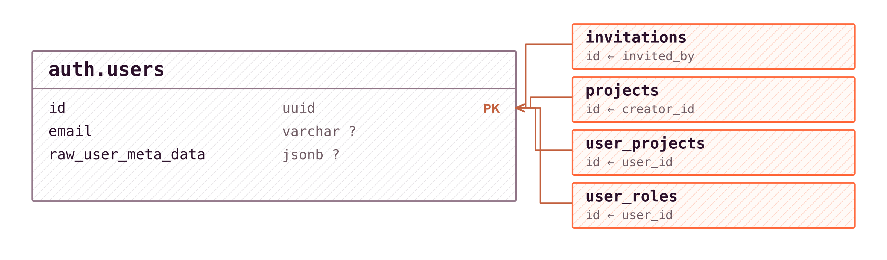

*Նկար 5.2 - օգտատերերի ինքնություն*

### `projects` - նախագծային պատկանելության հիմք

**Սյունակներ․** `id uuid`, `creator_id uuid`, `name text`, `created_at timestamptz`։

PK-ն `id`-ն է, իսկ `creator_id`-ն FK է դեպի `auth.users.id`՝ մեկ ստեղծողից բազմաթիվ նախագծեր կապով։ `name`-ի լռելյայն արժեքը դատարկ տողն է, սակայն նախագիծ ստեղծող RPC-ն պահանջում է ոչ դատարկ անուն։ Ստեղծողի արտաքին բանալու վերջնական ջնջման վարքը `RESTRICT` է․ սեփական նախագծերի առկայությամբ ինքնության ջնջումը չի կարող դրանք շղթայական ջնջել։

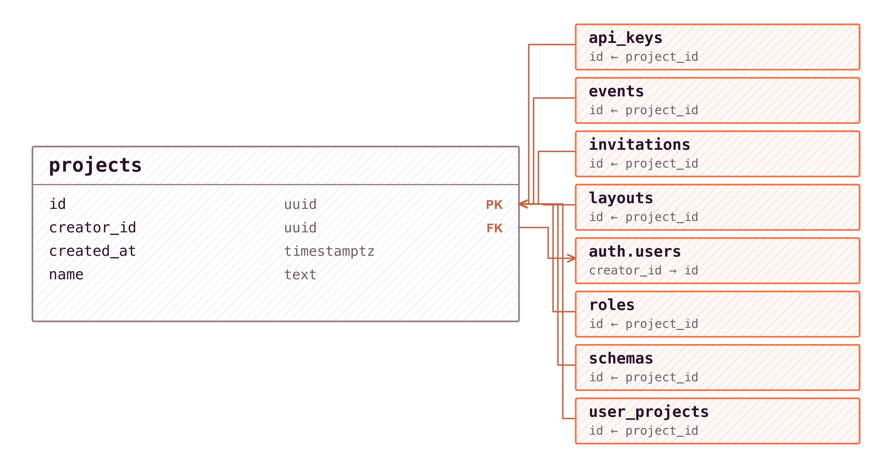

*Նկար 5.3 - նախագծեր*

### `user_projects` - նախագծի անդամակցություն

**Սյունակներ․** `id uuid`, `user_id uuid`, `project_id uuid`։

PK-ն `id`-ն է, իսկ երկու FK-ները հղվում են `auth.users.id`-ին և `projects.id`-ին՝ օգտատերերի ու նախագծերի միջև ձևավորելով M:N կապ։ `(user_id, project_id)` զույգի համար կա որոնման ինդեքս, բայց չկա `UNIQUE` սահմանափակում։ Անդամակցությունն ինքնուրույն պայման է․ միայն դերային գրառման առկայությունը բավարար չէ նախագծի իրավունքներ ստանալու համար։

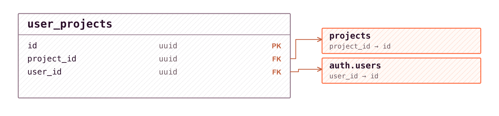

*Նկար 5.4 - նախագծի անդամակցություններ*

### `roles` - նախագծային դերեր

**Սյունակներ․** `id uuid`, `project_id uuid`, `name text`, `created_at timestamptz`։

PK-ն `id`-ն է, `project_id`-ն՝ FK դեպի `projects.id`, ուստի նախագիծը կարող է սահմանել բազմաթիվ դերեր։ Դերի անունը ներկայացման հատկություն է, իսկ դրա լիազորությունները որոշվում են `role_permissions`-ով։ Դերի անվան նախագծային եզակիություն սահմանված չէ։

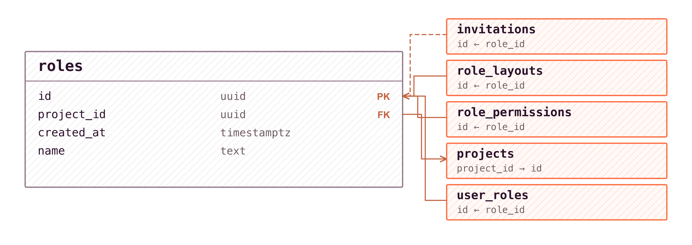

*Նկար 5.5 - դերեր*

### `user_roles` - դերերի նշանակում օգտատերերին

**Սյունակներ․** `id uuid`, `user_id uuid`, `role_id uuid`։

Հիմնական բանալին բաղադրյալ է՝ `(id, user_id, role_id)`, իսկ FK-ները հղվում են `auth.users.id`-ին և `roles.id`-ին։ Սա օգտատերերի և դերերի M:N կապն է, սակայն `(user_id, role_id)` զույգն առանձին եզակի չէ։ Նշանակման trigger-ը պահանջում է անդամակցություն հենց դերի նախագծին, իսկ գործող իրավունքները հաշվարկվում են այդ անդամակցության պահպանման պայմանով։

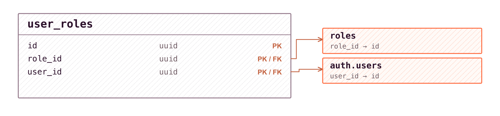

*Նկար 5.6 - օգտատերերի դերեր*

### `permissions` - գործողությունների տեղեկատու

**Սյունակներ․** `id uuid`, `subject text`, `action text`։

PK-ն `id`-ն է, իսկ `(action, subject)` զույգն ունի `UNIQUE` սահմանափակում։ Աղյուսակը նախագծային FK չունի և ընդհանուր տեղեկատու է դերերի համար։ `subject = 'all'` արժեքը իրավունքի ստուգման ժամանակ ընդգրկում է բոլոր առարկաները, բայց չի փոխարինում գործողության ճշգրիտ համապատասխանեցումը։

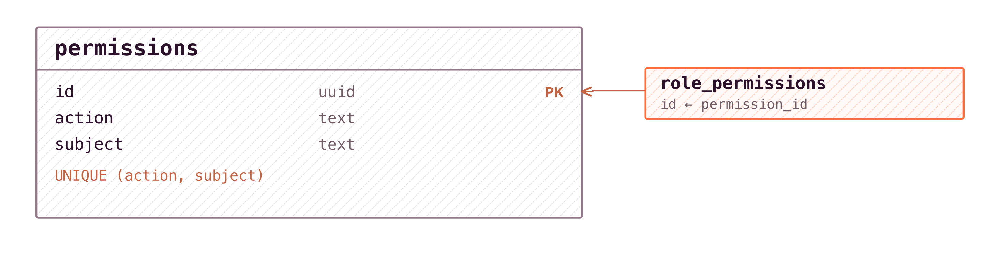

*Նկար 5.7 - թույլտվություններ*

### `role_permissions` - դերերի լիազորություններ

**Սյունակներ․** `id uuid`, `role_id uuid`, `permission_id uuid`։

PK-ն `(id, role_id, permission_id)` եռյակն է, իսկ FK-ները՝ դեպի `roles.id` և `permissions.id`։ Աղյուսակը ձևավորում է դերերի ու իրավունքների M:N կապը, որի միջոցով միևնույն իրավունքը հասանելի է տարբեր նախագծերի դերերին։ `(role_id, permission_id)` զույգի առանձին եզակիություն չկա։

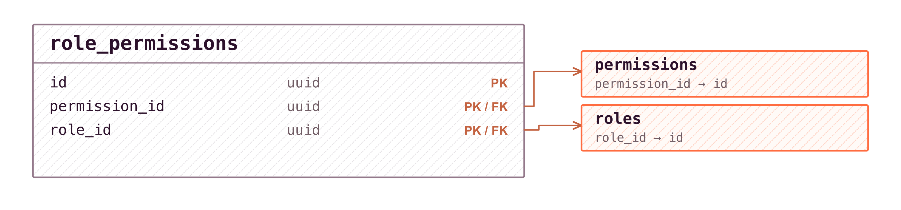

*Նկար 5.8 - դերերի թույլտվություններ*

### `invitations` - նախագծին միանալու հրավերներ

**Սյունակներ․** `id uuid`, `project_id uuid`, `email text`, `role_id uuid?`, `invited_by uuid`, `token uuid`, `status text`, `created_at timestamptz`, `expires_at timestamptz`։

PK-ն `id`-ն է, իսկ FK-ները հղվում են նախագծին, ընտրովի դերին և հրավիրող `auth.users` ինքնությանը՝ յուրաքանչյուր ծնողից բազմաթիվ հրավերներ կապով։ `token`-ը եզակի UUID է, `status`-ը `CHECK`-ով սահմանափակված է `pending`, `accepted`, `revoked` արժեքներով, իսկ լռելյայն ժամկետը յոթ օր է։ Մասնակի եզակի ինդեքսը թույլ է տալիս միայն մեկ `pending` հրավեր նույն `(project_id, email)` զույգի համար․ ժամկետի ավարտն ինքնին կարգավիճակ չի փոխում, իսկ դերի ջնջումը `role_id`-ն դարձնում է `NULL`։

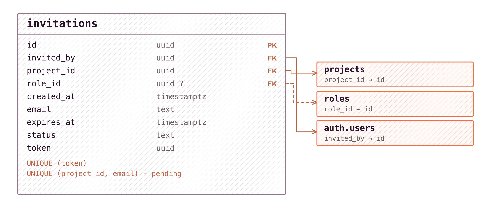

*Նկար 5.9 - հրավերներ*

## Պայմանագրեր, իրադարձություններ և API բանալիներ

### `schemas` - իրադարձությունների սխեմաներ

**Սյունակներ․** `id uuid`, `project_id uuid`, `name text`, `created_at timestamptz`, `key text`, `display_name text`, `status schema_status`։

PK-ն `id`-ն է, իսկ `project_id` FK-ն կազմում է նախագիծ–սխեմաներ 1:N կապ։ `(project_id, key)` զույգը եզակի է, իսկ `status`-ի արժեքները `active` և `archived` են՝ `active` լռելյայն արժեքով։ `key`-ն մեքենայական պայմանագրի անունն է, մինչդեռ խմբագրվող `display_name`-ը և պահպանվող `name`-ը ծառայում են անվան ներկայացմանը։

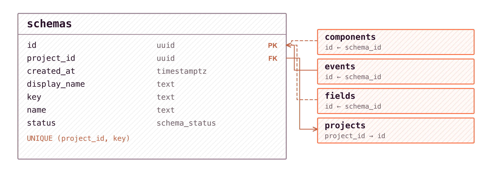

*Նկար 5.10 - իրադարձությունների սխեմաներ*

### `fields` - սխեմայի դաշտեր

**Սյունակներ․** `id uuid`, `schema_id uuid?`, `name text`, `metadata json`, `created_at timestamptz`, `type "FieldTypes"`, `key text`, `display_name text`, `status field_status`, `required boolean`։

PK-ն `id`-ն է, FK-ն՝ դեպի `schemas.id`, իսկ `(schema_id, key)` զույգն ունի `UNIQUE` սահմանափակում՝ nullable `schema_id`-ի PostgreSQL իմաստաբանությամբ։ `FieldTypes`-ի արժեքներն են `STRING`, `NUMBER`, `BOOLEAN`, `DATETIME`, `ARRAY`, `JSON`, `ENUM`, իսկ `field_status`-ինը՝ `active`, `archived`։ `metadata`-ի լռելյայն արժեքը `{}` է, `required`-ինը՝ `false`, կարգավիճակինը՝ `active`, և մեկ սխեման կարող է ունենալ բազմաթիվ դաշտեր։

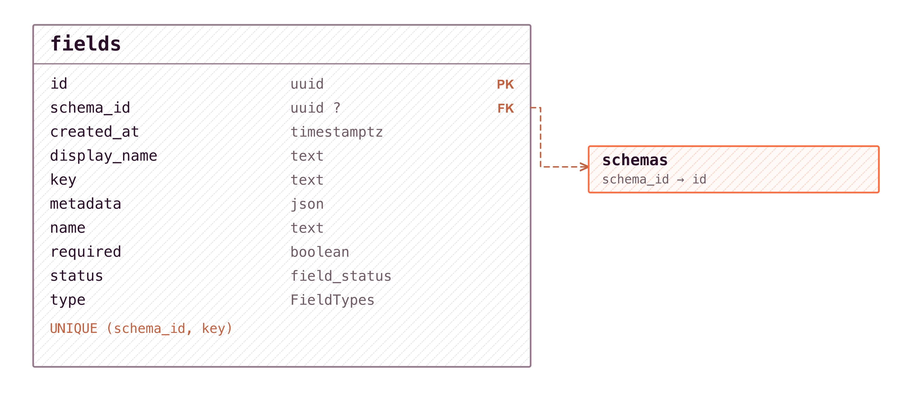

*Նկար 5.11 - սխեմայի դաշտեր*

### `events` - կառուցվածքային իրադարձություններ

**Սյունակներ․** `id bigint`, `created_at timestamptz`, `project_id uuid`, `schema_id uuid`, `value json`։

PK-ն `id`-ն է, իսկ նախագծի և սխեմայի FK-ները սահմանում են երկու 1:N կապ։ `value`-ը պահպանում է դաշտերի `key`-երով անվանված JSON օբյեկտը, և գրառման trigger-ը ստուգում է դրա համապատասխանությունը ակտիվ պայմանագրին։ Նախագծի ու սխեմայի առանձին FK-ներից բացի ստուգվում է նաև դրանց համատեղ պատկանելությունը։

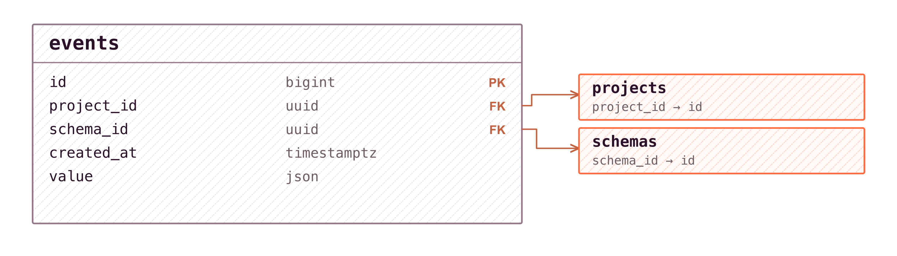

*Նկար 5.12 - իրադարձություններ*

### `api_keys` - նախագծային հասանելիության բանալիներ

**Սյունակներ․** `id bigint`, `project_id uuid`, `key_hash text`, `key_prefix text`, `last_used_at timestamptz?`, `revoked_at timestamptz?`։

PK-ն `id`-ն է, `project_id`-ն՝ FK դեպի նախագիծ, իսկ `key_hash`-ն ունի եզակի ինդեքս և 64 նիշանոց փոքրատառ hexadecimal ձևաչափի `CHECK`։ `key_prefix`-ը սահմանափակված է ութ hexadecimal նիշով․ աղյուսակը չունի ոչ plaintext `key`, ոչ էլ `created_at` սյունակ։ Ստեղծման ֆունկցիան գաղտնիքը վերադարձնում է միայն իր արդյունքով, իսկ պահպանում է SHA-256 հեշը, նախածանցը և օգտագործման կամ անվավերացման ժամանակները։

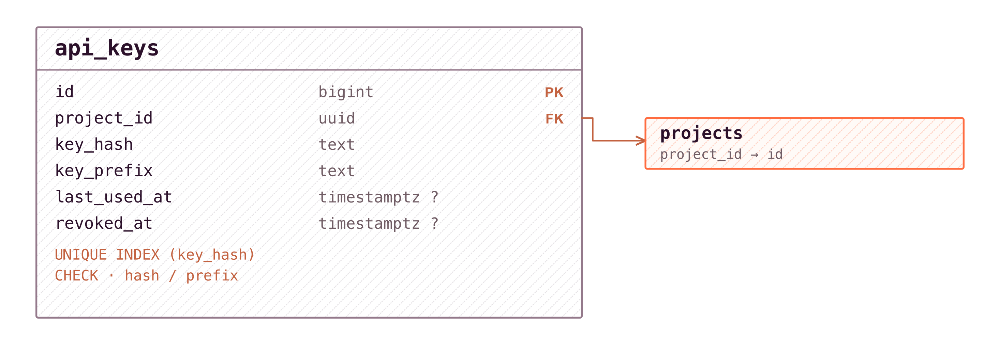

*Նկար 5.13 - API բանալիներ*

## Դասավորություններ և գծապատկերների կապեր

### `layouts` - ցուցադրման դասավորություններ

**Սյունակներ․** `id bigint`, `created_at timestamptz`, `project_id uuid`, `name text`, `description text`, `color text`։

PK-ն `id`-ն է, իսկ `project_id` FK-ն թույլ է տալիս մեկ նախագծում ունենալ մի քանի դասավորություն։ Նկարագրության լռելյայն արժեքը `No description` է, գույնինը՝ `#3b82f6`։ Դասավորության կառուցվածքային բովանդակությունը պահվում է ոչ թե այս տողի JSON-ում, այլ առանձին `components` գրառումներում։

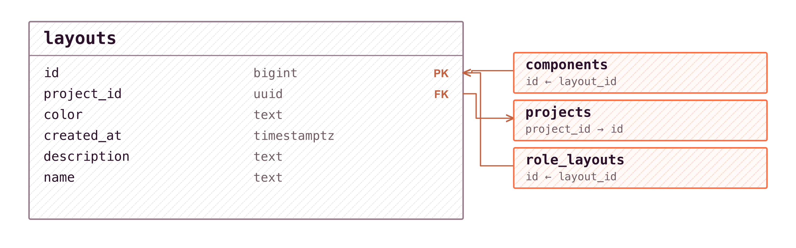

*Նկար 5.14 - դասավորություններ*

### `components` - գծապատկերների բաղադրիչներ

**Սյունակներ․** `id uuid`, `layout_id bigint`, `name text`, `description text`, `type "ComponentTypes"`, `index smallint`, `inputs_ids json`, `created_at timestamptz`, `visualization text`, `schema_id uuid?`, `span text`։

PK-ն `id`-ն է, իսկ FK-ները հղվում են դասավորությանը և ընտրովի սխեմային՝ երկուսի համար էլ 1:N կապով։ `type`-ի միակ enum արժեքը և լռելյայնը `TIME_SERIES` են, իսկ փաստացի ներկայացումը նկարագրվում է `visualization`-ով՝ `line` լռելյայն արժեքով, և լայնությունը՝ `span`-ով՝ `full` լռելյայն արժեքով։ `index`-ը կարգի `smallint` արժեք է՝ առանց դասավորության ներսում եզակիության սահմանափակման, իսկ `inputs_ids`-ի դաշտային կապերը JSON են, ոչ թե առանձին FK-ներ․ սխեմայի ջնջումը միայն զրոյացնում է `schema_id` հղումը։

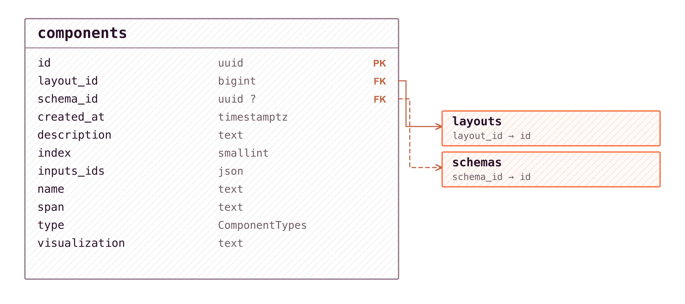

*Նկար 5.15 - դասավորության բաղադրիչներ*

### `role_layouts` - դերային թույլատրելիության ցուցակ

**Սյունակներ․** `id uuid`, `role_id uuid`, `layout_id bigint`։

PK-ն `id`-ն է, FK-ները՝ դեպի `roles.id` և `layouts.id`, իսկ `(role_id, layout_id)` զույգը եզակի է։ Այս M:N կապը գործում է որպես whitelist․ կապերի բացակայությամբ դասավորությունը տեսանելի է նախագծի բոլոր անդամներին, առկայությամբ՝ համապատասխան դեր ունեցողներին։ Նախագծի ստեղծողը և `read:layouts` իրավունք ունեցող անդամները բացառություն են, իսկ ցուցակի փոփոխությունը պահանջում է `update:layouts` իրավունք։

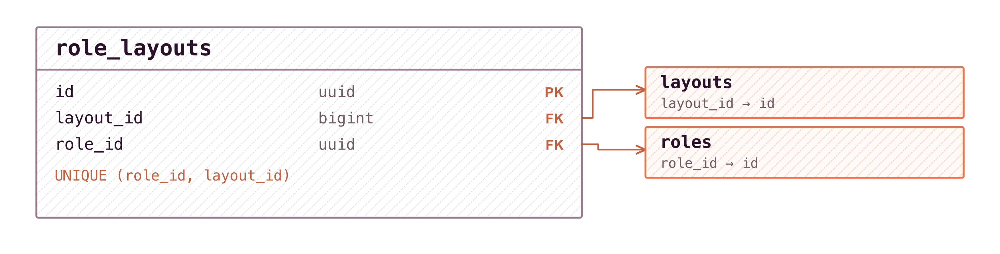

*Նկար 5.16 - դերային տեսանելիություն*

## Պայմանագրի կայունություն և կապերի ամբողջականություն

Սխեմայի `key`-ի և դաշտի `key`/`type` զույգի անփոփոխությունը կիրառական API-ի կանոն է․ խմբագրման ուղիները չեն թույլատրում դրանք փոխել։ Տվյալների բազայի եզակի սահմանափակումները կանխում են նույն ծնողի ներսում կրկնվող բանալիները, բայց ինքնին չեն նշանակում անփոփոխություն։ Նույն կերպ բանալիների ձևաչափի ստուգումը կատարվում է API-ում, ոչ թե առանձին SQL immutability trigger-ով։ Այս շերտերի տարբերակումը կարևոր է՝ պայմանագրի նշանակությունը չնույնացնելու համար միայն սյունակի SQL տեսակի հետ։

Արխիվացումը պահպանում է նույնացուցիչներն ու պատմական հղումները։ Արխիվացված սխեման չի ընդունում նոր իրադարձություններ, իսկ արխիվացված դաշտերը չեն մասնակցում ակտիվ դաշտերի ստուգմանը։ API-ն դաշտն արխիվացնելիս նաև սահմանում է `required = false`։ Հին իրադարձությունների արժեքները չեն վերագրվում և պայմանագրի փոփոխության պատճառով ինքնաբերաբար կրկին չեն ստուգվում։

`metadata`-ն նկարագրում է թվային միջակայքը, թվարկման թույլատրելի արժեքները, զանգվածի տարրերի տեսակը և բացատրությունը։ Հետևյալը նախագծային պայմանագրի ընթերցման պատկերավոր, պարամետրացված հարցում է, ոչ թե պահպանված ֆունկցիայի բառացի արտագրություն․

```sql
SELECT f.key, f.type, f.required, f.metadata
FROM public.fields AS f
JOIN public.schemas AS s ON s.id = f.schema_id
WHERE s.project_id = $1::uuid
  AND s.key = $2::text
  AND s.status = 'active'
  AND f.status = 'active';
```

Արտաքին բանալին հաստատում է ծնողի գոյությունը, բայց ոչ բոլոր իմաստային պայմանները։ Օրինակ՝ իրադարձության նախագծի և սխեմայի համընկնումը հաստատում է `validate_event_write`-ը, իսկ բաղադրիչների խմբային պահպանման ֆունկցիան ստուգում է ընտրված սխեմայի պատկանելությունը դասավորության նախագծին։ `role_layouts`-ի կամ հրավերի դեր–նախագիծ համընկնումը առանձին բաղադրյալ FK-ով ամրագրված չէ․ դրանց հղումներն ու նախագծային թույլտվությունները չպետք է ներկայացնել որպես նույն երաշխիքը։

Կիրառական արտաքին բանալիների ջնջման հիմնական վարքը `CASCADE` է։ Բացառություններն են `projects.creator_id`-ի `RESTRICT`-ը և `components.schema_id` ու `invitations.role_id` հղումների `SET NULL`-ը։ Այսպիսով, արխիվացումը տարբերվում է ֆիզիկական ջնջումից․ առաջինը պահպանում է կառուցվածքը, երկրորդը գործարկում է հայտարարված կապերի մաքրման կանոնները։

## Պահպանվող ֆունկցիաներ և trigger-ներ

Տվյալների բազայի վարքը ներառում է 30 կիրառական պահպանվող ֆունկցիա, որոնցից երեքը trigger ֆունկցիաներ են։ Դրանք բաժանվում են հասանելիության ստուգման, ամբողջական գործողությունների, SDK սպասարկման և արժեքների վավերացման խմբերի։ Ստորև ներառված են նաև ներքին օգնականները, ոչ միայն TypeScript RPC նկարագրություններում երևացող անունները։

### Հասանելիության և պատկանելության օգնականներ

Այս խմբի `SECURITY DEFINER` ֆունկցիաները թույլ են տալիս RLS կանոններին ստանալ անհրաժեշտ պատկանելության տեղեկությունը՝ առանց փոխադարձ քաղաքականությունների անվերջ կրկնության։ `has_permission`-ը պահանջում է գործող անդամակցություն, գործողության ճշգրիտ համապատասխանություն և ընտրված առարկա կամ `all`։

| Ֆունկցիա և արդյունք | Նպատակ |
|---|---|
| `is_project_member(uuid) → boolean` | Ստուգում է ընթացիկ օգտատիրոջ անդամակցությունը։ |
| `is_project_creator(uuid) → boolean` | Ստուգում է նախագծի ստեղծող լինելը։ |
| `has_permission(uuid, text, text) → boolean` | Հաշվում է նախագծային դերերից բխող իրավունքը։ |
| `get_project_id_for_schema(uuid) → uuid` | Գտնում է սխեմայի նախագիծը՝ դաշտերի RLS-ի համար։ |
| `get_project_id_for_layout(bigint) → uuid` | Գտնում է բաղադրիչի ծնող դասավորության նախագիծը։ |
| `get_project_id_for_layout_unchecked(bigint) → uuid` | Նույն պատկանելության ստացումը տարանջատում է `role_layouts`-ի RLS ցիկլից։ |
| `get_project_id_for_invitation(uuid) → uuid` | Վերադարձնում է հրավերի նախագիծը։ |
| `get_project_member_emails(uuid) → table(user_id uuid, email text)` | Միայն նախագծի անդամի համար վերադարձնում է անդամների հասցեները։ |

### Նախագծային, հաշվի և խմբային գործողություններ

Մի քանի փոխկապակցված փոփոխությունները ֆունկցիայի ներսում կազմում են մեկ գործարք։ `create_project`, `batch_layout_components`, `list_user_projects` և `prepare_account_deletion` ֆունկցիաներն աշխատում են կանչողի իրավունքներով՝ `SECURITY INVOKER`, իսկ ստորև նշված մյուսները կիրառում են `SECURITY DEFINER` և իրենց անհրաժեշտ ստուգումները։

| Ֆունկցիա և արդյունք | Նպատակ |
|---|---|
| `create_project(text) → setof projects` | Միասին ստեղծում է նախագիծը, ստեղծողի անդամակցությունը, `Owner` դերը, նշանակումը և տեղեկատուի իրավունքների կապերը։ |
| `update_user_role(uuid, uuid, uuid) → void` | Ստուգում է լիազորությունը, անդամակցությունը և դերի նախագիծը, ապա փոխարինում տվյալ նախագծի նշանակումները։ |
| `accept_invitation(uuid) → json` | Ստուգում է token-ը, ժամկետն ու հասցեի համապատասխանությունը, ավելացնում անդամակցությունն ու ընտրովի դերը և նշում ընդունումը։ |
| `batch_layout_components(bigint, jsonb, jsonb, jsonb) → setof components` | Ստուգում և միասին կատարում է բաղադրիչների ստեղծումները, փոփոխություններն ու ջնջումները։ |
| `lock_layout_for_component_batch(bigint, uuid[]) → void` | Ստուգում է խմբային գործողության հասանելիությունը և կողպում դասավորությունն ու ընտրված սխեմաները։ |
| `create_api_key(uuid, bigint) → table` | Ստեղծում է բանալի, իսկ ընտրովի փոխարինման դեպքում նույն գործարքում անվավերացնում է նախորդը։ |
| `revoke_api_key(bigint) → bigint` | Լիազորության ստուգումից հետո լրացնում է ակտիվ բանալու `revoked_at`-ը։ |
| `list_user_projects() → table` | Վերադարձնում է հասանելի նախագծերը՝ `can_delete` հաշվարկվող հատկությամբ։ |
| `leave_project(uuid) → uuid` | Ոչ ստեղծող անդամի համար հեռացնում է նախագծային դերերն ու անդամակցության գրառումները։ |
| `prepare_account_deletion() → uuid` | Ստուգում է ստեղծողի FK-ի անվտանգ վարքը և սեփական նախագծերի բացակայությունը, բայց ինքնությունը չի ջնջում։ |

`create_api_key`-ի վերադարձվող տողը պարունակում է `id`, `project_id`, `key_prefix`, `last_used_at`, `revoked_at` և մեկանգամյա `key` արժեքը։ Այդ արդյունքի վերջին դաշտը պահպանվող սյունակ չէ։ Բանալու ստեղծումն ու անվավերացումը համաձայնեցվում են նախագծի տողի կողպմամբ, մինչդեռ հրավերի ընդունումը հրավերի տողի բացահայտ `SELECT FOR UPDATE` կողպում չի կիրառում։

### Իրադարձությունների ընդունում, SDK և վիճակագրություն

SDK-ին սպասարկող երեք ֆունկցիաներն օգտագործում են ներկայացված API բանալու հեշը և մերժում անվավերացված բանալին։ Սխեմաների նկարագրությունը ստացվում է `/api/sdk/schemas` ճանապարհով և Python SDK-ում վերածվում է Pydantic դասերի։ Սա տարբեր մեխանիզմ է `database.types.ts`-ի TypeScript աղյուսակային տեսակներից․ առաջինը նկարագրում է նախագծի իրադարձությունների պայմանագրերը, երկրորդը՝ հավելվածի SQL կառուցվածքի ծրագրային ներկայացումը։

| Ֆունկցիա և արդյունք | Նպատակ |
|---|---|
| `ingest_event(text, text, jsonb) → table(id bigint, created_at timestamptz)` | Բանալիով ընտրում է նախագիծն ու ակտիվ սխեման, գրում իրադարձությունը և թարմացնում `last_used_at`-ը։ |
| `get_active_fields_for_ingest(text, text) → table` | Վերադարձնում է ակտիվ դաշտերի `key`, `type`, `required`, `metadata jsonb` նկարագրությունները։ |
| `get_project_schemas_for_sdk(text) → jsonb` | Վերադարձնում է նախագծի ակտիվ սխեմաներն ու դաշտերը և թարմացնում բանալու օգտագործման ժամանակը։ |
| `events_daily_counts(uuid, integer) → table(day date, count bigint)` | Կանչողի RLS-ի ներքո հաշվարկում է օրական քանակները՝ ներառելով նաև զրոյական օրերը։ |

### Արժեքների ստուգում և ավտոմատ գործարկվող պահապաններ

Վավերացումը պահանջում է օբյեկտային արմատ, ստուգում պարտադիր դաշտերը, պարզ տեսակները, թվային սահմանները, թվարկումները և զանգվածի տարրերը։ Թվերը մեկնաբանվում են JavaScript-ի binary64 մոտեցմանը համահունչ, իսկ ամսաթիվը՝ հատուկ ընդունման կանոնով, ոչ թե պարզապես PostgreSQL timestamp փոխակերպմամբ։ Անծանոթ լրացուցիչ բանալիներն այս DB ստուգիչը չի մերժում։

| Ֆունկցիա | Նպատակ և գործարկման կապ |
|---|---|
| `event_number_value(json) → double precision` | JSON թիվը փոխակերպում է binary64 ներկայացման՝ մշակելով աստիճանի սահմանային դեպքերը։ |
| `event_number_text(double precision) → text` | Ձևավորում է թվային սահմանների սխալներում օգտագործվող տեքստը։ |
| `event_datetime_valid(text) → boolean` | Ստուգում է ամսաթվային տողի ընդունվող ձևաչափն ու բաղադրիչները։ |
| `event_primitive_error(text, json, json) → text` | Վերադարձնում է առանձին արժեքի անհամապատասխանության պատճառը կամ `NULL`։ |
| `event_value_errors(json, json) → jsonb` | Հավաքում է ամբողջ իրադարձության դաշտային սխալները։ |
| `require_user_role_membership() → trigger` | `user_roles_require_membership`՝ դերային նշանակման `AFTER INSERT/UPDATE` անդամակցության պահապան։ |
| `lock_event_field_schema() → trigger` | `fields_lock_event_schema`՝ դաշտի ներդրման, ջնջման կամ պայմանագրային սյունակների փոփոխության դեպքում համակարգում է ծնող սխեմայի կողպումը։ |
| `validate_event_write() → trigger` | `events_validate_write`՝ յուրաքանչյուր `AFTER INSERT/UPDATE` ստուգում է ակտիվ սխեման, նախագիծը և արժեքը։ |

Վերջին trigger-ների սխալը հետ է դարձնում նույն գործարքի գրառումները։ `AFTER` տեղադրումը նաև ապահովում է, որ սովորական կանչողի RLS ստուգումն անցնի նախքան արտոնյալ ստուգիչը բացահայտի դաշտային մանրամասներ։ Այստեղ պայմանագրային պահապանները պաշտպանում են նոր իրադարձության համապատասխանությունը․ դրանք չեն փոխարինում API-ում իրականացվող բանալու և տեսակի անփոփոխության կանոններին։

## Ինդեքսներ և գործարքային համաձայնեցում

Բոլոր 14 կիրառական աղյուսակներում միացված է RLS։ Հավելվածի սերվերային Supabase հաճախորդը պահպանում է օգտատիրոջ session-ը, իսկ նախագծի ու դերերի ստուգումները կիրառվում են տվյալների հասանելիության պահին։ API բանալիով գործող SDK ֆունկցիաները առանձնացված մուտք են՝ իրենց նույնականացմամբ, բայց դրանց գրած իրադարձությունները նույնպես անցնում են տվյալների բազայի վավերացման trigger-ով։

Ինդեքսները համապատասխանում են անդամակցության, դերային միացումների, ակտիվ պայմանագրերի և իրադարձությունների ընթերցման ուղիներին։ Հատկապես նշանակալի են `events(project_id, schema_id, created_at DESC)`, `schemas(project_id, status)` և `fields(schema_id, status)` ինդեքսները։ Եզակի ինդեքսներն ունեն նաև ամբողջականության դեր՝ բանալու հեշի, պայմանագրային բանալիների և սպասող հրավերների կրկնությունները սահմանափակելով։

Կողպումները տեղային համաձայնեցման միջոց են․ դերերի փոխարինումը կողպում է համապատասխան անդամակցությունները, բաղադրիչների խմբային պահպանումը՝ դասավորությունը, իսկ դաշտերի փոփոխությունն ու իրադարձությունների ստուգումը համաձայնեցվում են ծնող սխեմայի միջոցով։ Դրանք պահպանում են փոխկապակցված գործողության ամբողջականությունը՝ առանց ամբողջ մոդելը մեկ ընդհանուր կողպման տակ դնելու։ Այսպիսով, տվյալների բազան ոչ միայն գրառումների պահոց է, այլև նախագծային սահմանների, կապերի և կառուցվածքային իրադարձությունների ստուգման միասնական հիմք։

---

# 6. FrontEnd և BackEnd փոխհամագործակցություն

Hotlog-ում միջերեսի և սերվերային մասի համագործակցությունը չի սահմանափակվում HTTP հարցումներով։ Այն հիմնվում է միասնական պայմանագրի վրա, որը սահմանում է տվյալների կառուցվածքը, թույլատրելի փոփոխությունները, հասանելիության կանոնները և պատասխանի ձևը։ Next.js 16 App Router-ով կառուցված հավելվածը, React 19 բաղադրիչները և Supabase/PostgreSQL շերտը համադրվում են SQL միգրացիաների, TypeScript տիպերի, API ձևափոխումների և cache-ի կառավարման միջոցով։

## Միգրացիաները՝ հավելվածի և բազայի պայմանագիր

`supabase/migrations` պանակի համարակալված SQL ֆայլերը նկարագրում են տվյալների բազայի կառուցվածքի հաջորդական զարգացումը։ Սկզբնական՝ baseline միգրացիան սահմանում է հիմնական աղյուսակները, կապերն ու տիպերը։ Հաջորդ միգրացիաները լրացնում կամ փոխարինում են այդ սահմանումները, ավելացնում կիրառական SQL ֆունկցիաներն ու հասանելիության քաղաքականությունները։ Ուստի վերջնական կառուցվածքը հասկանալու համար բավարար չէ միայն առաջին `CREATE TABLE` հրամանը․ պետք է հաշվի առնել նաև հետագա `ALTER TABLE`, `CREATE OR REPLACE FUNCTION` և քաղաքականությունների վերասահմանումները։

Հերթականությունը պայմանավորված է օբյեկտների կախվածություններով։ Նախ պետք է գոյություն ունենան աղյուսակներն ու դրանց սյունակները, ապա՝ այդ սյունակներն օգտագործող գործառույթներն ու սահմանափակումները։ Նույն սկզբունքը վերաբերում է իրավունքներին․ աղյուսակային արտոնությունները, RLS քաղաքականությունները և RPC-ի կատարման թույլտվությունները միասին են որոշում հասանելիությունը։ Այսպիսով, միգրացիան ոչ միայն նոր դաշտի նկարագրություն է, այլև հավելվածի վարքագծի փոփոխության տվյալահենք մասը։


*Նկար 6.1 - միգրացիաների շղթա*

## Պայմանագրի զարգացումը և համատեղելիությունը

Կառուցվածքային իրադարձությունների սխեմաների զարգացումը ցույց է տալիս այս մոտեցման նշանակությունը։ Սկզբնական `name` դաշտին հաջորդող փոփոխությունները `schemas` և `fields` աղյուսակներում ավելացնում են `key`, `display_name` և `status`, իսկ դաշտերի համար՝ նաև `required`։ Միգրացիան նախ լրացնում է առկա գրառումների նոր արժեքները, կարգավորում կրկնվող բանալիները, ապա սահմանում պարտադիր արժեքներն ու եզակիության սահմանափակումները։ Սխեմայի բանալին եզակի է նախագծի, դաշտի բանալին՝ սխեմայի շրջանակում։

Հավելվածում `key`-ը ծառայում է որպես կայուն տեխնիկական նույնացուցիչ, իսկ `display_name`-ը՝ խմբագրվող անվանում։ Սխեմայի թարմացման API-ն բացահայտ մերժում է `key`-ի փոփոխությունը։ `active` և `archived` վիճակները թույլ են տալիս կառավարել տեսանելիությունը՝ առանց գրառումն ու պատմական կապերը վերացնելու։ Միաժամանակ API-ն շարունակում է լրացնել նաև նախկին `name` սյունակը։ Սա համատեղելիության կոնկրետ օրինակ է․ միջերեսի նոր ներկայացումը չի անտեսում բազայի պահպանված պարտադիր դաշտը։

Նմանապես զարգանում է դասավորությունների կարգավորումը։ `layouts.color`, բաղադրիչների `visualization`, `schema_id` և `span` սյունակները պահպանում են միջերեսում ընտրված գույնը, գծապատկերի տեսակը, սխեմայի կապն ու լայնությունը։ `span`-ի նախնական արժեքը `full` է, իսկ միջերեսը տարբերակում է ամբողջական և կիսալայն ներկայացումները։ Նախկին `type` սյունակի համար սահմանված լռելյայն արժեքը թույլ է տալիս նոր հարցումներում այն չուղարկել։ Համատեղելիությունն այստեղ ապահովվում է SQL լռելյայն արժեքների և հավելվածի համապատասխան ձևափոխումների համադրությամբ։

API բանալիների պայմանագիրը ևս փոխվում է համաձայնեցված ձևով։ Վերջնական կառուցվածքում բաց բանալու սյունակը հեռացված է․ պահպանվում են SHA-256 ամփոփագիրը՝ `key_hash`, ճանաչելի նախածանցը և օգտագործման ու անվավերացման տվյալները։ Ստեղծման RPC-ն ամբողջական բանալին վերադարձնում է ստեղծման պահին, իսկ ցուցակագրման API-ն ընտրում է միայն մետատվյալները։ Հետևաբար բազայի փոփոխությանը համապատասխանում են և՛ սերվերային հարցումները, և՛ միջերեսում գաղտնիքի ժամանակավոր պահպանումը։

## Գեներացված տիպերի դերը և սահմանները

`database.types.ts`-ը տվյալների բազայի նկարագրությունից ստացվող TypeScript ներկայացումն է։ Այն պարունակում է աղյուսակների `Row`, `Insert`, `Update` կառուցվածքները, կապերը, enum-ները և SQL գործառույթների մուտքային ու ելքային տիպերը։ Նախագծում Supabase-ի տիպերի գեներացման համար նախատեսված է առանձին `supabase-types` գործողություն․ ֆայլը սովորական build-ի ընթացքում ինքնաբերաբար չի վերագեներացվում։ Կառուցվածքի աղբյուրը միգրացիաներն են, իսկ գեներացված ֆայլը՝ դրանցով ձևավորված բազայի արտապատկերումը, ոչ թե սահմանափակումների փոխարինողը։

Օրինակ՝ գոյություն ունեցող տիպից կարելի է առանձնացնել բաղադրիչի տողն ու խմբային պահպանման մուտքը․

```typescript
import type { Database } from './database.types'

type ComponentRow = Database['public']['Tables']['components']['Row']
type ComponentBatchArgs =
  Database['public']['Functions']['batch_layout_components']['Args']
```

Սա տիպերի կիրառման օրինակ է, ոչ հավելվածից բառացի արտածում։ Տիպավորումը օգնում է մշակման ժամանակ, սակայն չի ստուգում ստացված JSON-ի արժեքները կամ օգտատիրոջ իրավունքները։ Python SDK-ի գեներացումն առանձին մեխանիզմ է․ այն նախագծի API բանալիով ստանում է `/api/sdk/schemas` պատասխանը և ակտիվ իրադարձությունների սխեմաներից ստեղծում Pydantic դասեր։ Դրանք նկարագրում են ուղարկվող իրադարձությունները, ոչ PostgreSQL աղյուսակները։ SDK-ն այդ դասերի օբյեկտները կամ `send_raw`-ի արժեքներն ուղարկում է `POST /api/events` հասցեով։

## Հարցման անցումը շերտերով

Դասավորության խմբագրումը ներկայացնում է ամբողջ շղթան։ `ModulesComponent`-ը օգտվում է `useModulesService`-ից, ծառայությունը՝ React Query hook-երից, իսկ դրանք՝ տիպավորված API գործառույթներից։ `ky`-ով կազմաձևված ընդհանուր հաճախորդը JSON հարցումն ուղարկում է հավելվածի նույն ծագման Next.js route handler-ին՝ ներառելով cookie-ները։ Այս բաժանումը բաղադրիչը ազատում է URL-ների, HTTP սխալների և տվյալների բազայի սյունակների անմիջական կառավարումից։

Handler-ը ստուգում է հարցման մարմինը և `supabase.auth.getUser()`-ով նույնականացնում օգտատիրոջը։ `supabase/server.ts`-ի հաճախորդը ստեղծվում է `createServerClient<Database>`-ով և հարցման cookie-ներով, հետևաբար բազային դիմումը պահպանում է օգտատիրոջ սեսիան։ SQL գործողության հասանելիությունը որոշում են համապատասխան արտոնությունները և RLS-ը։ Ավելի ուշ միգրացիաներով `has_permission`-ը հաշվի է առնում ոչ միայն դերը, այլև նախագծին անդամակցությունը, իսկ իրադարձության գրառման trigger-ը ստուգում է սխեմայի պատկանելությունը, ակտիվությունն ու արժեքների համապատասխանությունը։

Բաղադրիչների ստեղծումը, փոփոխումն ու հեռացումը միավորվում են `batch_layout_components` RPC-ում։ Այն ստուգում է ամբողջ խմբաքանակը, արգելափակում համապատասխան դասավորության տողը և փոփոխություններն իրականացնում մեկ գործարքով․ սխալը հետ է շրջում այդ խմբաքանակը։ Նույն սկզբունքով `create_project` RPC-ն միասին ստեղծում է նախագիծը, անդամակցությունը և սկզբնական դերը։ Դասավորության ընդհանուր մետատվյալների առանձին հարցումը, սակայն, բաղադրիչների գործարքի մաս չէ։

Պատասխանի ճանապարհին handler-ը բազայի տողերը վերածում է միջերեսի DTO-ների․ օրինակ՝ `schema_id`-ը դառնում է `schemaId`, `created_at`-ը՝ `createdAt`, `name`-ը՝ `title`, իսկ `inputs_ids`-ը՝ `bindings`։ Այս ձևափոխումը համատարած անվանափոխություն չէ, այլ տվյալ endpoint-ի հստակ պայմանագիր։ Կանոնավորված JSON պատասխանը վերադարձվում է API գործառույթին և React Query-ին։

## Cache-ի համաձայնեցումը և սխալի հետշրջումը

Հաստատված փոփոխությունը պետք է արտացոլվի նաև էկրանի վիճակում։ Query key-երում նախագծի կամ սխեմայի նույնացուցիչը պահպանում է cache-ի տարանջատումը։ Բաղադրիչների հաջող պահպանման hook-ը չեղարկում է տվյալ հարցման ընթացիկ ընթերցումները, պատասխանից cache է տեղադրում հաստատված բաղադրիչները՝ ներառյալ բազայի ստեղծած նույնացուցիչները, ապա համապատասխան հարցումը նշում է հնացած։ Այս հերթականությունը թույլ չի տալիս ավելի վաղ սկսված ընթերցման պատասխանին փոխարինել նոր հաստատված արդյունքը։ Սխեմայի դաշտերը պահպանելուց հետո թարմացման ենթակա են նշվում և՛ դաշտերի, և՛ սխեմաների հարցումները։

Որոշ գործողություններ ունեն լավատեսական փոփոխություն։ API բանալու հեռացման hook-ը նախ չեղարկում է համապատասխան ընթերցումը, պահում նախկին տվյալները և բանալին անմիջապես հեռացնում ցուցակից։ Եթե հարցումը ձախողվում է, `onError`-ը վերականգնում է միայն այդ գործողությամբ հեռացված տարրը՝ չվերադարձնելով ամբողջ հին ցուցակը և չչեղարկելով այլ փոփոխություններ։ `onSettled`-ը վերջում անվավերացնում է համապատասխան cache-ը։ `ky`-ի սխալների մշակումը պահպանում է HTTP սխալը և առանձնացնում սերվերի հաղորդագրությունը, որպեսզի ձախողումը հասնի hook-ին, իսկ միջերեսը չներկայացնի չհաստատված փոփոխությունը որպես պահպանված արդյունք։

---

# 7. Համակարգի ֆունկցիոնալություն

## Ծրագրային ինտեգրման պայմանագրահեն մոտեցումը

Hotlog-ի ծրագրային ինտեգրման հիմքում կառուցվածքային իրադարձությունն է՝ նախապես սահմանված սխեմային համապատասխանող գրառումը։ Իրադարձություն ուղարկող հավելվածը փոխանցում է ոչ միայն կամայական հաղորդագրություն, այլ որոշակի նշանակություն ունեցող դաշտեր։ Օրինակ՝ օգտատիրոջ գրանցումը նկարագրող իրադարձությունը կարող է պարունակել էլեկտրոնային հասցե, ընտրված ծառայության տարբերակ և թվային գնահատական։ Սխեման սահմանում է այդ դաշտերի բանալիները, տիպերը, պարտադիր լինելը և լրացուցիչ սահմանափակումները։

Python SDK-ն այս պայմանագիրը կապում է ծրագրավորողի աշխատանքային միջավայրի հետ։ Հավելվածի հեղինակը սխեմայի կառուցվածքը ձեռքով չի կրկնում առանձին Python դասերում․ SDK-ի գեներատորը այն ստանում է սերվերից և ստեղծում ներմուծվող մոդուլ։ Արդյունքում դաշտերի անունները հասանելի են խմբագրիչի հուշումներում, տիպերի ստատիկ ստուգման գործիքներում և Pydantic-ի կատարման ժամանակի ստուգումներում։

Այս մոտեցումը բաժանում է ինտեգրումը երկու փոխկապակցված գործողության։ Նախ ընթերցվում է նախագծի գործող պայմանագիրը և ստեղծվում են Python մոդելները։ Այնուհետև հավելվածը կառուցում ու ուղարկում է այդ մոդելների օրինակները։ Սխեմաների ընթերցման համար ծառայում է `GET /api/sdk/schemas`, իսկ իրադարձությունների փոխանցման համար՝ `POST /api/events` միջերեսը։

SDK-ն նախատեսված է Python 3.11 և ավելի նոր տարբերակների համար։ Pydantic-ը ներկայացնում է տվյալների տիպավորված կառուցվածքը, իսկ `httpx`-ը կատարում է համաժամանակյա HTTP հարցումները։ Այս երկու պարտականությունները տարանջատված են․ իրադարձության կառուցումը ցանցային գործողություն չէ, իսկ դրա փոխանցումը կատարվում է բացահայտ մեթոդի կանչով։

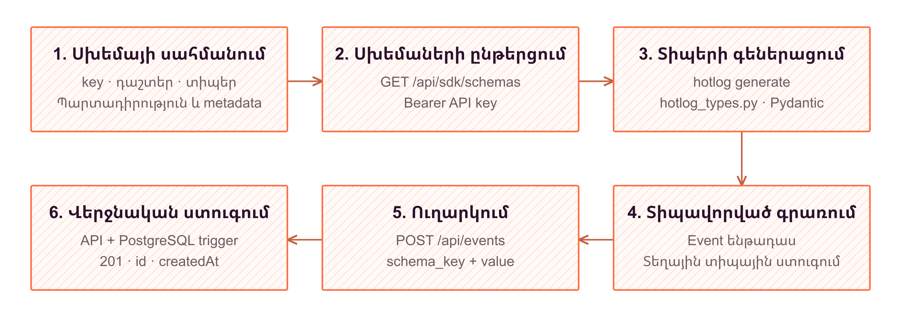

*Նկար 7.1 - SDK-ի տիպավորված ինտեգրում*

## Կայուն բանալիներ և նախագծային սահմաններ

Ծրագրային պայմանագրի համար անհրաժեշտ է տարբերակել մեքենայորեն օգտագործվող նույնացուցիչը և մարդուն ցուցադրվող անվանումը։ Hotlog-ում սխեման և դաշտը ունեն կայուն `key`, իսկ դրանց ընթեռնելի անվանումը ներկայացվում է `display_name`-ով։ Այսպիսով, կառավարման միջերեսում անվան փոփոխությունը չի պարտադրում փոխել իրադարձություն ուղարկող հավելվածի դաշտերի անունները։

Սխեմայի բանալին եզակի է նախագծի սահմաններում, իսկ դաշտի բանալին՝ համապատասխան սխեմայի սահմաններում։ Կառավարման API-ն մերժում է արդեն ստեղծված բանալու փոփոխությունը։ Դաշտի տիպը նույնպես այդ միջերեսով չի վերագրվում․ այլ տիպի անցումը ներկայացվում է հին դաշտի արխիվացմամբ և նոր դաշտի ստեղծմամբ։ Այս կանոնը կանխում է նույն բանալու նշանակության աննկատ փոխարինումը։

Արխիվացումը ֆիզիկական ջնջում չէ։ Սխեմաներն ու դաշտերը պահպանվում են տվյալների բազայում, սակայն չեն ներառվում SDK-ին տրամադրվող գործող պայմանագրում։ Սխեմայի արխիվացումից հետո դրա համար նոր իրադարձությունների սովորական ընդունումը մերժվում է։ Դաշտի արխիվացման դեպքում կառավարման API-ն նաև հեռացնում է դրա պարտադիր լինելու պահանջը։ Նախկին գրառումները չեն վերագրվում նոր կառուցվածքով, իսկ արխիվացված բանալին չի ազատվում այլ պայմանագրի համար։

SDK-ի հարցումների նախագծային պատկանելությունը որոշվում է API բանալիով։ Իրադարձության մարմինը չի պարունակում նախագիծ ընտրելու համար օգտագործվող `project_id`։ Սերվերը բանալու հիման վրա գտնում է նախագիծը և սխեման որոնում միայն դրա սահմաններում։ Հետևաբար տարբեր նախագծերում նույն `user_signup` բանալու առկայությունը չի միավորում դրանց իրադարձությունները։

Բանալու ստուգումն իրականացվում է դրա SHA-256 հեշի համեմատությամբ և հաշվի է առնում հետկանչված լինելը։ Տվյալների բազայում պահպանվում են հեշը և բանալու կառավարման տեղեկությունները, ոչ թե սկզբնական գաղտնի արժեքը։

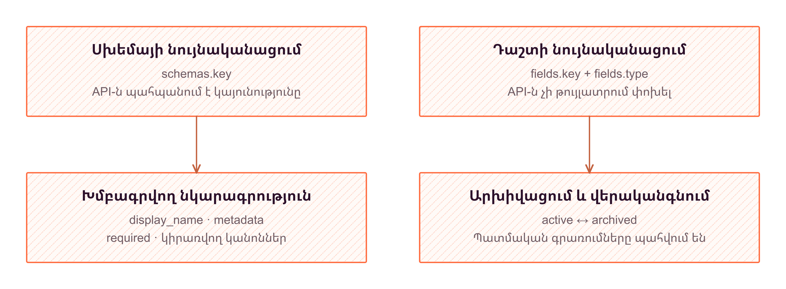

*Նկար 7.2 - տվյալների պայմանագիր*

## Սխեմաների ընթերցում և Python մոդուլի ստեղծում

`GET /api/sdk/schemas` հարցումը ընդունում է `Authorization: Bearer …` վերնագիր։ Այն չի պահանջում SDK օգտագործող հավելվածից բրաուզերային մուտքի նստաշրջան։ Next.js-ի route handler-ը փոխանցում է բանալին `get_project_schemas_for_sdk` SQL RPC-ին, որը ստուգում է այն և վերադարձնում համապատասխան նախագծի գործող սխեմաները։

Հաջող պատասխանի `data` օբյեկտը պարունակում է `project` և `schemas` բաժինները։ Յուրաքանչյուր սխեմայի համար ներկայացվում են `key`, `name`, `displayName` և `fields` հատկությունները։ Դաշտերի նկարագրությունները ներառում են `key`, `type`, `required` և `metadata`։ Այս տվյալները բավարար են Python դասերի կառուցվածքը ստանալու համար՝ առանց SDK-ին տվյալների բազայի աղյուսակների անմիջական հասանելիություն տրամադրելու։

Ստեղծման գործողությունն արտահայտվում է CLI հրամանով․

```bash
uv run hotlog generate \
  --api-url https://hotlog.example \
  --out hotlog_types.py
```

Այստեղ `https://hotlog.example`-ը բացատրական հասցե է։ Բանալին կարող է փոխանցվել `--api-key` ընտրանքով կամ վերցվել `HOTLOG_API_KEY` միջավայրային փոփոխականից։ Հասցեի համար օգտագործվում են `--api-url` և `HOTLOG_API_URL`, ընդ որում բացահայտ տրված հասցեն գերակայում է միջավայրային արժեքին։ `--out`-ը սահմանում է ստեղծվող ֆայլի ուղին, իսկ դրա լռելյայն անունը `hotlog_types.py` է։

CLI-ն կատարում է սխեմաների ընթերցման հարցում, ստացված նկարագրությունը փոխանցում գեներատորին և գրում Python մոդուլը։ Բանալու բացակայության դեպքում այն վերադարձնում է `2`, իսկ մշակվող ցանցային կամ HTTP սխալի դեպքում՝ `1` ավարտման կոդը՝ բացատրությունը հաղորդելով ստանդարտ սխալների հոսքով։

Ստեղծված ֆայլը պարունակում է սխեմաների դասերը և `SchemaKeys` դասը՝ համապատասխան տողային բանալիներով։ Դրա վերնագիրը նաև նշում է նախագիծն ու սխեմաների քանակը։ Մոդուլը ներմուծելիս սխեմաների նոր հարցում չի կատարվում․ այն արդեն պարունակում է ստեղծման պահին ստացված պայմանագրի Python արտապատկերը։

## Խիստ Pydantic մոդելներ և metadata-ի նշանակությունը

Յուրաքանչյուր գեներացված դաս ժառանգվում է SDK-ի հանրային `Event` դասից։ Վերջինս հիմնված է Pydantic `BaseModel`-ի վրա և սահմանում է `strict=True`, `extra="forbid"` ու `populate_by_name=True` կարգավորումները։ Անհայտ դաշտերը մերժվում են, իսկ տիպերի անհամապատասխանությունները չեն քողարկվում ընդհանուր ավտոմատ փոխակերպումներով։ Օրինակ՝ ամբողջ թիվը չի փոխարինում պահանջվող տողին։

Տիպերի հիմնական համապատասխանեցումը պարզ է․ `STRING`-ը դառնում է `str`, `NUMBER`-ը՝ `float`, `BOOLEAN`-ը՝ `bool`, իսկ `DATETIME`-ը՝ `datetime`։ `JSON` դաշտը ներկայացվում է `dict[str, Any]` տիպով։ `ARRAY`-ի համար տարրի տիպը որոշվում է `metadata.itemType`-ից, օրինակ՝ ստացվում է `list[str]`։ Քարտեզում չներկայացված տարրատեսակի դեպքում կիրառվում է `Any`, ուստի այստեղ չի ենթադրվում կամայական խորությամբ ներդրված կառուցվածքի ամբողջական տիպավորում։

Պարտադիր դաշտը չունի լռելյայն արժեք։ Ոչ պարտադիր դաշտը ստանում է `T | None = None` տեսքը։ Սահմանված `enumValues`-ից ստեղծվում է `Literal`, որը սահմանափակում է ընդունվող արժեքները նաև Python կողմում։ Դատարկ ցուցակի դեպքում գեներատորը տալիս է `str`, սակայն սերվերի թույլատրելիության կանոնները շարունակում են գործել։

Հետևյալը բացատրական `user_signup` պայմանագրից ստացվող դասի կրճատված արտապատկերն է, ոչ կոնկրետ նախագծից բառացի արտածում․

```python
from typing import ClassVar, Literal
from pydantic import Field
from hotlog import Event

class UserSignup(Event):
    _hotlog_schema_key: ClassVar[str] = "user_signup"

    email: str = Field(..., description="Account email")
    plan: Literal["free", "plus"] | None = None
    score: float | None = Field(
        default=None, description="Signup score"
    )
```

`_hotlog_schema_key`-ը դասային հատկություն է և իրադարձության բովանդակության դաշտ չէ։ Այն կապում է `UserSignup` դասը սերվերի `user_signup` սխեմայի հետ։ `description`-ը փոխանցվում է `Field`-ին, իսկ Python անունից տարբերվող բանալիների համար գեներատորը կարող է ավելացնել `alias`։

Կարևոր է metadata-ի ամբողջությունը չնույնացնել տեղային սահմանափակումների հետ։ Եթե `score`-ի metadata-ում նշված է `numberRange`՝ `min: 0` և `max: 100`, գեներատորը դրանք չի վերածում `Field(ge=0, le=100)` սահմանափակումների։ Այդ միջակայքը ստուգում են սերվերը և PostgreSQL-ի պահպանման սահմանը։ Նույն կերպ `email: str` հայտարարությունը ստուգում է տողային տիպը, ոչ էլեկտրոնային հասցեի ձևաչափը։ Այս տարբերությունը սահմանում է գեներացված մոդելի իրական երաշխիքների շրջանակը։

## Տիպավորված ուղարկում և հաճախորդի կյանքի ցիկլ

SDK-ի հիմնական հանրային միջերեսներն են `Client`, `Event` և `IngestResult`։ `Client`-ը պահում է API բանալին, հասցեն և HTTP հաճախորդը, իսկ `Event`-ի ժառանգորդը ներկայացնում է մեկ սխեմայի իրադարձություն։ Բանալին կարող է տրվել `api_key` պարամետրով կամ վերցվել `HOTLOG_API_KEY`-ից։ Բացահայտ `base_url`-ը թույլ է տալիս որոշել API-ի հասցեն։

Տիպավորված ուղարկումը կատարվում է հետևյալ կերպ․

```python
from hotlog import Client, IngestResult
from hotlog_types import UserSignup

event = UserSignup(
    email="ani@example.org",
    plan="plus",
    score=80.0,
)

with Client(base_url="https://hotlog.example") as client:
    result: IngestResult = client.send(event)

print(result.id, result.created_at.isoformat())
```

Իրադարձության կառուցման պահին Pydantic-ը ստուգում է գեներացված դասում արտահայտված պահանջները։ `client.send(event)`-ը կարդում է դասի սխեմայի բանալին և պատրաստում հարցումը։ Եթե բանալին բացակայում է, SDK-ն բարձրացնում է իր `Error` բացառությունը։

Նույն փոխանցումն ունի դասի միջոցով կանչվող ձևեր՝ `UserSignup.send(client, event)` և `UserSignup.send(client, email="ani@example.org")`։ Առաջինը ընդունում է արդեն կառուցված օրինակ, իսկ երկրորդը այն կառուցում է փոխանցված անվանական փաստարկներով։ Այլ դասի օրինակ կամ օրինակին զուգահեռ լրացուցիչ փաստարկներ փոխանցելը առաջացնում է `TypeError`։ Արդեն կառուցված օրինակի ուղարկումը նոր մոդելի կառուցում չէ․ պահպանման վերջնական ստուգումը մնում է սերվերի պարտականությունը։

Փոխանցումից առաջ կիրառվում է `model_dump(by_alias=True, exclude_none=True, mode="json")`։ Ուստի օգտագործվում են սերվերի սկզբնական բանալիները, `None` արժեքներով ոչ պարտադիր դաշտերը չեն ներառվում մարմնում, իսկ ժամանակային արժեքները ստանում են JSON-ին համապատասխան ներկայացում։

Միևնույն `Client`-ը վերաօգտագործում է `httpx.Client`-ի կապերը։ Սեփական HTTP հաճախորդի լռելյայն timeout-ը տասը վայրկյան է։ `close()` մեթոդը կամ `with` կառուցվածքից ելքը փակում է SDK-ի ստեղծած հաճախորդը։ Եթե `client=` պարամետրով փոխանցվում է արտաքին `httpx.Client`, դրա փակման պատասխանատվությունը մնում է կանչող հավելվածին։ `send_raw(schema_key, value)` մեթոդն էլ թույլ է տալիս փոխանցել բառարան՝ շրջանցելով գեներացված մոդելի տեղային ստուգումը, բայց ոչ սերվերի կանոնները։

## Իրադարձության ընդունում և վերջնական վավերացում

SDK-ն `POST /api/events` հարցմանը կցում է Bearer բանալին և `Content-Type: application/json` վերնագիրը։ Հարցման մարմնի արտաքին կառուցվածքը պարունակում է երկու հատկություն՝ `schema_key` և `value`։ Նախորդ բացատրական իրադարձության համապատասխան մարմինն է `{"schema_key":"user_signup","value":{"email":"ani@example.org","plan":"plus","score":80.0}}`։

Route handler-ը նախ ստուգում է բովանդակության տեսակը, բանալու առկայությունը, մարմնի առավելագույն՝ 64 KiB չափը և JSON-ի կառուցվածքը։ `schema_key`-ը պետք է լինի ոչ դատարկ տող։ Այնուհետև `get_active_fields_for_ingest` RPC-ն ստուգում է բանալու նախագծային պատկանելությունը, գտնում գործող սխեման և վերադարձնում դրա գործող դաշտերը։

Հավելվածային վավերացուցիչը ստուգում է, որ `value`-ն օբյեկտ է։ Պարտադիր դաշտի բացակայությունը կամ `null` արժեքը համարվում է չլրացված պահանջ։ Ստուգվում են պարզ տիպերը, թվերի վերջավոր լինելը, `numberRange` սահմանները, enum-ի անդամակցությունը և ժամանակային տողերի ընդունվող ձևաչափը։ Զանգվածի տարրերը ստուգվում են `itemType`-ով, իսկ դրանց սխալները կարող են մատնանշվել, օրինակ, `scores[2]` բանալիով։

Այս ստուգումը ամբողջությամբ նույնական չէ Pydantic մոդելի կանոններին։ Python մոդելը մերժում է անհայտ դաշտերը, մինչդեռ սերվերի վավերացուցիչը ստուգում է գործող պայմանագրում նկարագրված դաշտերը և լրացուցիչ բանալիների առկայության համար առանձին սխալ չի ձևավորում։ Հետևաբար տեղային խստությունը և սերվերային թույլատրելիությունը պետք է դիտարկել որպես տարբեր սահմաններ։

Հաջորդ քայլում `ingest_event` RPC-ն կրկին լուծում է բանալու և սխեմայի կապը և կատարում գրառումը։ Տվյալների բազայի `events_validate_write` trigger-ը պահպանման սահմանին ևս ստուգում է սխեմայի ակտիվությունը, նախագծի համապատասխանությունը և արժեքների պայմանագիրը։ Դաշտերի փոփոխման ու իրադարձության ստուգման գործողությունները կիրառում են սխեմայի գրառման կողպման համաձայնեցված մեխանիզմ։ Այսպիսով, պահպանման որոշումը չի հիմնվում միայն ավելի վաղ ստացված նկարագրության վրա։

Հաջող ընդունման HTTP կարգավիճակը `201` է։ Պատասխանի կառուցվածքն է, օրինակ, `{"data":{"id":42,"createdAt":"2026-04-14T10:30:00+00:00"}}`։ SDK-ն այն վերածում է `IngestResult`-ի՝ `id: int` և `created_at: datetime` հատկություններով։ `createdAt`-ը պահպանված գրառման ժամանակն է, ոչ պարտադիր իրադարձության բովանդակության մեջ առանձին ներկայացված գործարար գործողության ժամը։

## Սխալների ներկայացում և բացառությունների համապատասխանեցում

Սխալների մշակման հիմնական տարբերակումը տեղային կառուցման և սերվերային մերժման միջև է։ `pydantic.ValidationError`-ը առաջանում է մոդելը կառուցելիս և ցույց է տալիս, որ հարցումը դեռ չի հասել ցանցային փոխանցման փուլին։ SDK-ի `hotlog.errors.ValidationError`-ը ներկայացնում է սերվերի `400` պատասխանը, երբ դրա `error` բաժնում առկա է `field_errors` հատկությունը։

`field_errors`-ը դաշտային գրառումների ցուցակ է։ Յուրաքանչյուր տարր ունի `field_key` և `reason`, օրինակ՝ `{"field_key":"score","reason":"must be >= 0"}`։ Արմատային կառուցվածքի խախտման դեպքում օգտագործվում է `<root>` նշումը։ Այս ձևաչափը հնարավորություն է տալիս հավելվածին տարբերել ընդհանուր հաղորդագրությունը կոնկրետ դաշտի պատճառից՝ առանց հաղորդագրության տեքստը վերլուծելու։

Ստորև բացատրական պայմանագրի `score=-1.0` արժեքը տեղային մակարդակում թույլատրելի `float` է, բայց սերվերի սահմանած զրո նվազագույնի դեպքում մերժվում է․

```python
from hotlog import Client
from hotlog_types import UserSignup
from pydantic import ValidationError as LocalValidationError
from hotlog.errors import AuthError, HTTPError
from hotlog.errors import ValidationError as ServerValidationError

with Client(base_url="https://hotlog.example") as client:
    try:
        UserSignup.send(
            client, email="ani@example.org", score=-1.0
        )
    except LocalValidationError as exc:
        print(exc.errors())
    except ServerValidationError as exc:
        print(exc.field_errors)
    except AuthError as exc:
        print(str(exc))
    except HTTPError as exc:
        print(exc.status_code, str(exc))
```

`401` պատասխանը վերածվում է `AuthError`-ի և ընդգրկում է բացակայող, անվավեր կամ հետկանչված բանալու դեպքերը։ Մնացած մշակվող անհաջող HTTP պատասխանները ներկայացվում են `HTTPError`-ով՝ պահպանելով `status_code`-ը։ Դրանցից են չգտնված կամ ոչ գործող սխեմայի սովորական `404`, չափը գերազանցող մարմնի `413` և բովանդակության անհամապատասխան տեսակի `415` պատասխանները։ Առանց `field_errors` հատկության `400` պատասխանը նույնպես այս խմբում է։

`httpx`-ի ցանցային բացառությունը SDK-ն ներկայացնում է `HTTPError(status_code=0)` ձևով․ զրոն այստեղ իրական HTTP կարգավիճակ չէ։ JSON չպարունակող պատասխանը նույնպես HTTP սխալ է համարվում։ SDK-ի բացառությունները ժառանգվում են ընդհանուր `Error` դասից, մինչդեռ Pydantic-ի տեղային բացառությունը առանձին է մնում։

## Գեներացված տիպերի և գործող պայմանագրի համադրումը

`hotlog_types.py`-ը սերվերի պայմանագրի ինքնաշխատ թարմացվող փոխարինող չէ։ Սխեմայի խմբագրումից հետո գեներատորը կրկին գործարկվում է, որպեսզի պարտադիր դաշտերը, enum-ի արժեքները, նկարագրությունները և գործող դաշտերի կազմը համապատասխանեն սերվերին։ Գեներացված ֆայլի ձեռքով խմբագրումը փոխում է միայն հավելվածի տեղային պատկերացումը, ոչ տվյալների բազայի կանոնները։

Կայուն բանալիները չեն նշանակում պայմանագրի բոլոր հատկությունների անփոփոխություն։ Օրինակ՝ պարտադիր դաշտի ավելացումից հետո հին մոդելը կարող է կառուցվել առանց սխալի, սակայն ուղարկումը մերժվում է։ Սխեմայի արխիվացման դեպքում նախկին Python դասի գոյությունն էլ չի տալիս նոր գրառում պահպանելու իրավունք։ Ուղարկման պահին գործող սերվերային պայմանագիրն է վերջնական հիմքը։

Python դասերի այս ստեղծումը տարբերվում է հավելվածում օգտագործվող `database.types.ts` մեխանիզմից։ Վերջինս TypeScript կողմում նկարագրում է տվյալների բազայի միջերեսը, իսկ Python գեներատորը նախագծի API-ով հասանելի սխեմաներից կառուցում է իրադարձությունների Pydantic մոդելներ։ Դրանց համատեղ դերը հստակ է․ գեներացված տիպերը նվազեցնում են ինտեգրման պատահական սխալները, իսկ սերվերն ու տվյալների բազան պահպանում են նախագծային սահմաններն ու գրառման պարտադիր կանոնները։

---

# 8. Եզրակացություն

## Տվյալային պայմանագրի միասնականություն

Hotlog-ի նախագծման հիմնական արդյունքը կառուցվածքային իրադարձությունների հետ աշխատանքի միասնական միջավայրն է, որտեղ տվյալների նկարագրությունը, ընդունումը, պահպանումը և ներկայացումը փոխկապակցված են։ Համակարգը չի սահմանափակվում գրառումների հավաքմամբ․ յուրաքանչյուր իրադարձություն կապվում է նախագծի որոշակի սխեմայի հետ, իսկ դաշտերի տեսակներն ու պարտադիր լինելը սահմանում են ընդունվող տվյալների պայմանագիրը։ Այս մոտեցումը տվյալների իմաստը դարձնում է բացահայտ և նվազեցնում այն անորոշությունը, որն առաջանում է ազատ ձևաչափով հաղորդագրությունների մշակման ժամանակ։

Պայմանագրի կայունությանը ծառայում է տեխնիկական նույնացուցիչների և ցուցադրվող անվանումների տարանջատումը։ Անվան խմբագրումը չի պահանջում փոխել իրադարձության մեջ օգտագործվող բանալին, իսկ արխիվացումը թույլ է տալիս դադարեցնել սխեմայի կամ դաշտի ակտիվ օգտագործումը՝ պահպանելով համապատասխան գրառումները։ Այսպիսով, ներկայացման փոփոխությունը տարանջատվում է տվյալների նույնականացումից։ Կարևոր է նաև, որ պայմանագրի ստուգումը կատարվում է ոչ միայն ընդունող API-ում, այլև PostgreSQL-ում՝ իրադարձության գրառման սահմանին։

Python SDK-ն այս նույն գաղափարը տեղափոխում է իրադարձություններ ուղարկող ծրագրի մակարդակ։ Նախագծի ակտիվ սխեմաներից այն գեներացնում է Pydantic դասեր՝ արտահայտելով դաշտերի տեսակներն ու պարտադիր լինելը։ Մշակողը կարող է կառուցել տիպավորված իրադարձություն և ուղարկել այն հաճախորդի միջոցով կամ անհրաժեշտության դեպքում կիրառել `send_raw` մեթոդը։ Գեներացված դասերը իրադարձությունների պայմանագրի ծրագրային արտահայտությունն են, ոչ թե տվյալների բազայի աղյուսակների տիպերի կրկնօրինակը։ Տեղային ստուգումները չեն փոխարինում սերվերային վավերացմանը, այլ լրացնում են այն։

## Շերտերի համաձայնեցված պատասխանատվություն

Ճարտարապետական ամբողջականությունը հիմնվում է նաև հասանելիության սահմանների հստակության վրա։ Վեբ միջավայրում Supabase Auth-ի օգտատիրոջ աշխատաշրջանը պահպանվում է սերվերային հարցումների ընթացքում, իսկ նախագծային անդամակցությունն ու դերային թույլտվությունները կիրառվում են RLS քաղաքականություններով և SQL գործառույթներով։ SDK-ի մուտքն ունի առանձին հիմք՝ նախագծի API բանալին։ Այս տարանջատումը թույլ է տալիս տարբերակել օգտատիրոջ գործողությունները ծրագրային ինտեգրման գործողություններից՝ երկուսն էլ կապելով համապատասխան նախագծի համատեքստին։

Տվյալների ամբողջականությունը միայն միջերեսի վարքագծից կախված չէ։ Միգրացիաները նկարագրում են կառուցվածքային փոփոխությունները, եզակիության սահմանափակումները և ստուգման կանոնները։ Նախագծի սկզբնական կապերի ստեղծումն ու դասավորության բաղադրիչների խմբային պահպանումը SQL RPC-ներով կատարվում են ատոմային ձևով։ Դրա շնորհիվ փոխկապակցված փոփոխությունները դիտարկվում են որպես մեկ գործողություն, ոչ թե իրարից անկախ հարցումների հաջորդականություն։

## Լուծման գործնական նշանակությունը

Next.js 16-ի, React 19-ի և TypeScript-ի վրա կառուցված մոդուլային վեբ միջերեսը տվյալային ու հասանելիության այս կանոնները ներկայացնում է օգտատիրոջ համար հասկանալի աշխատանքային հոսքերով։ Հայերեն, ռուսերեն և անգլերեն միջերեսները տարանջատված են գործառնական տրամաբանությունից։ Կարգավորվող դասավորություններում գծապատկերների կապումը սխեմաների դաշտերին թույլ է տալիս նույն բաղադրիչներից կազմել տարբեր դիտումներ՝ առանց յուրաքանչյուր դիտման համար առանձին էջի տրամաբանություն ստեղծելու։

Այսպիսով, Hotlog-ի արժեքը առանձին հնարավորությունների քանակը չէ, այլ դրանց հիմքում ընկած համաձայնեցված կառուցվածքը։ Նույն սխեման ուղղորդում է տվյալների ստեղծումը, ընդունման ստուգումը և տեսողական ներկայացումը, իսկ նախագծային սահմաններն ու տվյալների բազայի կանոնները պահպանում են այդ գործընթացի համատեքստը։ Արդյունքում ձևավորվում է հասկանալի համակարգային մոդել, որտեղ մշակողի ինտեգրումը և օգտատիրոջ աշխատանքը հիմնվում են ընդհանուր, բացահայտ սահմանված պայմանագրերի վրա։
